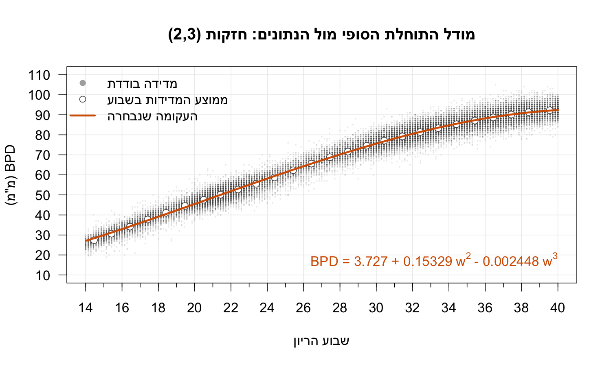
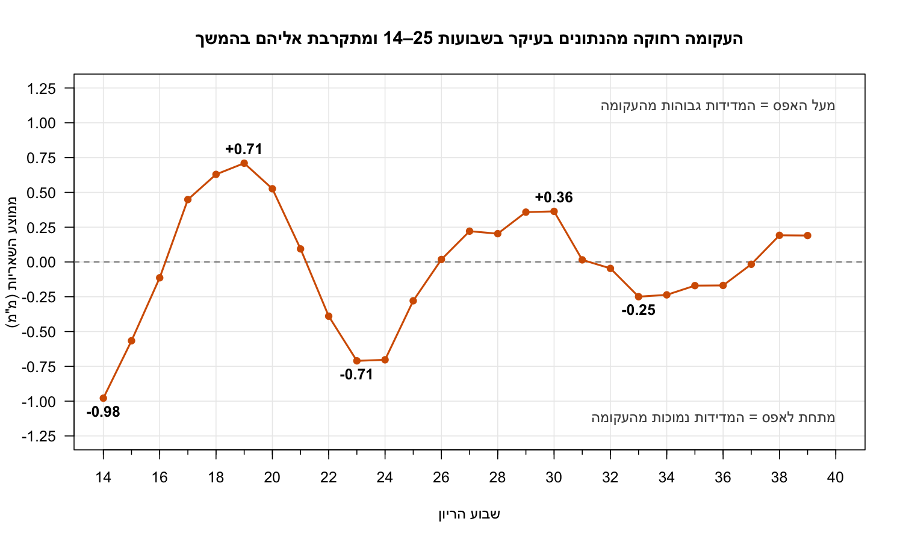
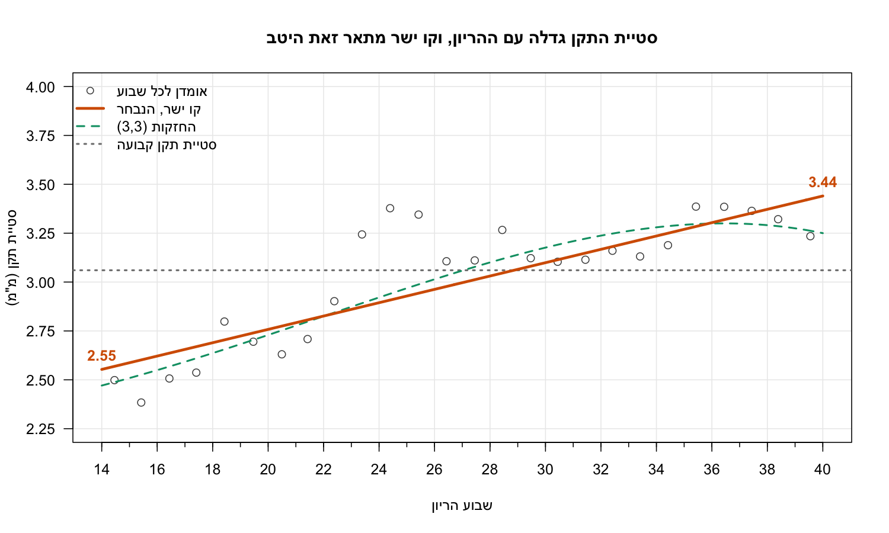
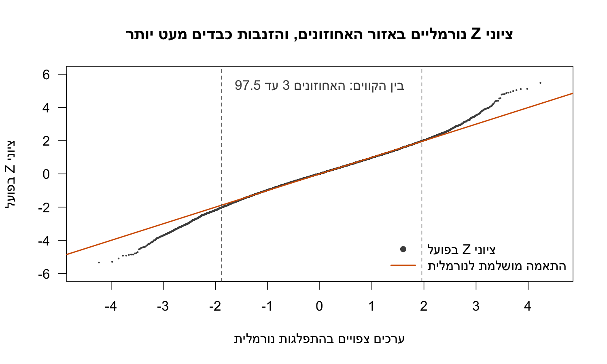
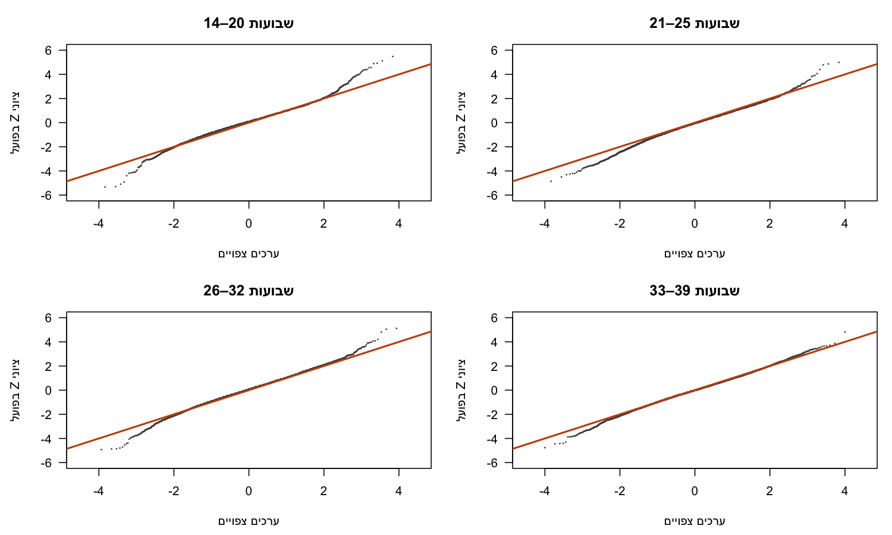
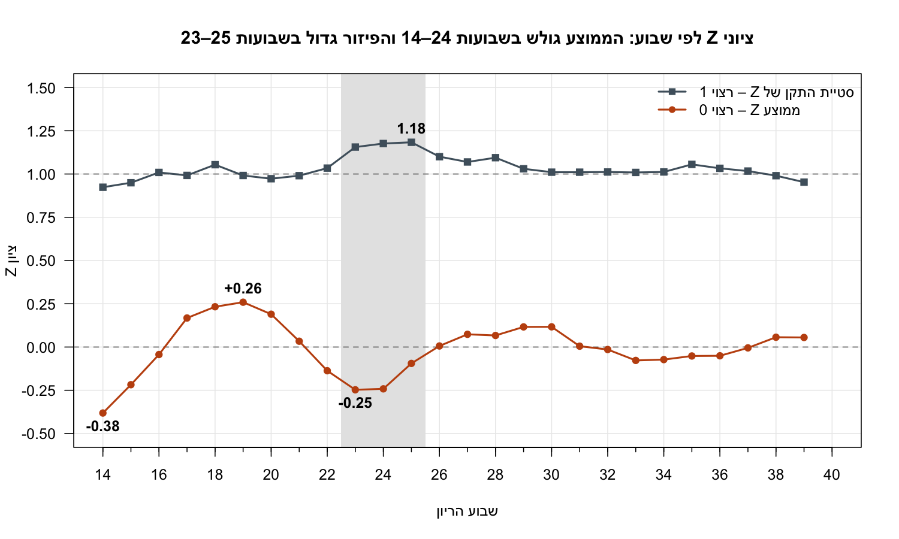
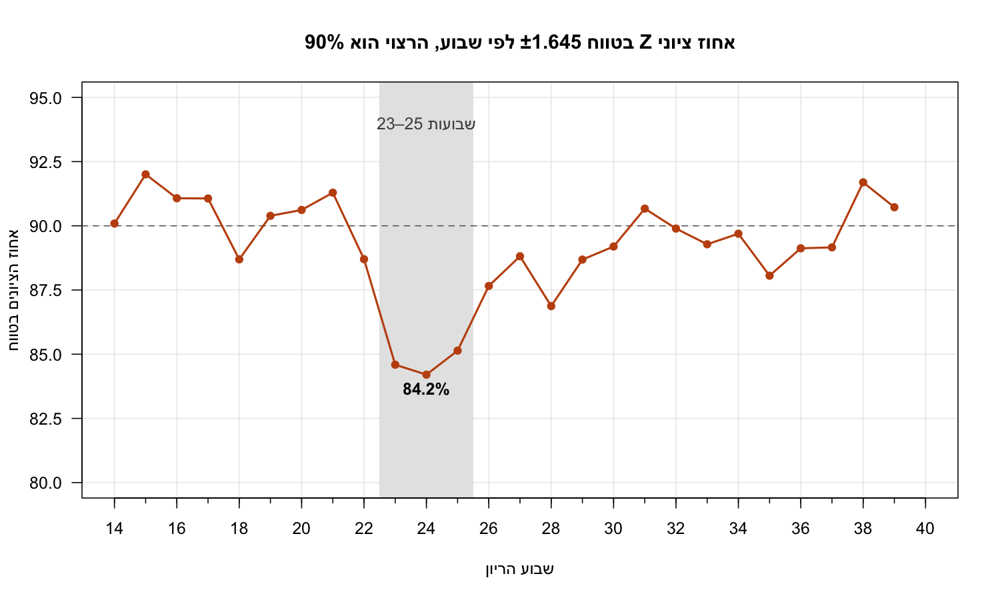
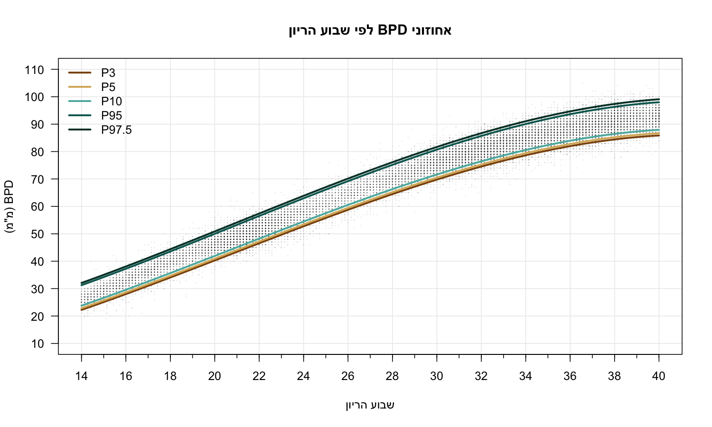
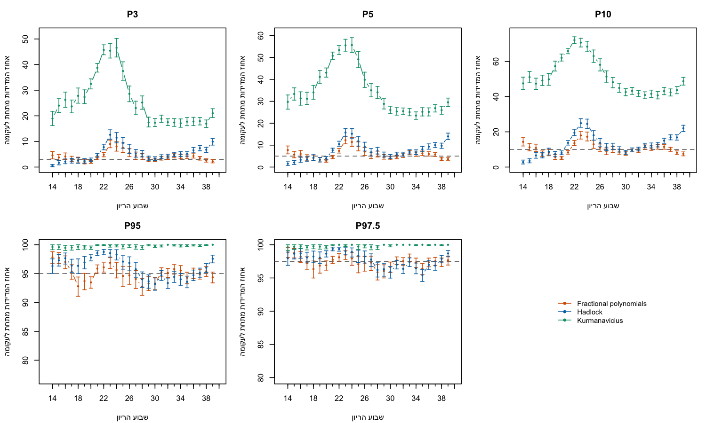

# שבוע 4 – התאמת עקומות גדילה ל-BPD (fractional polynomials)

מסמך חי: מוסיפים אליו החלטות ונימוקים בכל פעם שמסיימים משימה, כמו בשבוע 3.

## 1. המשימה בקצרה

מיישמים על הנתונים הישראליים את השיטה שבאמצעותה פותחו העקומות הקיימות: **fractional polynomials** גם לתוחלת וגם לסטיית התקן של ה-BPD כפונקציה של גיל ההריון, בהנחה שהמדד מתפלג נורמלית עם פרמטרים התלויים בגיל.

- **חזקות לשיקול:** -2, -1, -0.5, 0.5, 1, 2, 3, ובנוסף LOG.
- **בחירת המודל:** לפי קריטריון אחד לבחירת משתנים. מומלץ במיוחד שיטה שלא נלמדה בכיתה, עם הסבר קצר, ושרלוונטית למטרה (חישוב אחוזונים).
- **שלוש הנחיות:**
  1. רגרסיה לתוחלת ולסטיית התקן, הסבר מפורש איך נבחרו המשתנים, והמודל הסופי.
  2. גרף של האחוזונים 3, 5, 10, 95 ו-97.5 כפונקציה של גיל.
  3. תיאור הצלחת המודל שלנו לעומת המודלים הקיימים, על קובץ האימון.
- **להגשה:** מצגת. **המאמר** שמפרט את השיטה: Royston & Wright, Ultrasound in Obstetrics & Gynecology 1998, בקישור מאתר הקורס.

## 2. עבודה מקדימה – בוצעה

הקובץ [bpd_week4.R](bpd_week4.R) כבר כולל את הסעיפים המשותפים, ורץ מתיקיית השורש בלי שגיאות:

- **נתונים:** `train.csv` ו-`test.csv` משבוע 3 (43,741 ו-13,291 מדידות).
- **מנוע fractional polynomials:** בניית החזקות (כולל LOG וחזקות חוזרות), התאמת מודל אחד, טבלת כל 44 המועמדים (FP1 ו-FP2) עם RSS, AIC ו-BIC (הכלי קיים, אבל הבחירה בפועל נעשית ב-cross-validation), ותחזיות מחוץ למדגם (cross-validation) מחולקות לפי הריון.
- **ממשק אחד לכל מודל:** `model$mean(w)` ו-`model$sd(w)`. כך מודל קיים ומודל חדש מטופלים באותו אופן. כלים: `model_percentile()` ו-`model_z()`.
- **המודלים הקיימים:** `had_model` (הדלוק) ו-`kur_model` (Kurmanavicius).
- **מודל זמני:** `new_model` מוגדר מראש כמודל זמני, ולכן משימות 3 ו-4 רצות גם לפני שמשימות 1 ו-2 מסתיימות.
- **עיצוב גרפים ועברית:** `heb()`, `save_plot()` ופלטת הצבעים משבוע 3.

## 3. חלוקת העבודה לפי שלבים

כל משימה יושבת בסעיף משלה בקובץ ולא תלויה בסעיפים של האחרות.

| # | משימה | מה עושים | מה מגישים | תלות |
|---|---|---|---|---|
| **1** | **מודל התוחלת** (סעיף 4) | רגרסיה של BPD על גיל עם FP וחזקות הרשימה כולל LOG. בחירה לפי הקריטריון שנבחר | המודל הסופי (חזקות, מקדמים, משוואה), טבלת המועמדים, הסבר מפורש לבחירה, בדיקת שאריות | אין. מציבה `mean_fit` |
| **2** | **מודל סטיית התקן** (סעיף 5) | רגרסיה של \|השארית\| על גיל עם FP. סטיית התקן = sqrt(π/2) כפול הערך המותאם. בדיקה שציוני התקן z מתפלגים N(0,1) ללא תלות בגיל | המודל הסופי, הסבר לבחירה, בדיקת z (ממוצע וסטיית תקן לפי שבוע, גרף Q-Q כללי ולפי תקופות בהריון) | משתמשת בשאריות של משימה 1. עד שהיא מוכנה, בתוחלת הזמנית. מציבה `sd_fit` |
| **3** | **גרף האחוזונים** (סעיף 6) | חישוב והצגת האחוזונים 3, 5, 10, 95, 97.5 לפי גיל, מעל ענן הנתונים | גרף אחד בעיצוב אחיד (עברית, שנתות כל שבועיים) וטבלת אחוזונים לכל שבוע | רצה על המודל הזמני. מתעדכנת אוטומטית כש-1 ו-2 מסתיימות |
| **4** | **הצלחת המודל מול הקיימים** (סעיף 7) | שיעור המדידות החורגות מכל אחוזון, בפועל מול הנקוב, לכל מודל (חדש, הדלוק, Kurmanavicius) על קובץ האימון בלבד, כפי שנאמר בהרצאה, עם רווח סמך. לא משתמשים כאן בקובץ הבדיקה | טבלה, גרף ומסקנה איזה מודל מתאים יותר ובאילו שבועות | רצה על המודל הזמני. מתעדכנת אוטומטית |
| **5** | **מצגת** | שלד המצגת עם הטקסטים והגרפים הקיימים, ומילוי המספרים בסוף | מצגת סופית | רואה סעיף 8 |

**אחרי שהכול מוכן (משותף):** להריץ את הקובץ מחדש מההתחלה, לוודא ש-`new_model` הוא הסופי, ולעדכן את המצגת במספרים.

## 4. החלטות פתוחות לצוות

ההחלטות של השלבים שהסתיימו מפורטות כאן ובהמשך בסעיפים 5–7.

### החלטה למשימה 4 – חישוב רווחי סמך

ההנחיה מבקשת להציג רווח סמך, אך אינה קובעת במפורש כיצד לחשב אותו. מאחר שבנתונים יש כמה מדידות מאותו הריון, בחרנו ב-**bootstrap לפי הריון**: בכל חזרה נדגמים הריונות עם החזרה וכל המדידות של הריון שנדגם נשארות יחד. כך רווח הסמך מתחשב בתלות האפשרית בין מדידות של אותו הריון. בחירה זו נעשתה לצורך הניתוח שלנו; היא אינה דרישה מפורשת של המטלה.

לבקשתנו, התוצאות יוצגו **לפי שבוע וגם בסיכום כולל**. הסיכום הכולל מאגד את מדידות האימון; התוצאות השבועיות מראות באילו שבועות יש התאמה טובה או חריגה.

## 5. מודל התוחלת (סעיף 4 בקוד) – מוכן

### מה רצינו
עקומה אחת שאומרת מה ה-BPD הממוצע בכל שבוע הריון. קו ישר לא מספיק: הראש גדל בכ-3.5 מ"מ בשבוע בשבועות 15–17, ובפחות מ-1 מ"מ בשבוע לקראת הסוף.

### מושגים
- **חזקות (fractional polynomials):** גרסאות שונות של השבוע: `w⁻²`, `w⁻¹`, `w⁻⁰·⁵`, `log(w)`, `w⁰·⁵`, `w`, `w²`, `w³`. לכל אחת יש כיפוף אחר, ושילוב שלהן יוצר צורות עקומה שונות.
- **מודל:** בחירה של חזקה אחת או שתיים. אפשר לחשוב עליו כעל מתכון: החזקות הן המרכיבים, והרגרסיה קובעת כמה מכל מרכיב (המקדמים).
- **למה 44 מודלים:** 8 מודלים עם חזקה אחת, 28 עם שתי חזקות שונות, ו-8 עם אותה חזקה פעמיים (למשל `w²` ו-`w²·log(w)`). זו הרשימה שבנספח של המאמר (Royston & Wright).
- **ציון (RMSE):** בכמה מילימטרים המודל טועה בדרך כלל. מעלים כל שגיאה בריבוע, מחשבים ממוצע ומוציאים שורש. ככל שהציון נמוך יותר, המודל טוב יותר.
- **Cross-validation:** בדיקה של המודל על הריונות שהוא לא ראה בזמן ההתאמה.

### שלבי העבודה
1. **מחלקים** את 17,718 ההריונות באקראי ל-5 קבוצות שוות. כל המדידות של הריון נשארות יחד באותה קבוצה.
2. **לוקחים מודל אחד** ומסתירים קבוצה אחת.
3. **מתאימים** את המודל על ארבע הקבוצות האחרות.
4. **חוזים** את המדידות של הקבוצה המוסתרת, ושומרים את השגיאות.
5. **חוזרים** על שלבים 2–4 עד שכל קבוצה הוסתרה פעם אחת.
6. **מחשבים ציון אחד** מכל השגיאות יחד.
7. **חוזרים** על הכול לכל 44 המודלים, עם אותן 5 קבוצות.
8. **בוחרים** את המודל עם הציון הנמוך ביותר.
9. **מתאימים אותו פעם אחרונה על כל קובץ האימון.** חמש המשוואות הזמניות נזרקות, כי הן שימשו רק לחישוב הציון.
10. **בודקים את השאריות** של המודל הסופי בכל שבוע.

### ההחלטות ולמה

לכל החלטה מופיעים השאלה, ההתלבטות, ההחלטה והנימוקים, כדי שגם מי שלא היה בשלב הזה יוכל להבין ולהסביר אותה.

#### החלטה 1 – איך בוחרים מבין המודלים?

**השאלה:** יש הרבה מודלים אפשריים, וצריך כלל אחד שיקבע מי מהם הכי טוב. המטלה מבקשת לבחור שיטה אחת ולהסביר אותה.

**ההתלבטות:** המטלה מזכירה את AIC, ‏BIC ו-stepwise כשיטות מוכרות, אבל כותבת ש"בחירה בשיטה שלא הוזכרה בכיתה ומעט הסבר עליה מומלץ במיוחד". בהרצאה הוצג גם קריטריון שבודק ישירות את האחוזונים.

| אפשרות | מה היא עושה, בפשטות | יתרון | חיסרון אצלנו |
|---|---|---|---|
| **AIC / BIC** | נותנים ציון לפי טיב ההתאמה, ומוסיפים קנס על כל פרמטר | פשוטים ונלמדו בכיתה | מניחים שהמדידות בלתי תלויות, ואצלנו יש כמה מדידות לכל הריון. לא בודקים ישירות חיזוי של הריונות חדשים |
| **Stepwise** | מוסיף או מוריד חזקה אחת בכל צעד | מהיר | הולך במסלול אחד ולא מובטח שימצא את המודל הטוב ביותר. אנחנו יכולים פשוט לבדוק את כולם |
| **קנס האחוזונים מההרצאה** | בודק כמה מדידות נמצאות מתחת לכל עקומת אחוזון | מודד ישירות את המטרה | אפשר לחשב אותו רק כשיש גם תוחלת וגם סטיית תקן, ובשלב הזה יש רק תוחלת |
| **Cross-validation לפי הריון** | בודק כמה המודל טועה על הריונות שהוסתרו ממנו | בודק חיזוי של הריונות חדשים ומתחשב במדידות החוזרות | יותר חישוב, וצריך להסביר אותו במצגת |

**ההחלטה:** cross-validation לפי הריון.

**למה:**
- **זו המלצת המטלה:** השיטה לא הוזכרה בכיתה, לפי שני סיכומי השיעורים שיש לנו: השיעור על תצפיות חריגות וחלוקה לאימון ובדיקה, והשיעור על פולינומים שבריים ובחירת מודל. הוצגו בהם AIC, ‏BIC, ‏stepwise, מעבר על כל תת-הקבוצות וקנס אחוזונים, ו-cross-validation לא מופיע באף אחד מהם.
- **היא בודקת את מה שחשוב לנו:** העקומות ישמשו עוברים חדשים, ולכן בודקים את המודל על הריונות שהוא לא ראה.
- **היא מתאימה לנתונים שלנו:** יש בממוצע כ-2.5 מדידות להריון, ומדידות של אותו עובר דומות זו לזו. בחלוקה לפי הריון, אף עובר לא נמצא גם באימון וגם בבדיקה.

**המגבלה:** בשלב התוחלת הציון בודק את התוחלת ולא את האחוזונים עצמם. בדיקת האחוזונים נכנסת בשלב סטיית התקן (סעיף 6).

#### החלטה 2 – מתוך כמה מודלים בוחרים: 44 או 256?

**השאלה:** אילו מודלים נכנסים לתחרות? כמה חזקות מותר לשים במודל אחד?

**ההתלבטות:** שני המקורות שלנו מציגים את זה אחרת.
- **המאמר:** מודל עם חזקה אחת או שתיים, כולל אותה חזקה פעמיים. סך הכול 44 מודלים.
- **ההרצאה:** כל אחת מ-8 החזקות יכולה להיכנס למודל או לא, כלומר `2⁸ = 256` אפשרויות. מודל יכול לכלול גם את כל 8 החזקות.

כדי לראות מה ההבדל בפועל, הרצנו את אותו cross-validation גם על כל האפשרויות של ההרצאה (בדיקה חד-פעמית, לא בקובץ הקוד):

| מספר חזקות | המודל הטוב ביותר | ציון | ההטיה השבועית הגדולה ביותר (מ"מ) |
|---|---|---|---|
| **2** | (2,3) | 3.157 | 0.98 |
| 4 | (-1, -0.5, 0, 0.5) | 3.148 | 0.65 |
| 8 (כל החזקות) | כולן | 3.139 | 0.22 |

ההטיה השבועית אומרת כמה העקומה רחוקה מהממוצע של המדידות בשבוע שבו היא הכי מפספסת.

**ההחלטה:** 44 מודלים, כלומר עד שתי חזקות.

**למה:**
- **זו המטרה שהמרצה הגדיר:** "מודל שדומה במהותו למודל הקיים", כי הוא צריך להיכנס למערכת האולטרסאונד ורופאים צריכים להבין אותו. הנוסחאות של הדלוק ושל Kurmanavicius משתמשות בשתי חזקות, `w` ו-`w³`, וגם הדוגמה של המרצה למודל חדש היא עם שתי חזקות.
- **השיפור קטן:** הציון של כל 8 החזקות טוב רק ב-0.018 מ"מ, והמרצה אמר שכדאי לעבור לנוסחה אחרת רק אם השיפור ניכר.
- **ב-256 הקריטריון לא עוצר:** במדגם גדול כל כך כמעט כל תוספת מורידה מעט את השגיאה, ולכן נבחרו כל 8 החזקות. זה מודל של 9 מקדמים, שקשה ליישם ולהסביר.
- **החזקות דומות מאוד זו לזו:** כשמכניסים את כולן, המקדמים הופכים ללא יציבים. המאמר גם מזהיר שמודלים מורכבים יכולים ליצור צורות לא סבירות בקצוות.

**מחיר ההחלטה:** עם 8 החזקות העקומה קרובה יותר לנתונים בשבועות המוקדמים. לכן בשלב האחוזונים (משימה 4) נבדוק במיוחד את השבועות 14–24, ואם הם ייצאו בעייתיים נדווח על כך.

#### החלטה 3 – לפי מה מחלקים לקבוצות?

**השאלה:** ב-cross-validation מסתירים חלק מהנתונים. מה בדיוק מסתירים?

**ההתלבטות:** אפשר להגריל כל מדידה בנפרד, או להגריל הריונות שלמים. הגרלת מדידות פשוטה יותר, אבל כך מדידה אחת של עובר יכולה להיות באימון ומדידה אחרת שלו בבדיקה.

**ההחלטה:** מגרילים הריונות שלמים, וכל המדידות של הריון נשארות באותה קבוצה.

**למה:** שתי מדידות של אותו עובר דומות זו לזו. אם אחת מהן באימון, המודל כבר "מכיר" את העובר, והבדיקה נראית טובה מהאמת.

**המגבלה:** הריונות שונים של אותה אישה יכולים ליפול בקבוצות שונות. זו תלות חלשה יותר, כי מדובר בעוברים שונים, ולכן לא טיפלנו בה.

#### החלטה 4 – לכמה קבוצות מחלקים?

**השאלה:** כמה פעמים חוזרים על הסתרת הנתונים?

**ההתלבטות:** מעט קבוצות פירושן פחות נתונים לאימון בכל סיבוב. הרבה קבוצות פירושן יותר חישוב והרבה פחות הריונות בכל בדיקה.

**ההחלטה:** 5 קבוצות, עם הגרלה קבועה (`seed = 2026`), כך שכל הרצה נותנת אותה חלוקה.

**למה:** זו בחירה מקובלת. בכל סיבוב נשארים כ-14,170 הריונות לאימון וכ-3,540 לבדיקה, כלומר די והותר לשני הצדדים. לא השווינו למספר קבוצות אחר.

#### החלטה 5 – איך מודדים את השגיאה?

**השאלה:** אחרי שיש לכל מדידה שגיאה, איך מסכמים אותן למספר אחד?

**ההתלבטות:** אפשר לחשב ממוצע של השגיאות בערך מוחלט, או RMSE, שבו מעלים כל שגיאה בריבוע, מחשבים ממוצע ומוציאים שורש.

**ההחלטה:** RMSE.

**למה:** הרגרסיה עצמה מחפשת את המקדמים שנותנים את סכום ריבועי השגיאות הקטן ביותר, אז הציון מודד את מה שהיא מנסה להשיג. הוא גם מעניש טעויות גדולות יותר, ומחזיר תוצאה במילימטרים, שקל להבין.

#### החלטה 6 – מה עושים עם הציונים?

**השאלה:** כשיש ציון לכל מודל, האם בוחרים פשוט את הנמוך ביותר? ומה אם שני מודלים כמעט שווים?

**ההתלבטות:** הפער בין (2,3) ל-(2,2) הוא רק 0.01 מ"מ, והמאמר אומר שכשמודלים כמעט שווים אפשר לבחור לפי צורת העקומה.

**ההחלטה:** בוחרים את הציון הנמוך ביותר, (2,3).

**למה:** זה כלל ברור שמוגדר מראש. לשני המודלים יש אותו מספר מקדמים, כך שאף אחד מהם לא פשוט יותר. גם צורת העקומה של (2,3) סבירה: היא עולה לאורך כל טווח הנתונים. בנוסף, ההטיה השבועית הגדולה ביותר שלו קטנה יותר: 0.98 מ"מ לעומת 1.17 ב-(2,2).

#### החלטה 7 – לשמור על הנוסחה הקיימת או לבחור נוסחה חדשה?

**השאלה:** האם מספיק לחשב מקדמים חדשים לנוסחה המוכרת עם `w` ו-`w³`, כלומר החזקות (1,3), או לעבור לחזקות אחרות?

**ההתלבטות:** בהרצאה הוצגו שתי רמות שינוי: אותה נוסחה עם מקדמים חדשים, שהיא הקרובה ביותר למה שהרופאים מכירים, או נוסחה שנבחרה מחדש, "רק אם השיפור ניכר".

**ההחלטה:** כרגע (2,3), כי זה המודל שנבחר בכלל שקבענו. נבחן שוב בשלב האחוזונים אם השיפור מספיק גדול.

**למה:** ציון (2,3) הוא 3.157 לעומת 3.193 ב-(1,3), וההטיה השבועית הגדולה ביותר קטנה מ-1.40 ל-0.98 מ"מ. במילימטרים זה הבדל קטן, אז רק בדיקת האחוזונים תראה אם הוא משמעותי.

#### החלטה 8 – מתאימים תוחלת וסטיית תקן יחד או בנפרד?

**השאלה:** האם לאמוד את שתי הפונקציות בבת אחת, או אחת אחרי השנייה?

**ההתלבטות:** בהרצאה נאמר שבאופן פורמלי צריך לאמוד אותן יחד, אבל שזה קשה.

**ההחלטה:** בנפרד. קודם תוחלת, ואחר כך סטיית תקן מהשאריות שלה.

**למה:** כך נעשה במאמר, וההרצאה מסבירה שרגרסיה רגילה נותנת אומד טוב לתוחלת גם כשהשונות משתנה עם השבוע. השיטה גם הרבה יותר פשוטה.

#### החלטה 9 – מה עושים עם מספרים גדולים בחישוב?

**השאלה:** `w³` מגיע ל-64,000 בשבוע 40, וחזקות של השבוע דומות זו לזו. זה עלול להקשות על החישוב.

**ההתלבטות:** בהרצאה הוצע מירכוז (לחסר מהשבוע מספר קבוע), אבל נאמר שם שממרכזים רק חזקות שלמות, ואצלנו יש גם שורשים ו-log, שדורשים מספר חיובי. אפשרות אחרת היא לחלק את השבוע ב-10.

**ההחלטה:** מחלקים את השבוע ב-10 בזמן ההתאמה.

**למה:** זה עובד על כל החזקות באותה צורה, וההתאמה רצה בלי קושי. החלוקה משנה רק את המקדמים, לא את העקומה ולא את הציונים.

#### החלטה 10 – האם משתמשים בקובץ הבדיקה?

**השאלה:** יש לנו קובץ בדיקה מהשנים 2008 ואילך. האם להיעזר בו בשלב הזה?

**ההתלבטות:** הוא יכול היה לשמש בדיקה נוספת של המודל, אבל קובץ ההקדמה קובע שההשוואה עליו היא שלב מאוחר יותר.

**ההחלטה:** לא משתמשים בו. כל העבודה, כולל ה-cross-validation, נעשית על קובץ האימון.

**למה:** בהרצאה נאמר במפורש לבדוק את המודל "על קובץ האימון בלבד". אם נשתמש בקובץ הבדיקה לבחירת המודל, הוא כבר לא יהיה בדיקה נקייה בהמשך.

### תוצאה (`output/04_mean_candidates.csv`, `output/04_mean_final_model.csv`)

| מודל | ציון (RMSE ב-cross-validation, מ"מ) |
|---|---|
| **(2,3) – נבחר** | **3.157** |
| (2,2) | 3.167 |
| (1,3) | 3.193 |
| (3,3) | 3.225 |
| (-2,-1) | 3.226 |
| log, הטוב ביותר עם חזקה אחת | 3.354 |

**המודל הסופי:**

> תוחלת BPD במ"מ = 3.727 + 0.15329·w² − 0.002448·w³

`w` הוא שבוע ההריון, כולל שברים. המקדם של `w²` חיובי, ולכן העקומה עולה. המקדם של `w³` שלילי, והוא מאט את העלייה בהמשך ההריון. בטווח הנתונים העקומה עולה כל הזמן.

**ציון של 3.157** פירושו שהמודל מחמיץ בדרך כלל בכ-3 מ"מ. הציון לא יכול להגיע ל-0, כי גם באותו שבוע עוברים שונים זה מזה.

### גרף המודל הסופי (`output/04_mean_fit.png`)

העקומה הכתומה היא המודל שנבחר, והעיגולים הם הממוצע של המדידות בכל שבוע. העקומה עוברת קרוב מאוד לממוצעים לאורך כל ההריון.

**הקשר למודל הקיים:** הדלוק ו-Kurmanavicius משתמשים בחזקות (1,3). בהרצאה נאמר שכדאי לעבור לנוסחה חדשה "רק אם השיפור ניכר". הציון של (2,3) טוב מ-(1,3) ב-0.036 מ"מ, וההטיה השבועית הגדולה ביותר קטנה מ-1.40 ל-0.98 מ"מ. האם זה שיפור ניכר נדע בשלב האחוזונים.

### בדיקת השאריות (`output/04_mean_residuals_by_week.png`)

שארית = מדידה פחות חיזוי. אם העקומה טובה, הממוצע שלה בכל שבוע צריך להיות קרוב ל-0.

| שבוע | 14 | 19 | 23 | 30 | 33 | 38 |
|---|---|---|---|---|---|---|
| ממוצע השאריות (מ"מ) | -0.98 | +0.71 | -0.71 | +0.36 | -0.25 | +0.19 |

יש גל שיטתי, בעיקר עד שבוע 24. שארית שלילית פירושה שהעקומה גבוהה מדי באותו שבוע. אחרי שבוע 26 ההטיה קטנה, עד כ-0.36 מ"מ. זה משפיע על האחוזונים, ולכן נבדוק במשימה 4 כמה מדידות באמת נמצאות מתחת לכל עקומה בכל שבוע.

בגרף מסומנות נקודות הקיצון של הגל, וכתוב מה המשמעות של נקודה מעל האפס ומתחתיו.

שבוע 39 בגרף כולל גם את המדידות של יום 280, לפי ההגדרה בקובץ הבסיס. ביום הזה יש 418 מדידות, יותר מבימים הסמוכים לו. לא בדקנו למה.

### הסבר קצר למצגת
> בחרנו את מודל התוחלת ב-cross-validation, שיטה שלא הוזכרה בשיעורים. חילקנו את ההריונות ל-5 קבוצות, ובכל פעם התאמנו את המודל על 4 קבוצות ובדקנו את שגיאת החיזוי על החמישית. החלוקה נעשתה לפי הריון, כי מדידות של אותו הריון תלויות זו בזו. מבין 44 המודלים נבחר (2,3), בעל השגיאה הנמוכה ביותר מחוץ למדגם.

## 6. מודל סטיית התקן (סעיף 5 בקוד) – מוכן

### מה רצינו
אחוזון מחושב כך: `אחוזון = תוחלת + K · סטיית תקן`. התוחלת אומרת איפה נמצא מרכז המדידות בכל שבוע, וסטיית התקן אומרת כמה הן מפוזרות סביבו. היא גם קובעת כמה רחוק מהתוחלת נמצאת כל עקומת אחוזון, ולכן טעות בה מזיזה ישירות את הגבול בין "תקין" ל"חריג".

הפיזור לא קבוע לאורך ההריון: בשבועות המוקדמים ההבדלים בין עוברים קטנים, ובהמשך הם גדלים. לכן צריך פונקציה של שבוע ההריון, ולא מספר אחד.

### מושגים
- **שארית:** מדידה פחות התוחלת של אותו שבוע. שארית גדולה בערך מוחלט פירושה מדידה רחוקה מהמרכז.
- **`|שארית| · 1.25`:** כך הופכים שארית לאומד של סטיית התקן. בהתפלגות נורמלית המרחק הממוצע מהמרכז הוא בערך 0.8 סטיות תקן, ולכן כפל ב-1.25 (המדויק: `√(π/2)`) מחזיר סטיית תקן. רגרסיה של הערך הזה על השבוע נותנת סטיית תקן לכל שבוע.
- **ציון Z:** `(מדידה − תוחלת) / סטיית תקן`, כלומר כמה סטיות תקן המדידה רחוקה מהמרכז. אם המודל טוב, הציונים מתפלגים נורמלית עם ממוצע 0 וסטיית תקן 1, בכל שבוע.
- **קנס האחוזונים (מההרצאה):** בודק בכל שבוע כמה אחוז מהמדידות נמצאות באמת מתחת לכל עקומה, וכמה זה רחוק מהאחוז הרצוי. המרחק מחולק ב-`√(p(1−p))`, כדי שאותה טעות תיחשב חמורה יותר באחוזון קיצוני. למשל, 5% מתחת לעקומת אחוזון 3 נותן קנס `0.02/0.171 = 0.117`, ו-12% מתחת לעקומת אחוזון 10 נותן `0.02/0.300 = 0.067`. ככל שהציון נמוך יותר, האחוזונים מדויקים יותר.

### שלבי העבודה
1. **לוקחים את אותן 5 קבוצות הריונות** כמו בשלב התוחלת, ומועמד אחד לסטיית התקן.
2. **מסתירים קבוצה אחת**, ועל ארבע האחרות מתאימים תוחלת עם החזקות (2,3).
3. **מחשבים שאריות** על ארבע הקבוצות, ומתאימים את מודל סטיית התקן על `|שארית|`.
4. **מחשבים לכל מדידה מוסתרת** תוחלת וסטיית תקן, ומהן את חמש עקומות האחוזונים.
5. **חוזרים** עד שכל קבוצה הוסתרה פעם אחת.
6. **מחשבים את הקנס:** בכל שבוע ולכל אחוזון, ואז ממוצע.
7. **חוזרים** על הכול לכל 45 המועמדים, ומשווים ציונים.
8. **בוחרים מודל ומתאימים אותו על כל קובץ האימון**, עם השאריות של מודל התוחלת הסופי.
9. **בודקים את ההנחה** בעזרת ציוני Z.

### ההחלטות ולמה

#### החלטה 1 – איך אומדים את סטיית התקן?

**השאלה:** אין לנו "סטיית תקן" שנמדדת לכל עובר. איך לומדים אותה מהנתונים?

**ההתלבטות:** שלוש דרכים.

| אפשרות | מה היא עושה | בעיה / יתרון |
|---|---|---|
| **חישוב לכל שבוע בנפרד** | סטיית תקן רגילה בתוך כל שבוע | פשוט, אבל המאמר מזהיר שזה יוצר עקומות משוננות, וגם מנפח את הפיזור בשבועות שבהם הגדילה מהירה |
| **אמידה משותפת עם התוחלת** | מודל אחד לשתי הפונקציות | נכון פורמלית, אבל בהרצאה נאמר שזה קשה |
| **רגרסיה של `\|שארית\| · 1.25` על השבוע** | שתי רגרסיות רגילות, בזו אחר זו | פשוט, ונותן עקומה חלקה |

**ההחלטה:** רגרסיה של `|שארית| · 1.25`.

**למה:** זו השיטה של המאמר ושל ההרצאה. המשמעות היא שגם סטיית התקן נבחרת מאותה משפחה של מודלים כמו התוחלת.

#### החלטה 2 – לפי איזה ציון בוחרים?

**השאלה:** אותה שיטה כמו בתוחלת, cross-validation, אבל איזה ציון מחשבים בתוכה?

**ההתלבטות:** בתוחלת השתמשנו ב-RMSE, אבל סטיית התקן היא מה שקובע את האחוזונים, והמטלה מבקשת לזכור שזו המטרה.

| אפשרות | מה היא מודדת | הערה |
|---|---|---|
| **RMSE** | כמה רחוק המודל מ-`\|שארית\| · 1.25` | פשוט, אבל לא בודק את האחוזונים |
| **Pinball loss** | עד כמה עקומות האחוזונים מדויקות | לא הוזכר בהרצאה |
| **קנס האחוזונים מההרצאה** | כמה אחוז המדידות מתחת לכל עקומה רחוק מהאחוז הרצוי | מודד ישירות את המטרה |

**ההחלטה:** קנס האחוזונים, מחושב על ההריונות המוסתרים.

**למה:** המרצה הציג אותו כדוגמה לקריטריון שמתאים למטרה, והוא מודד בדיוק את מה שחשוב לנו. חישבנו ממוצע על השבועות במקום סכום, כדי שהמספר יהיה קל לקריאה, והדירוג זהה.

#### החלטה 3 – אילו מועמדים נכנסים?

**השאלה:** האם להשתמש באותם 44 מודלים כמו בתוחלת?

**ההתלבטות:** המרצה הזכיר שאם אפשר להסתפק בסטיית תקן קבועה, זה יתרון, אבל היא לא נמצאת בין 44 המודלים.

**ההחלטה:** 45 מועמדים: 44 המודלים ועוד סטיית תקן קבועה.

**למה:** כך בודקים במפורש את האפשרות הפשוטה ביותר, במקום להניח שהיא לא מספיקה.

#### החלטה 4 – איזה מודל בוחרים?

**השאלה:** המודל עם הציון הנמוך ביותר הוא גם מסובך. האם לבחור בו, או במודל פשוט יותר עם ציון מעט פחות טוב?

**ההתלבטות:** בשלב התוחלת קבענו ש"הציון הנמוך ביותר מנצח". אבל כאן מודל פשוט בהרבה מגיע קרוב מאוד, והמרצה אמר ש"כל פישוט נוסף הוא יתרון".

| אפשרות | נוסחה (מ"מ) | ציון | מעל הטוב ביותר | סטיית תקן: שבוע 14 ← 40 |
|---|---|---|---|---|
| (3,3) | `2.238 + 0.107·z³ − 0.066·z³·log(z)`, כש-`z = w/10` | 0.0637 | – | 2.47 ← 3.25 |
| (2,3) | עם `w²` ו-`w³` | 0.0645 | 1.4% | 2.43 ← 3.27 |
| **(1), קו ישר – נבחר** | `2.076 + 0.0341·w` | **0.0650** | **2.1%** | 2.55 ← 3.44 |
| קבועה | `3.06` | 0.0747 | 17.3% | 3.06 ← 3.06 |

**מה בדקנו כדי להחליט:**
- **האם היתרון של (3,3) אמיתי?** חזרנו על החישוב עם 6 חלוקות אקראיות שונות (בדיקה חד-פעמית, לא בקובץ הקוד), ו-(3,3) ניצח בכולן. כלומר היתרון אמיתי, אבל קטן: כ-2% בקנס.
- **האם ההבדל נראה בפועל?** כמעט לא. אחוז המדידות מתחת לעקומת אחוזון 3 (הרצוי: 3%), על הריונות מוסתרים:

| שבועות | (3,3) | קו ישר |
|---|---|---|
| 14–16 | 4.42% | 4.05% |
| 17–20 | 2.38% | 2.33% |
| 21–25 | 5.41% | 5.52% |
| 26–39 | 3.61% | 3.62% |

**ההחלטה:** קו ישר.

**למה:**
- **הוא מספיק טוב:** ההבדל מ-(3,3) קטן מאוד, ובשבועות 14–16 הקו הישר אפילו קרוב יותר ל-3%.
- **זו ההמלצה של המאמר:** "ברוב המקרים קו ישר יספיק לסטיית התקן", כי צורתה פשוטה יותר מזו של התוחלת.
- **זו הנוסחה המוכרת:** Kurmanavicius משתמש באותה צורה, ולכן אפשר להציג אותה כ"אותה נוסחה עם מקדמים ישראליים". זו בדיוק הרמה הראשונה שהמרצה הציע.
- **קל להסביר אותה:** "סטיית התקן גדלה בכ-0.34 מ"מ כל 10 שבועות". ל-`z³·log(z)` אין פירוש פשוט, ורופאים לא ירצו להשתמש במודל שהם לא מבינים.
- **הפישוט לא בא על חשבון ההתאמה לגיל:** בניגוד לסטיית תקן קבועה, הקו הישר עדיין גדל עם השבוע. קבועה גרועה ב-17%, והיא עושה את העקומות רחבות מדי בשבועות המוקדמים. למשל, בשבועות 14–16 נמצאות 98.6% מהמדידות מתחת לעקומת אחוזון 95, ולא 95%.

**מחיר ההחלטה (חשוב לומר במצגת):** זו חריגה מהכלל "הציון הנמוך ביותר מנצח", וההכרעה שפער של כ-2% הוא "קטן" היא שיקול דעת שנעשה אחרי שראינו את התוצאות. בשלב התוחלת השאלה לא עלתה, כי המודל הטוב ביותר עם חזקה אחת היה גרוע בכ-6%.

**השוואה מעניינת:** אצל Kurmanavicius סטיית התקן היא `1.648 + 0.0653·w`, כלומר בשיפוע גדול פי שניים בערך מהשיפוע שלנו. בשבוע 40 זה 4.26 מ"מ אצלו ו-3.44 מ"מ אצלנו.

#### החלטה 5 – לתקן את התוחלת לפי סטיית התקן?

**השאלה:** המאמר מציין אפשרות לחזור ולהתאים את התוחלת מחדש, כשמדידות מהשבועות עם פיזור גדול מקבלות משקל נמוך יותר. האם לעשות זאת?

**ההתלבטות:** זה עשוי לדייק מעט את התוחלת, אבל מוסיף שלב ומסבך את ההסבר.

**ההחלטה:** לא עושים זאת.

**למה:** המאמר עצמו אומר שבדרך כלל השיפור קטן מאוד, ומדובר בשלב נוסף שאינו נדרש במטלה. לא בדקנו זאת על הנתונים שלנו.

### תוצאה (`output/05_sd_candidates.csv`, `output/05_sd_final_model.csv`)

**המודל הסופי:**

> סטיית תקן של BPD במ"מ = 2.076 + 0.0341·w

ביחד עם התוחלת מסעיף 5, בשבוע 30 התוחלת היא 75.6 מ"מ וסטיית התקן 3.10 מ"מ. לכן אחוזון 3 הוא `75.6 − 1.881·3.10 = 69.8` מ"מ.

### גרף המודל הסופי (`output/05_sd_fit.png`)

העיגולים הם אומדן של סטיית התקן בכל שבוע בנפרד (הממוצע של `|שארית| · 1.25` באותו שבוע). הקו הכתום הוא המודל שנבחר, ובגרף מוצגות גם שתי החלופות שנשקלו. רואים שהקו הישר קרוב ל-(3,3) לאורך רוב ההריון, ושסטיית תקן קבועה לא מתארת את העלייה. בשבועות 23–25 העיגולים נמצאים מעל הקו, וזה מתאים לממצא בבדיקת ציוני Z.

### בדיקת ההנחה: ציוני Z (`output/05_z_summary.csv`, `output/05_z_by_week.csv`)

המאמר מציע שלוש בדיקות: ציור מול התפלגות נורמלית, ציוני Z מול גיל, ובדיקה שכ-90% מהציונים בין ±1.645.

| מדד | התקבל | רצוי |
|---|---|---|
| ממוצע Z | 0.00 | 0 |
| סטיית תקן של Z | 1.03 | 1 |
| ציונים בין ±1.645 | 89.5% | 90% |

**בציור מול ההתפלגות הנורמלית** הנקודות צמודות לקו בערך בין ‎−2 ל-‎+2, כלומר באזור שבו נמצאים האחוזונים שלנו. מעבר לזה הזנבות כבדים מעט מהצפוי. בהרצאה נאמר שמה שחשוב הוא הנורמליות באזור האחוזונים, ולא בזנבות הרחוקים. הקווים האנכיים בגרף מסמנים את האזור הזה.

**אותה בדיקה לפי תקופות בהריון** מראה תמונה דומה בכל התקופות. 26 גרפים נפרדים לכל שבוע לא היו קריאים, ולכן חילקנו ל-4 תקופות:

**לפי שבוע** התמונה פחות טובה:
- **הממוצע גולש מ-0:** ‎−0.38 בשבוע 14, ‎+0.26 בשבוע 19 ו-‎−0.25 בשבועות 23–24. זה אותו גל שראינו בשאריות התוחלת.
- **סטיית התקן גבוהה מ-1 בשבועות 23–25:** 1.16–1.18, ושם רק 84–85% מהציונים בין ±1.645, במקום 90%. כלומר בשבועות האלה הפיזור גדול ממה שהקו הישר מניח.
- **מהשבוע ה-30 ואילך** הממוצע וסטיית התקן קרובים מאוד לערכים הרצויים.

**הבדיקה השלישית מהמאמר, לפי שבוע:** ברוב השבועות כ-90% מהציונים בטווח, וכאן רואים היטב את הירידה בשבועות 23–25, עד 84.2% בשבוע 24.

**מה זה אומר:** הבעיה מרוכזת בשבועות 14–25. לא בדקנו מה הסיבה לכך, וייתכן שמדובר בהבדל בין הנשים שנסרקות בשבועות האלה לאחרות, כי מספר הסריקות יורד שם בחדות. שתי ההטיות יחד ישפיעו על האחוזונים שם, ולכן זה הטווח שנבדוק במיוחד במשימה 4.

### איך וידאנו שהחישובים נכונים

במסגרת בדיקה חד-פעמית (לא בקובץ הקוד) חישבנו את התוצאות מחדש בדרך נפרדת, עם `lm` על השבועות המקוריים:
- המקדמים של שני המודלים הסופיים זהים.
- הציון של (2,3) בשלב התוחלת והציון של הקו הישר בשלב סטיית התקן זהים.
- אף הריון לא מפוצל בין קבוצות, ובכל קבוצה יש 3,543–3,544 הריונות.
- חלוקת השבוע ב-10 לא משנה את העקומות, גם עם `log` וחזקות חוזרות.
- בטווח 14–40 התוחלת עולה כל הזמן וסטיית התקן חיובית.
- קובץ הבדיקה נטען בקוד, אבל לא משמש באף חישוב של משימות 1 ו-2.

### הסבר קצר למצגת
> אמדנו את סטיית התקן ברגרסיה של הערך המוחלט של השארית, כפול 1.25, על שבוע ההריון, כמו במאמר. בחרנו מודל ב-cross-validation לפי הריון, עם קריטריון שמודד ישירות את דיוק האחוזונים: כמה אחוז המדידות מתחת לכל עקומה רחוק מהאחוז הרצוי. המודל הטוב ביותר היה מסובך וטוב רק בכ-2% מקו ישר, ולכן בחרנו בקו הישר, שקל להסביר ושזהה בצורתו לנוסחה הקיימת.

## 6. משימה 3 – גרף האחוזונים

בהנחת ההתפלגות הנורמלית של ה-BPD בכל שבוע, חישבנו כל אחוזון לפי
`μ(w) + qnorm(p) · σ(w)`, כאשר `μ(w)` ו-`σ(w)` הן התוחלת וסטיית התקן של המודל הסופי. חישבנו את האחוזונים 3, 5, 10, 95 ו-97.5 לכל שבוע שלם בין 14 ל-40, וציירנו אותם מעל מדידות קובץ האימון.

העקומות עולות לאורך ההריון, והמרווח בין האחוזונים התחתונים לעליונים גדל. לדוגמה, האחוזון 3 עולה מ-22.25 מ"מ בשבוע 14 ל-85.86 מ"מ בשבוע 40; האחוזון 97.5 עולה מ-32.06 ל-99.08 מ"מ. הערכים לכל שבוע נמצאים ב-[טבלת האחוזונים](output/06_percentiles_by_week.csv).

## 7. משימה 4 – השוואת כיסוי האחוזונים

לכל מודל ואחוזון חישבנו את שיעור המדידות שנמצא מתחת לעקומה, פעם אחת בכלל קובץ האימון ופעם נוספת בנפרד בכל שבוע. רווחי הסמך של 95% חושבו ב-1,000 חזרות bootstrap לפי הריון. הניתוח כולל 43,741 מדידות מ-17,718 הריונות; השבועות שיש בהם נתונים הם 14–39. קובץ הבדיקה לא נכלל.

### שיעור המדידות מתחת לעקומה – כלל קובץ האימון

אם המודל מכויל, השיעור בפועל אמור להיות קרוב לאחוזון הנקוב. המספרים בטבלה הם האחוזים בפועל; הקובץ המקושר בהמשך כולל גם רווחי סמך.

| מודל | מתחת ל-P3 (צפוי 3%) | מתחת ל-P5 (צפוי 5%) | מתחת ל-P10 (צפוי 10%) | מתחת ל-P95 (צפוי 95%) | מתחת ל-P97.5 (צפוי 97.5%) |
|---|---:|---:|---:|---:|---:|
| Fractional polynomials | 3.83% | 5.53% | 9.95% | 95.00% | 97.40% |
| Hadlock | 5.35% | 7.59% | 12.94% | 95.81% | 97.59% |
| Kurmanavicius | 24.56% | 33.40% | 50.20% | 99.82% | 99.90% |

במדגם הכולל, המודל החדש קרוב ביותר לשיעורים הצפויים בכל חמשת האחוזונים. Hadlock קרוב יחסית אך חורג יותר באחוזונים הנמוכים. Kurmanavicius רחוק במיוחד באחוזונים הנמוכים: למשל, 50.20% מהמדידות נמוכות מעקומת P10, לעומת 10% הצפויים.

### כיול לפי שבוע

בגרף הקו המקווקו בכל חלונית מציין את האחוז הנקוב; הנקודות הן השיעורים בפועל, וקווי השגיאה הם רווחי סמך של 95%.

המודל החדש אינו מכויל באותה מידה בכל שבוע. החריגה הבולטת היא בשבועות 23–25, בעיקר בעקומות הנמוכות: בשבוע 23, למשל, 17.98% מהמדידות נמצאות מתחת ל-P10, ורווח הסמך הוא 15.93%–20.12%, לעומת 10% צפויים. גם שיעורי המדידות מתחת ל-P3 ול-P5 גבוהים מהצפוי באותם שבועות. לכן, אף שהמודל החדש מתאים טוב יותר מהמודלים הקיימים במדגם הכולל, יש לו בעיית כיול מקומית באמצע ההריון.

הטבלה המלאה, כולל השיעור הצפוי, השיעור בפועל, רווח הסמך ומספר המדידות בכל שבוע, נמצאת ב-[`07_percentile_coverage.csv`](output/07_percentile_coverage.csv).

## 8. מבנה מצגת מוצע

1. שאלה ושיטה: מה עושים ולמה fractional polynomials.
2. איך בוחרים מודל: הקריטריון שנבחר ולמה (מה שהמטלה דורשת במפורש).
3. מודל התוחלת: משוואה וגרף התאמה (`04_mean_fit.png`, `04_mean_residuals_by_week.png`).
4. מודל סטיית התקן: משוואה ובדיקת ההנחה (`05_sd_fit.png`, `05_z_qq.png`, `05_z_by_week.png`, `05_z_within_by_week.png`).
5. גרף האחוזונים.
6. השוואה למודלים הקיימים: טבלה וגרף.
7. מסקנות.

## 9. הערות

- **הקבוצות המציגות:** BPD3 ו-BPD4. הקבוצה שלנו, BPD5, לא ברשימה, ולכן ככל הנראה אנחנו מגישות בלי להציג בכיתה. ללמוד זאת מהמרצה.
- **קריאת המאמר:** כל הצוות צריך להכיר את השיטה לפני שמתחילים. סיכום משותף מוכן על ידי AI, כמו בשבוע 3.
- **הרצה:** מתיקיית השורש, `Rscript "week 4/bpd_week4.R"`. הפלט נשמר ב-`week 4/output`.

## 10. רשימת משימות

- [x] עבודה מקדימה (נתונים, מנוע, ממשק, מודלים קיימים, מודל זמני)
- [x] החלטה על שיטת הבחירה: cross-validation לפי הריון
- [x] החלטה על מספר המודלים: 44, עד שתי חזקות
- [x] החלטה על מדידת השגיאה בשלב סטיית התקן: קנס האחוזונים מההרצאה
- [x] משימה 1 – מודל התוחלת
- [x] משימה 2 – מודל סטיית התקן
- [x] משימה 3 – גרף האחוזונים
- [x] משימה 4 – הצלחת המודל מול הקיימים
- [x] הרצה מחדש של כל הקובץ עם המודל הסופי
- [ ] מצגת

