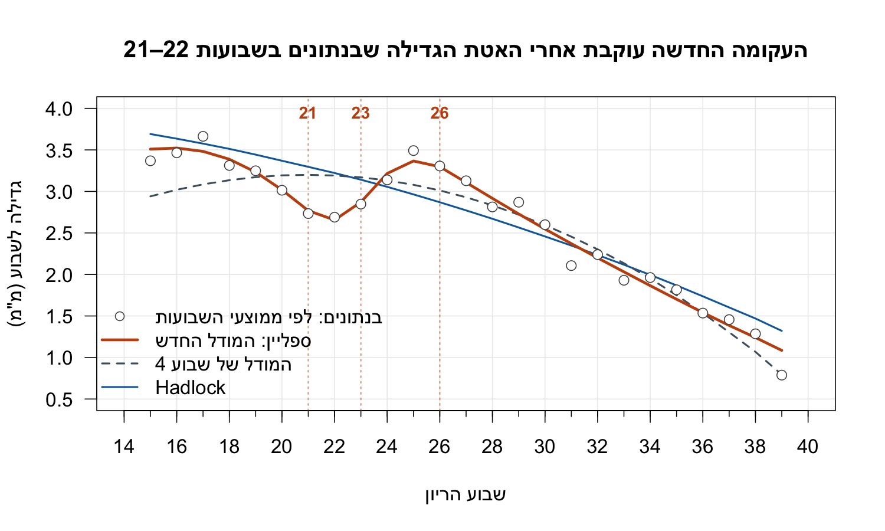
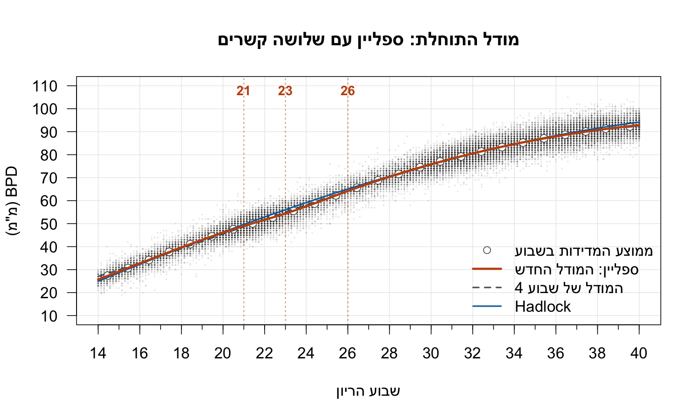
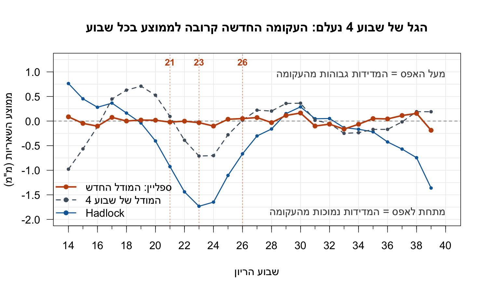

# שבוע 5 – עקומות גדילה ל-BPD ברגרסיה גמישה

מסמך חי: מוסיפים אליו החלטות ונימוקים בכל פעם שמסיימים שלב, כמו בשבועות 3 ו-4.

## 1. המשימה

**נוסח המטלה:**

> השלב הבא של הניתוח הוא התאמת מודל רגרסיה "גמישה" או לא פרמטרית.
> אם משתמשים בשיטה שנלמדה בכיתה (cubic splines), תנו את הדעת על מספר ומיקום ה-knots.
> ניתן גם להשתמש בשיטות אחרות כמו שיטת Loess או שיטת Kernel עליהן דיברנו מעט וניתן לקרוא יותר בספרות.
> יש להתאים מודל הן לתוחלת והן לסטיית התקן (כפי שנעשה בשבוע שעבר), לחשב את האחוזונים ולבדוק את טיב ההתאמה.
> תסבירו במצגת את ההחלטות שלכם – למה בחרתם בנקודות הספציפיות ל-knots, איזה מודלים שקלתם לעשות וכו.
> תקפידו לרשום במצגת בסופו של דבר את המודל הסופי איתו עבדתם.
> בגרפים בהם אתם מתארים את המודל תציגו גם את הגרף של השיטה בה משתמשים היום (אפשר גם להציג את המודל אותו התאמתם בשבוע שעבר).

**מהשיעור (11.11.2026, `lecture_2026-11-11_splines.pdf`, סעיף 13):** לבחור **אחת** מהשיטות (ספליינס, קרנל או LOESS), להתאים בה תוחלת וסטיית תקן, לחשב אחוזונים ולהשוות ל-Hadlock ול-Kurmanavicius. אם בוחרים ספליינס, להחליט כמה קשרים ואיפה ולנמק.

**"השיטה שבה משתמשים היום"** היא Hadlock. לפי קובץ ההקדמה (`Intro1.pdf`), אלה העקומות שבהן משתמשים בישראל.

## 2. רשימת הדרישות

כל שורה היא דרישה מהמטלה או מהשיעור, עם השלב שבו היא מטופלת. בסוף השבוע כל השורות צריכות להיות מסומנות.

| # | הדרישה | מקור | שלב | בוצע |
|---|---|---|---|---|
| 1 | מודל רגרסיה גמישה: ספליין קובי, LOESS או קרנל, שיטה אחת | מטלה, שיעור | 1 | |
| 2 | אם ספליין: החלטה על מספר ה-knots ועל מיקומם | מטלה, שיעור | 2, 3 | |
| 3 | מודל לתוחלת | מטלה | 2 | ✓ |
| 4 | מודל לסטיית התקן, כמו בשבוע 4 | מטלה | 3 | |
| 5 | חישוב האחוזונים | מטלה | 4 | |
| 6 | בדיקת טיב ההתאמה | מטלה | 3, 5 | |
| 7 | השוואה ל-Hadlock ול-Kurmanavicius | שיעור | 5 | |
| 8 | בגרפים שמתארים את המודל: גם עקומת Hadlock. המודל של שבוע 4 רשות | מטלה | 2, 3, 4 | |
| 9 | הסבר ההחלטות במצגת: למה ה-knots האלה, אילו מודלים נשקלו | מטלה | 6 | |
| 10 | המודל הסופי רשום במצגת | מטלה | 6 | |

## 3. מה לא עושים השבוע

- **לא משתמשים בקובץ הבדיקה.** ההשוואה עליו היא שלב 6 בתוכנית הכללית של `Intro1.pdf`, והיא עוד לא התבקשה. גם הבחירה בין הקשרים נעשית על קובץ האימון בלבד.
- **לא מתאימים את כל שלוש השיטות עד הסוף.** בשיעור נאמר לבחור אחת. שיטות אחרות יכולות להופיע רק כ"חלופה שנשקלה", אם נחליט שזה נחוץ כדי לנמק את הבחירה (החלטה 1).
- **לא משנים את הנתונים:** אותו `train.csv` משבוע 3, בלי ניקוי נוסף.
- **לא מוסיפים שיטות שלא הוזכרו במטלה,** כמו רגרסיית קוונטילים או LMS. אם נראה שהנחת הנורמליות לא מחזיקה, מדווחים על כך ולא מחליפים שיטה.
- **אותם אחוזונים כמו בשבוע 4:** 3, 5, 10, 95 ו-97.5, אותם שבועות (14–40), ואותה הנחת נורמליות.

## 4. נקודת המוצא: מה ידוע משבוע 4

הפרטים ב-[README של שבוע 4](../week%204/README.md). בקצרה:

- **המודל של שבוע 4** (fractional polynomials): תוחלת `3.727 + 0.15329·w² − 0.002448·w³`, סטיית תקן `2.076 + 0.0341·w`. הוא משוחזר בסעיף 2 של הקוד כ-`fp_model`, עם אותם מקדמים.
- **בכלל קובץ האימון הוא מכויל היטב,** למשל 3.83% מהמדידות מתחת לאחוזון 3 (ב-Hadlock: 5.35%).
- **הבעיה שנשארה מקומית:** בשבועות 14–25 העקומה מתנדנדת סביב הנתונים. ממוצע השאריות הוא ‎−0.98 מ"מ בשבוע 14, ‎+0.71 בשבוע 19 ו-‎−0.71 בשבוע 23. בשבוע 23 נמצאות 17.98% מהמדידות מתחת לאחוזון 10, במקום 10%. גם הפיזור בשבועות 23–25 גדול ממה שהקו הישר של סטיית התקן מניח.
- **הכלים שכבר בנינו ונמשיך להשתמש בהם:** cross-validation לפי הריון (5 קבוצות, `seed = 2026`), קנס האחוזונים מההרצאה, ציוני Z, וכיסוי האחוזונים עם bootstrap לפי הריון.

השאלה המרכזית של השבוע נובעת מכאן: **האם שיטה גמישה מתקנת את הבעיה בשבועות 14–25, והאם השיפור מצדיק מודל מסובך יותר?**

## 5. מושגים

- **רגרסיה גמישה או לא פרמטרית:** במקום לקבוע מראש צורת נוסחה ולאמוד רק את המקדמים, נותנים לנתונים לקבוע את הצורה, ומאפשרים לעקומה להתנהג אחרת באזורים שונים של ההריון.
- **Knot (קשר):** נקודה על ציר השבועות שבה העקומה רשאית לשנות את צורתה. בין שני קשרים יש קטע, ובכל קטע פולינום משלו.
- **ספליין קובי:** בכל קטע פולינום מדרגה 3, והקטעים מחוברים בצורה חלקה (בלי קפיצה ובלי שבירה). זו עדיין רגרסיה ליניארית רגילה, עם משתנה נוסף `(w − t)³₊` לכל קשר `t`. המשתנה הזה שווה 0 לפני הקשר. מספר המקדמים: 4 ועוד מספר הקשרים.
- **ספליין קובי טבעי:** ספליין קובי שמחויב להיות קו ישר מחוץ לשתי נקודות קצה, כדי שלא "יברח" בקצוות. מספר המקדמים: 2 ועוד מספר הקשרים הפנימיים.
- **B-splines:** דרך חישובית אחרת לבנות את אותו ספליין, יציבה יותר. ב-R: `splines::bs()` ו-`splines::ns()`. המקדמים שלה לא נקראים כנוסחה פשוטה.
- **החלקת קרנל:** הערך בכל שבוע הוא ממוצע משוקלל של המדידות סביבו, כשמדידות קרובות מקבלות משקל גבוה יותר. **רוחב הפס (bandwidth)** קובע כמה רחוק מסתכלים.
- **LOESS:** כמו קרנל, אבל בכל חלון מתאימים רגרסיה קטנה במקום ממוצע. **span** הוא אחוז הנתונים שנכנס לכל חלון.
- **התאמת יתר:** עקומה גמישה מדי מתחילה לעקוב אחרי רעש אקראי שקיים רק במדגם. cross-validation לפי הריון בודק זאת, כי הוא בודק את העקומה על הריונות שהיא לא ראתה.

## 6. תוכנית העבודה

כל שלב מקביל לסעיף בקובץ [bpd_week5.R](bpd_week5.R). הפלטים נשמרים ב-`output/`, עם מספר הסעיף בתחילת שם הקובץ.

### שלב 0 – תשתית (סעיפים 0–2 בקוד) – בוצע

- הגדרות, `heb()`, `save_plot()`, `save_table()` והצבעים, כמו בשבוע 4.
- טעינת `train.csv` וחלוקה קבועה של ההריונות ל-5 קבוצות (`fold`), זהה לחלוקה של שבוע 4.
- המודלים להשוואה: `had_model`, `kur_model`, ו-`fp_model` (המודל של שבוע 4, מותאם מחדש מאותם נתונים, עם אותם מקדמים).
- הקובץ רץ מתיקיית השורש בלי שגיאות.

### שלב 1 – בחירת השיטה (סעיף 3 בקוד) – בוצע

- **מה החלטנו:** ספליין (החלטה 1), ספליין קובי רגיל (החלטה 1ב), בסיס ידני (החלטה 2).
- **מה בנינו:** מנוע אחד שמשמש גם לתוחלת וגם לסטיית התקן:

| כלי | מה הוא עושה |
|---|---|
| `fit_spline(y, x, knots, natural)` | מתאים ספליין קובי רגיל או טבעי עם הקשרים שנותנים לו. מחזיר את מספר המקדמים, את RSS, את הנוסחה בשבועות ואת `predict(w)` |
| `cv_predict_spline(y, x, knots, natural)` | תחזיות על הריונות מוסתרים, לפי אותן 5 קבוצות של שבוע 4 |
| `spline_formula(fit)` | הנוסחה כטקסט, למצגת. למשל: `a + b*w + ... + g*(w-24)^3+` |
| `spline_label(knots, natural)` | שם קצר למועמד, לטבלאות |

- **בדיקות** (`output/03_engine_checks.csv`, כולן עברו, והקוד נעצר אם אחת נכשלת):
  - ספליין רגיל בלי קשרים זהה לפולינום מדרגה 3 שמותאם ב-`lm`.
  - ספליין טבעי בלי קשרים זהה לקו ישר.
  - הנוסחה בשבועות נותנת בדיוק את העקומה המותאמת, גם בספליין הטבעי, שבו פותחים סוגריים.
  - ספליין טבעי ישר מחוץ לשבועות 14–40.
  - מספר המקדמים: 4 ועוד מספר הקשרים ברגיל, 2 ועוד מספר הקשרים בטבעי.
  - בבדיקות האלה משמשים הקשרים 20 ו-30 כדוגמה בלבד. זו לא הבחירה.
- **בדיקה חד-פעמית, לא בקובץ הקוד:** עם קשרים לדוגמה (18, 24, 32), העקומות של המנוע זהות לאלה של `splines::bs()` ו-`splines::ns()` עד הפרש של פחות מ-10⁻⁹ מ"מ.
- **פלטים:** `03_growth_by_week.csv` (קצב הגדילה, הנימוק להחלטה 1ב), `03_engine_checks.csv`.

#### החלטה 1 – איזו שיטה גמישה?

**השאלה:** המטלה מציעה שלוש שיטות: cubic splines, ‏LOESS וקרנל. צריך לבחור אחת, ולהתאים בה גם את התוחלת וגם את סטיית התקן.

**ההתלבטות:**

| שיטה | איך היא עובדת, בפשטות | מה בוחרים | יתרון | חיסרון אצלנו |
|---|---|---|---|---|
| **ספליין קובי** | רגרסיה ליניארית רגילה, עם פולינום מדרגה 3 בכל קטע בין קשרים, והקטעים מחוברים בצורה חלקה | מספר הקשרים ומיקומם | נותן נוסחה. גמיש מקומית. כל הכלים של רגרסיה רגילה עובדים עליו | צריך להחליט על הקשרים ולנמק. עלול להתנהג לא טוב בקצוות |
| **LOESS** | בכל שבוע מתאימים רגרסיה קטנה רק על המדידות הסמוכות | span (רוחב החלון), דרגה | גמיש מאוד, ומתנהג סביר בקצוות | אין נוסחה, רק טבלת ערכים. קשה לומר כמה הוא "מסובך" |
| **קרנל** | בכל שבוע ממוצע משוקלל של המדידות הסמוכות | רוחב פס, סוג קרנל | הכי פשוט לתכנת | אין נוסחה. בקצוות (שבוע 14, שבועות 39–40) הממוצע רואה מדידות רק מצד אחד, ולכן העקומה נמשכת פנימה |

**ההחלטה:** ספליין.

**למה:**
- **המודל הסופי הוא נוסחה.** כך אפשר לכתוב אותו במצגת, כפי שהמטלה דורשת, ולהכניס אותו למכשיר אולטרסאונד כמו את הנוסחאות של Hadlock ו-Kurmanavicius. LOESS וקרנל נותנים רק טבלת ערכים, ובכל שבוע צריך לחשב את העקומה מחדש מכל הנתונים.
- **הוא מטפל בדיוק בבעיה של שבוע 4.** הבעיה הייתה מקומית: גל בשבועות 14–25. בנוסחה של שבוע 4 כל הנתונים קובעים יחד את אותם מקדמים, ולכן אי אפשר לתקן אזור אחד בלי להשפיע על האחרים. בספליין העקומה בכל קטע נקבעת בעיקר מהמדידות של אותו קטע, ואפשר להציב קשרים בדיוק באזור הבעייתי.
- **זו עדיין רגרסיה ליניארית.** לכן כל מה שבנינו בשבוע 4 עובד עליו בלי שינוי: אותו cross-validation לפי הריון, אותה אמידה של סטיית התקן מ-`|שארית| · 1.25`, ואותו חישוב אחוזונים.
- **קל להשוות את המורכבות שלו לשבוע 4.** מספר המקדמים בספליין ידוע מראש: 4 ועוד מספר הקשרים בספליין קובי. לכן אפשר לשאול במונחים פשוטים אם השיפור מצדיק את המקדמים הנוספים, כמו ששאלנו בשבוע 4 על (2,3) מול (1,3). ב-LOESS ובקרנל המורכבות נקבעת ברוחב החלון, ואין לה ספירה פשוטה.
- **הבחירה בקשרים ניתנת להסבר.** אפשר למקם קשרים בשבועות שיש להם משמעות, ולהסביר לרופא איפה העקומה רשאית לשנות כיוון. ברוחב חלון של LOESS אין משמעות קלינית.

**המחיר:**
- **צריך להחליט כמה קשרים ואיפה,** וההחלטה הזו משפיעה על התוצאה. נבחר אותם בכלל שנקבע מראש (החלטה 3), ונבדוק אותם על הריונות מוסתרים.
- **הנוסחה ארוכה יותר** משל Hadlock: איבר נוסף לכל קשר, ולמקדמים אין פירוש פשוט כל אחד בנפרד. מה שמובן הוא העקומה כולה.
- **בקצוות ספליין קובי רגיל יכול "לברוח".** לכן נשארת פתוחה השאלה אם להשתמש בספליין קובי רגיל או בספליין טבעי (החלטה 1ב).

**הסבר קצר למצגת:**
> בחרנו ב-cubic spline. הבעיה של המודל משבוע 4 הייתה מקומית, גל בשבועות 14–25, וספליין מאפשר לעקומה לשנות צורה באזור אחד בלי להזיז את שאר ההריון. בניגוד ל-LOESS ולקרנל, התוצאה היא נוסחה, שאפשר לרשום ולהכניס למכשיר כמו את Hadlock. מספר המקדמים שלה ידוע, ולכן אפשר לבדוק ישירות אם השיפור מצדיק את המורכבות.

#### החלטה 1ב – ספליין קובי רגיל או טבעי?

**השאלה:** יש שני סוגים של ספליין קובי. הם נבדלים רק במה שקורה בקצוות, כלומר בתחילת ההריון ובסופו.

**ההתלבטות:**

| אפשרות | מה קורה בקצוות | יתרון | חיסרון |
|---|---|---|---|
| **ספליין קובי רגיל** | אחרי הקשר האחרון העקומה ממשיכה כפולינום מדרגה 3, בלי מגבלה | חופשי להתעקל גם בקצוות | עלול "לברוח" בקצוות, במיוחד כשחוזים מחוץ לטווח הנתונים או כשבקצה יש מעט נתונים |
| **ספליין קובי טבעי** | בנקודות הקצה (שבוע 14 ושבוע 40) העקומה חייבת להיות ישרה, כלומר קצב הגדילה לא משתנה שם | יציב בקצוות ומחוץ לטווח. חוסך 2 מקדמים | אם בקצה הנתונים באמת מתעקלים, האילוץ מטה את העקומה |

**מה בדקנו:** בכמה מ"מ גדל ה-BPD הממוצע בשבוע, בכל שלב של ההריון (`output/03_growth_by_week.csv`). החישוב: ההפרש בין הממוצעים של שבועות סמוכים, חלקי ההפרש בגיל הממוצע שלהם.

| שבוע | 15 | 17 | 19 | 30 | 35 | 37 | 38 | 39 |
|---|---|---|---|---|---|---|---|---|
| גדילה לשבוע (מ"מ) | 3.37 | 3.66 | 3.25 | 2.60 | 1.82 | 1.46 | 1.29 | 0.79 |

- **בתחילת ההריון** הגדילה יציבה יחסית: בין 3.25 ל-3.66 מ"מ בשבוע, בשבועות 15–19. העקומה כמעט ישרה שם, והאילוץ של ספליין טבעי לא מזיק.
- **בסוף ההריון** הגדילה מאטה בחדות: מ-1.82 מ"מ בשבוע 35 ל-0.79 בשבוע 39, כלומר יותר מחצי בתוך ארבעה שבועות. זו עקמומיות חזקה בדיוק בקצה, שם ספליין טבעי מחייב את העקומה להיות ישרה.

**תיקון:** בגרסה הראשונה חישבנו את ההפרש בין ממוצעי שבועות סמוכים בלי לחלק בהפרש הגילים. המרווח הזה אינו בדיוק שבוע. בשבוע 39 הוא 1.16 שבועות, כי שבוע 39 כולל את יום 280, ובשבוע 21 הוא 0.93 שבועות (עמודת `mean_age` בקובץ). המספרים בגרסה הראשונה היו לכן מעט מוטים, אבל המסקנה לא השתנתה.

**ההחלטה:** ספליין קובי רגיל. בשלב 2 נכניס את הספליין הטבעי, עם אותם קשרים, לטבלת המועמדים כחלופה שנשקלה, ו-cross-validation יראה אם הנימוק מחזיק.

**למה:**
- **האילוץ של ספליין טבעי סותר את מה שקורה בסוף ההריון.** קצב הגדילה של הראש יורד בחצי בשבועות האחרונים. עקומה שמוכרחת להיות ישרה בשבוע 40 עלולה לעבור מעל המדידות בשבועות האלה, ולהזיז את כל האחוזונים שם.
- **זה האזור שבו אסור לטעות.** הסריקות השגרתיות הן בסביבות שבוע 22, בשבוע 32 וממש לפני הלידה (`Intro1.pdf`). גם בנתונים שלנו, בכל שבוע מ-30 עד 39 יש יותר מ-2,000 מדידות.
- **הבעיה שספליין טבעי פותר לא קיימת אצלנו:**
  - **אין חיזוי מחוץ לטווח.** העקומות נדרשות לשבועות 14–40, והנתונים מכסים בדיוק את הטווח הזה. בשבוע 40 עצמו (יום 280) יש 418 מדידות.
  - **יש הרבה נתונים בשני הקצוות.** בשבוע 14 יש 787 מדידות, ובכל אחד מהשבועות האחרונים אלפים. הם מחזיקים את העקומה במקום ולא נותנים לה לברוח.
- **החיסכון של 2 מקדמים לא משמעותי** מול 43,741 מדידות.

**המחיר:** אם ספליין רגיל בכל זאת יתנהג לא טוב בקצוות, נגלה זאת רק בבדיקת המועמדים. לכן הספליין הטבעי נכנס להשוואה, ובגרף המודל צריך לבדוק במיוחד את שבועות 14–15 ו-37–40.

**הסבר קצר למצגת:**
> בחרנו ספליין קובי רגיל ולא טבעי. ספליין טבעי מכריח את העקומה להיות ישרה בקצוות, אבל בסוף ההריון גדילת הראש מאטה בחדות: מ-1.82 מ"מ בשבוע בשבוע 35 ל-0.79 בשבוע 39. היתרון שלו, יציבות מחוץ לטווח הנתונים, לא נדרש כאן, כי הנתונים מכסים את כל שבועות 14–40, ויש בקצוות מאות עד אלפי מדידות בכל שבוע. בדקנו גם ספליין טבעי כחלופה.

#### החלטה 2 – איך בונים את הספליין בקוד?

**השאלה:** ספליין הוא רגרסיה ליניארית עם עמודות מיוחדות. את העמודות האלה אפשר לבנות בשתי דרכים.

**ההתלבטות:**

| אפשרות | מה זה | יתרון | חיסרון |
|---|---|---|---|
| **בסיס ידני** | בונים בעצמנו את העמודות `w`, `w²`, `w³` ו-`(w − t)³₊` לכל קשר, ובספליין טבעי את `B_t(w)` לפי הנוסחה מהשיעור | כל מקדם שיוצא הוא חלק מהנוסחה. אפשר לרשום אותה במצגת ישירות | העמודות דומות מאוד זו לזו, וזה עלול להקשות על החישוב |
| **`splines::bs()` ו-`ns()`** | פונקציות מוכנות של R שבונות בסיס B-splines | יציב חישובית | המקדמים לא נקראים כנוסחה. כדי לרשום את המודל צריך לתרגם אותם |

**ההחלטה:** בסיס ידני.

**למה:**
- **המטלה דורשת לרשום את המודל הסופי.** בבסיס הידני הנוסחה היא פשוט המקדמים, בצורה שכל אחד יכול לחשב: חלק פולינומי כמו אצל Hadlock, ועוד איבר אחד לכל קשר, שמתחיל לפעול רק אחרי הקשר.
- **רואים בדיוק מה המודל עושה.** כל קשר מוסיף איבר אחד, ואפשר להסביר מה האיבר הזה עושה: מאותו שבוע והלאה העקומה רשאית לשנות כיוון.
- **הבעיה החישובית נפתרת בשתי דרכים:** מחלקים את השבוע ב-10 בזמן ההתאמה, כמו בשבוע 4, וההתאמה עצמה נעשית ב-`lm.fit`, שמחשב בצורה יציבה גם כשהעמודות דומות. הבדיקה מול `bs()` ו-`ns()` הראתה שהעקומות זהות.

**המחיר:** למקדמים בנפרד אין פירוש פשוט. מה שאפשר להסביר הוא העקומה כולה, וכמה איברים יש בה. בספליין טבעי הנוסחה ארוכה יותר, כי כשפותחים סוגריים נוספים איברים בשבועות 14 ו-40.

**הסבר קצר למצגת:**
> בנינו את הספליין בעצמנו, כרגרסיה ליניארית עם איבר `(w − t)³₊` לכל קשר. כך הנוסחה הסופית היא המקדמים עצמם: החלק הפולינומי כמו אצל Hadlock, ועוד איבר אחד שנכנס לפעולה אחרי כל קשר. בדקנו שהעקומות זהות לאלה של הפונקציות המוכנות ב-R.

### שלב 2 – מודל התוחלת (סעיף 4 בקוד) – בוצע

1. **מגדירים את המועמדים:** כמה קשרים ואיפה (החלטה 3). לכל מערך קשרים גם ספליין טבעי, כחלופה (החלטה 1ב).
2. **בוחרים לפי קריטריון** (החלטה 4), על הריונות מוסתרים.
3. **מתאימים את המודל הנבחר על כל קובץ האימון** וכותבים אותו כנוסחה.
4. **בודקים שאריות לפי שבוע** ומשווים לגל של שבוע 4.
5. **גרף:** המודל מעל ענן הנתונים, עם עקומת Hadlock ועם המודל של שבוע 4, אם נחליט להציג אותו (החלטה 6).

**פלטים:** `04_mean_candidates.csv`, `04_mean_stability.csv`, `04_mean_final_model.csv`, `04_mean_residuals_by_week.csv`, `04_mean_growth.csv`, `04_mean_fit.png`, `04_mean_residuals_by_week.png`, `04_mean_growth.png`.

#### שלוש עובדות מהנתונים שעליהן נשענות החלטות 3 ו-4

1. **מספר המדידות בכל שבוע נקבע לפי לוח הסריקות, לא לפי הביולוגיה.** 13% מהמדידות הן משבועות 14–19, ‏12.8% משבועות 23–28, ו-53.4% משבועות 30–39 (בדיקה חד-פעמית על `train.csv`, לא בקובץ הקוד). הסריקות השגרתיות הן בסביבות שבוע 22, בשבוע 32 ולפני הלידה (`Intro1.pdf`).
2. **הבעיה שרצינו לתקן נמצאת דווקא בשבועות הדלילים.** הגל של שבוע 4: העקומה גבוהה מדי ב-0.98 מ"מ בשבוע 14, נמוכה מדי ב-0.71 בשבוע 19, וגבוהה מדי ב-0.71 בשבוע 23.
3. **RMSE כמעט לא רואה את הגל.** בשבוע 4, מודל עם 8 חזקות כמעט העלים את הגל: ההטיה השבועית הגדולה ביותר ירדה מ-0.98 ל-0.22 מ"מ. ה-RMSE השתפר רק מ-3.157 ל-3.139. רוב ה-RMSE, כ-3 מ"מ, הוא הבדלים טבעיים בין עוברים, ששום מודל לא יקטין.

#### החלטה 3 – כמה קשרים ואיפה?

**השאלה:** ספליין מוגדר לפי הקשרים שלו. כמה קשרים לשים, ובאילו שבועות?

**ההתלבטות:** האפשרויות מהשיעור:

| אפשרות | איפה הקשרים יוצאים אצלנו | הערכה |
|---|---|---|
| AIC/BIC עם קשר בכל שבוע | הקריטריון בוחר | מניח שהמדידות בלתי תלויות, ואצלנו יש כ-2.5 מדידות להריון. עם 43,741 מדידות הוא ישאיר הרבה קשרים, כמו 256 המודלים בשבוע 4 |
| לפי אחוזונים של השבוע | עם 2 קשרים: 24, 33. עם 3: 22, 31, 35 | שמה קשרים איפה שיש הרבה סריקות, כלומר בסוף ההריון, ולא איפה שהעקומה מתכופפת |
| רוחבים שווים | עם 2 קשרים: 23, 31. עם 3: 21, 27, 34 | לא מתחשבת בנתונים |
| משמעות קלינית | 20 ו-30, או 22 ו-32 (הסריקות השגרתיות) | קל להסביר, אבל אין סיבה שהעקומה תתכופף דווקא שם |
| חיפוש ב-cross-validation | הנתונים קובעים | בודק ישירות על הריונות מוסתרים. המחיר: בודקים הרבה אפשרויות, וייתכן שהמנצחת תנצח במזל |

(המיקומים לפי אחוזונים ולפי רוחבים שווים מעוגלים לשבוע שלם. הם מחושבים בקוד, סעיף 4א.)

**ההחלטה (של הצוות):** חיפוש ב-cross-validation לפי הריון, עם גבולות שנקבעו מראש:
- **2 או 3 קשרים,** כדי שהנוסחה לא תהיה מורכבת מדי: 6 או 7 מקדמים.
- **קשרים בשבועות שלמים בלבד.**
- **בין שבוע 16 לשבוע 38.**
- **לפחות שבועיים בין קשרים סמוכים.**

סך הכול 1,561 מערכי קשרים: 231 עם 2 קשרים ו-1,330 עם 3.

**למה:**
- **הנתונים קובעים איפה העקומה מתכופפת,** ולא לוח הסריקות. קשרים לפי אחוזונים היו נופלים בעיקר בשבועות 30–39, שם העקומה של שבוע 4 כבר הייתה טובה.
- **2–3 קשרים:** מספיק כדי לתקן גל מקומי, ועדיין נוסחה שאפשר לרשום ולהסביר.
- **שבועות שלמים:** לרופא קל יותר להבין "משבוע 23" מאשר "משבוע 23.4".
- **שבועות 16–38:** קשר צמוד לקצה נשען על מעט נתונים מצד אחד שלו.
- **לפחות שבועיים בין קשרים:** שני קשרים בשבועות סמוכים מאפשרים לעקומה ליצור "גבשושית" לפי שבוע אחד של נתונים.
- **שיטות המיקום מהשיעור לא נזרקות:** הן חלק מ-1,561 האפשרויות, ומסומנות בטבלת המועמדים. כך רואים איפה דורגה כל אחת.

**המחיר:**
- **כשבודקים הרבה אפשרויות, המנצחת עלולה לנצח במזל.** לכן נקבע מראש כלל פשטות (החלטה 4), ונבדקה יציבות הבחירה.
- **אנחנו לא יודעים מי נבדקת בכל שבוע.** אין לנו את התיק הרפואי, ולכן אם הגל בשבועות 20–25 נובע מהאוכלוסייה שנבדקת ולא מגדילת העובר, העקומה תלמד אותו. הצוות קיבל את המגבלה הזו, וצריך לציין אותה במצגת.

#### החלטה 4 – לפי מה בוחרים בין המועמדים?

**השאלה:** לכל מערך קשרים יש תחזיות על הריונות מוסתרים. איך מסכמים אותן לציון אחד, ואיך בוחרים?

**ההתלבטות:**

| אפשרות | מה היא מודדת | הערכה |
|---|---|---|
| RMSE ב-cross-validation (כמו בשבוע 4) | השגיאה הממוצעת לכל מדידה | עקבית עם שבוע 4. אבל רובה הבדלים טבעיים בין עוברים, והשבועות העמוסים שולטים בה (עובדה 3) |
| **ההטיה השבועית ב-cross-validation** | ממוצע השאריות בכל שבוע, על הריונות מוסתרים, ואז שורש ממוצע הריבועים על פני השבועות. כל שבוע מקבל אותו משקל | מודדת בדיוק את מה שהמודל יכול לשנות. זה סיכום במספר אחד של גרף השאריות לפי שבוע משבוע 4 |
| קנס האחוזונים | מודד את המטרה עצמה | דורש גם מודל לסטיית התקן. נשמר לשלב 3, כמו בשבוע 4 |
| AIC/BIC | | מניחים שהמדידות בלתי תלויות |

**ההחלטה:** ההטיה השבועית על הריונות מוסתרים, עם כלל פשטות שנקבע מראש. RMSE מדווח לצדה.

**כלל הפשטות (one-standard-error rule):** בוחרים את המודל עם **הכי מעט קשרים** שהציון שלו לא גבוה מהציון הטוב ביותר ועוד טעות תקן אחת. את טעות התקן מחשבים מההבדלים בין 5 הקבוצות. בין מודלים עם אותו מספר קשרים, בוחרים את הציון הנמוך ביותר.

**למה:**
- **היא פשוטה להסבר כמו RMSE, ורואה את מה ש-RMSE מחמיץ:** "בכל שבוע, עד כמה העקומה רחוקה מהממוצע של המדידות". ב-RMSE כל 1,561 המועמדים נמצאים בטווח צר, בין 3.138 ל-3.155 מ"מ. בהטיה השבועית ההבדלים בין המועמדים גדולים פי כמה, ולכן רואים אותם.
- **משקל שווה לכל שבוע:** כל אישה נבדקת מול העקומה של השבוע שלה. העקומה בשבוע 25 צריכה להיות מדויקת כמו העקומה בשבוע 32, גם אם במדגם נסרקו בשבוע 25 פחות נשים. גם קנס האחוזונים של שבוע 4 חושב כממוצע על פני השבועות.
- **הכלל נקבע לפני שראינו תוצאות.** בבחירת סטיית התקן של שבוע 4 החלטנו ש"פער של 2% הוא קטן" רק אחרי שראינו את המספרים, וזה נרשם כמחיר. כאן הכלל מוגדר מראש, והוא מעדיף את המודל הפשוט: 3 קשרים נבחרים רק אם הם טובים מ-2 קשרים בבירור. זה כלל מקובל בספרות (Hastie, Tibshirani & Friedman, *The Elements of Statistical Learning*).

**המחיר:**
- **מנקודת המבט של העומס על המערכת** (`Intro1.pdf`: יותר מדי אזעקות שווא), טעות בשבוע עמוס פוגעת ביותר נשים. RMSE משקף את נקודת המבט הזו, ולכן הוא מוצג לצדה.
- **הציון לא יכול להגיע ל-0,** כי גם הממוצע של המדידות בכל שבוע משתנה מעט באקראי.
- **טעות התקן מ-5 קבוצות היא אומדן גס.**

#### תוצאות החיפוש (`output/04_mean_candidates.csv`)

| מודל | מקדמים | הטיה שבועית (מ"מ) | ההטיה הגדולה ביותר בשבוע אחד (מ"מ) | RMSE (מ"מ) | דירוג מתוך 1,561 |
|---|---|---|---|---|---|
| **קשרים 21, 23, 26 – נבחר** | 7 | **0.090** | 0.186 | 3.138 | 1 |
| קשרים 20, 23, 26 | 7 | 0.091 | 0.175 | 3.138 | 2 |
| הטוב ביותר עם 2 קשרים: 25, 27 | 6 | 0.173 | 0.350 | 3.141 | 154 |
| אחוזונים, 3 קשרים: 22, 31, 35 | 7 | 0.208 | 0.427 | 3.142 | 356 |
| רוחבים שווים, 2 קשרים: 23, 31 | 6 | 0.217 | 0.410 | 3.143 | 412 |
| קליני, הסריקות השגרתיות: 22, 32 | 6 | 0.236 | 0.473 | 3.144 | 531 |
| אחוזונים, 2 קשרים: 24, 33 | 6 | 0.260 | 0.513 | 3.146 | 721 |
| רוחבים שווים, 3 קשרים: 21, 27, 34 | 7 | 0.262 | 0.574 | 3.145 | 740 |
| קליני: 20, 30 | 6 | 0.275 | 0.595 | 3.146 | 841 |
| ייחוס: ספליין בלי קשרים (פולינום מדרגה 3) | 4 | 0.387 | 0.852 | 3.155 | – |
| ייחוס: המודל של שבוע 4, FP (2,3) | 3 | 0.416 | 0.979 | 3.157 | – |

**מה רואים:**
- **הבחירה לפי הכלל:** הציון הטוב ביותר הוא 0.0896, עם טעות תקן של 0.0078, ולכן הסף הוא 0.0974. אף מודל עם 2 קשרים לא עובר את הסף (הטוב שבהם: 0.173), ולכן נבחר הטוב ביותר עם 3 קשרים: **21, 23, 26**.
- **שני הקריטריונים מסכימים:** גם לפי RMSE המודל 21, 23, 26 הוא הראשון. כלומר, הבחירה לא תלויה בקריטריון.
- **השיפור לעומת שבוע 4 גדול.** ההטיה השבועית קטנה פי 4.6, מ-0.416 ל-0.090 מ"מ. ההטיה הגדולה ביותר בשבוע אחד ירדה מ-0.98 ל-0.19 מ"מ.
- **שלושת הקשרים מרוכזים בשבועות 21–26,** בדיוק סביב הגל של שבוע 4.
- **שיטות המיקום מהשיעור דורגו נמוך** (מקום 356 ומטה). הסיבה: אף אחת מהן לא שמה קשרים צפופים בשבועות 21–26.

**הספליין הטבעי (החלטה 1ב):** הטוב ביותר מבין הספליינים הטבעיים, עם קשרים 21, 23, 28, מגיע להטיה של 0.167, כמעט פי 2 מהספליין הרגיל. זה מאשר את ההחלטה לבחור בספליין רגיל.

**יציבות (`output/04_mean_stability.csv`):** החיפוש חזר על 20 המועמדים המובילים עם 5 חלוקות אקראיות אחרות של ההריונות. **בכל חמש החלוקות נבחר אותו מודל, 21, 23, 26,** והציון שלו נע בין 0.0897 ל-0.0899. כלומר, הבחירה לא נובעת ממזל של חלוקה מסוימת.

#### המודל הסופי לתוחלת (`output/04_mean_final_model.csv`)

> תוחלת BPD במ"מ = 11.438 − 3.1952·w + 0.42867·w² − 0.0091125·w³ + 0.070735·(w−21)³₊ − 0.097427·(w−23)³₊ + 0.036470·(w−26)³₊

**כמה ספרות לרשום:** המקדמים מוכפלים במספרים גדולים (`w³` מגיע ל-64,000), ולכן העיגול משנה את העקומה. בבדיקה חד-פעמית: עם 4 ספרות משמעותיות הנוסחה המעוגלת סוטה מהעקומה בעד 0.05 מ"מ, ועם 5 ספרות בעד 0.008 מ"מ. לכן הנוסחה נרשמת עם 5 ספרות משמעותיות, גם במצגת. המקדמים המלאים נמצאים בקובץ.

`w` הוא שבוע ההריון עם שברים. `(w−t)³₊` שווה `(w−t)³` אחרי שבוע `t`, ו-0 לפניו. עד שבוע 21 זה פולינום רגיל מדרגה 3, ובכל קשר נכנס לפעולה איבר נוסף שמשנה את צורת העקומה מאותו שבוע והלאה. העקומה עולה בכל טווח השבועות 14–40 (נבדק בקוד).

#### שאריות לפי שבוע (`output/04_mean_residuals_by_week.csv`)

| שבוע | 14 | 17 | 19 | 23 | 24 | 30 | 33 | 39 |
|---|---|---|---|---|---|---|---|---|
| שבוע 5 (מ"מ) | +0.09 | +0.07 | +0.02 | ‎−0.03 | ‎−0.10 | +0.16 | ‎−0.16 | ‎−0.19 |
| שבוע 4 (מ"מ) | ‎−0.98 | +0.45 | +0.71 | ‎−0.71 | ‎−0.70 | +0.36 | ‎−0.25 | +0.19 |

הגל של שבועות 14–25 נעלם. השארית הגדולה ביותר היא עכשיו בשבוע 39: העקומה גבוהה מדי ב-0.19 מ"מ. שבוע 39 כולל גם את יום 280.

#### ממצא: קצב הגדילה של העקומה (`output/04_mean_growth.csv`)

הגדילה לשבוע, מחושבת כמו בהחלטה 1ב, בנתונים ולפי כל עקומה:

| שבוע | 17 | 19 | 21 | 22 | 23 | 25 | 27 | 30 | 35 |
|---|---|---|---|---|---|---|---|---|---|
| בנתונים (מ"מ בשבוע) | 3.66 | 3.25 | 2.73 | 2.69 | 2.85 | 3.49 | 3.13 | 2.60 | 1.82 |
| העקומה שנבחרה | 3.48 | 3.23 | 2.77 | 2.66 | 2.87 | 3.37 | 3.11 | 2.55 | 1.70 |
| המודל של שבוע 4 | 3.08 | 3.17 | 3.20 | 3.19 | 3.17 | 3.08 | 2.93 | 2.59 | 1.75 |
| Hadlock | 3.58 | 3.44 | 3.30 | 3.22 | 3.14 | 2.96 | 2.77 | 2.46 | 1.87 |

**מה רואים:**
- **לפי העקומה החדשה, ראש העובר גדל בשבועות 21–22 לאט יותר** (כ-2.7 מ"מ בשבוע) מאשר בשבוע 25 (כ-3.4 מ"מ בשבוע). אחר כך הקצב יורד בהדרגה עד סוף ההריון.
- **זה בדיוק מה שקורה בנתונים, אבל ביולוגית קשה להסביר את זה.** ב-Hadlock, למשל, הקצב יורד בהדרגה לאורך כל ההריון. סביר יותר שזה קשור למי שנבדקת בשבועות האלה: בשבועות 20–22, סביב סריקת המערכות, יש הכי הרבה מדידות.
- **זו תכונה של הנתונים, לא תוצאה של בחירת 3 קשרים.** גם המודל הטוב ביותר עם 2 קשרים (25, 27) מראה האטה ואז האצה, אם כי חלשה יותר: 2.92 מ"מ בשבוע בשבועות 21–22, ו-3.26 בשבוע 26 (בדיקה חד-פעמית, לא בקובץ הקוד).
- **המודל של שבוע 4 לא יכול להראות את זה.** לכן הוא החמיץ את הנתונים בשבועות 14–25.

**ההחלטה (של הצוות):** מקבלים את הקשרים 21, 23, 26, שנבחרו בכלל שנקבע מראש.

**למה:**
- **זו בחירת הכלל,** והיא יציבה בכל החלוקות.
- **מודל בלי ההאטה מחייב להוסיף אילוץ על צורת קצב הגדילה.** זה מעבר למה שהמטלה ביקשה, והוא היה פוגע בהתאמה לנתונים בשבועות 20–25.
- **אין לנו דרך לדעת מי נבדקת בכל שבוע,** כי אין לנו את התיק הרפואי.

**המחיר:** העקומה משקפת את האוכלוסייה שנבדקה בכל שבוע, וייתכן שבשבועות 21–25 זו לא האוכלוסייה הכללית. במצגת מציגים את זה כמגבלה.

#### החלטה 6 – להציג את המודל של שבוע 4 בגרפים?

**השאלה:** המטלה מחייבת להציג את Hadlock בכל גרף שמתאר את המודל, ומאפשרת (רשות) להציג גם את המודל של שבוע 4.

**ההחלטה (של הצוות):** כן, בגרפים של התוחלת ושל סטיית התקן, באפור-כחלחל (`COL_ALT`), בקו מקווקו. בגרף האחוזונים יופיעו רק המודל החדש ו-Hadlock.

**למה:** בגרפים של התוחלת רואים במבט אחד שהגל של שבוע 4 נעלם. בגרף האחוזונים כבר יש 10 עקומות, ועוד 5 היו הופכים אותו לבלתי קריא.

#### הגרפים

בכל הגרפים: המודל החדש בכתום, Hadlock בכחול, המודל של שבוע 4 באפור-כחלחל מקווקו. הקשרים מסומנים בקווים אנכיים מנוקדים.

בגרף הזה שלוש העקומות כמעט חופפות, כי ההבדלים ביניהן הם פחות מ-2 מ"מ, על ציר של 100 מ"מ. את ההבדלים רואים בגרף השאריות:

- **המודל של שבוע 4:** הגל בשבועות 14–25.
- **Hadlock:** גבוה מדי ב-1.73 מ"מ בשבוע 23, וגבוה מדי ב-1.36 מ"מ בשבוע 39 (עמודת `mean_resid_hadlock`).
- **המודל החדש:** קרוב ל-0 בכל השבועות.

#### הסבר קצר למצגת

> בחרנו את הקשרים ב-cross-validation לפי הריון. בדקנו 1,561 אפשרויות של 2 או 3 קשרים, בשבועות שלמים, עם לפחות שבועיים ביניהם. קריטריון הבחירה: עד כמה העקומה רחוקה מהממוצע של המדידות בכל שבוע, על הריונות שהמודל לא ראה, כשכל שבוע מקבל אותו משקל. קבענו מראש שנבחר 3 קשרים רק אם הם טובים מ-2 בבירור. נבחרו הקשרים 21, 23 ו-26, ואותה בחירה התקבלה בחמש חלוקות אקראיות נוספות. ההטיה השבועית קטנה פי 4.6 לעומת המודל של שבוע 4. מגבלה: העקומה עוקבת אחרי האטה בגדילה בשבועות 21–22 שקיימת בנתונים. ייתכן שהיא נובעת ממי שנבדקת סביב סריקת המערכות, ואין לנו את התיק הרפואי כדי לבדוק זאת.

### שלב 3 – מודל סטיית התקן (סעיף 5 בקוד)

1. **אומדים סטיית תקן** מ-`|שארית| · 1.25`, כמו בשבוע 4.
2. **מגדירים מועמדים:** האם אותם קשרים כמו בתוחלת, או בחירה נפרדת (החלטה 5).
3. **בוחרים ומתאימים** את המודל הסופי, וכותבים אותו כנוסחה.
4. **בודקים ציוני Z לפי שבוע:** ממוצע קרוב ל-0, סטיית תקן קרובה ל-1, וכ-90% מהציונים בטווח המרכזי. כך בדקנו בשבוע 4, והאחוזונים נשענים על זה.
5. **גרף:** סטיית התקן לפי שבוע, עם Hadlock (קבועה, 3 מ"מ) ועם המודל של שבוע 4.
6. **מרכיבים** את `new_model`.

**פלטים:** `05_sd_candidates.csv`, `05_sd_final_model.csv`, `05_z_by_week.csv`, `05_sd_fit.png`, `05_z_by_week.png`.

### שלב 4 – האחוזונים (סעיף 6 בקוד)

- **טבלה:** חמשת האחוזונים לכל שבוע שלם, 14–40.
- **גרף:** העקומות של המודל החדש מעל הנתונים, עם עקומות Hadlock. אם הגרף יהיה עמוס מדי עם 10 עקומות, מחליטים איך לפצל אותו בזמן הבנייה ומתעדים כאן.

**פלטים:** `06_percentiles_by_week.csv`, `06_percentile_curves.png`.

### שלב 5 – טיב ההתאמה מול המודלים הקיימים (סעיף 7 בקוד)

- **מה בודקים:** כמה אחוז מהמדידות נמצאות מתחת לכל עקומה, לעומת האחוז הנקוב. בכלל קובץ האימון ובכל שבוע.
- **אילו מודלים:** המודל החדש, Hadlock, Kurmanavicius והמודל של שבוע 4.
- **רווחי סמך:** bootstrap לפי הריון, 1,000 חזרות, כמו בשבוע 4.
- **בדיקת התאמת יתר:** אותם מדדים על הריונות מוסתרים, כמו ב-`05_cv_check.csv` של שבוע 4. זה חשוב יותר השבוע, כי מודל גמיש חשוף יותר להתאמת יתר.
- **מסקנה:** האם הבעיה בשבועות 14–25 נפתרה, ובכמה.

**פלטים:** `07_percentile_coverage.csv`, `07_percentile_coverage.png`, `07_cv_check.csv`.

### שלב 6 – מצגת

- **עיצוב ורמת פירוט** כמו בשבועות 3 ו-4. ההחלטות מסומנות במלבן בגוון זהב, כמו בשבוע 4.
- **חובה לפי המטלה:** נימוק למספר הקשרים ולמיקומם, המודלים שנשקלו, המודל הסופי כנוסחה, ועקומת Hadlock בכל גרף של המודל.
- **כל מספר** בה לקוח מ-`output/` ומה-README.

**הקובץ:** `BPD_week5_presentation.pptx`.

## 7. החלטות פתוחות

כל החלטה תתועד במבנה הקבוע (השאלה, ההתלבטות, ההחלטה, למה, והמחיר) כשנגיע אליה.

| # | השאלה | האפשרויות | מתי |
|---|---|---|---|
| 1 | איזו שיטה? | **הוחלט: ספליין** (שלב 1, החלטה 1) | שלב 1 |
| 1ב | איזה ספליין? | **הוחלט: ספליין קובי רגיל.** הטבעי נכנס להשוואה בשלב 2 כחלופה (שלב 1, החלטה 1ב) | שלב 1 |
| 2 | איך בונים אותו בקוד? | **הוחלט: בסיס ידני כמו בשיעור** (שלב 1, החלטה 2) | שלב 1 |
| 3 | כמה קשרים ואיפה? | **הוחלט: חיפוש ב-cross-validation, 2–3 קשרים בשבועות שלמים 16–38, לפחות שבועיים ביניהם.** נבחרו 21, 23, 26 (שלב 2, החלטה 3) | שלב 2 |
| 4 | לפי איזה קריטריון בוחרים בין המועמדים? | **הוחלט: ההטיה השבועית על הריונות מוסתרים, עם כלל טעות תקן אחת** (שלב 2, החלטה 4) | שלב 2 |
| 5 | סטיית התקן: אותה שיטה ואותם קשרים? | אותם קשרים כמו בתוחלת / בחירה נפרדת לפי קנס האחוזונים, כמו בשבוע 4 / צורה פשוטה יותר | שלב 3 |
| 6 | להציג את המודל של שבוע 4 בגרפים? | **הוחלט: כן, בגרפים של התוחלת ושל סטיית התקן** (שלב 2, החלטה 6) | שלב 2 |

## 8. הרצה

מתיקיית השורש: `Rscript "week 5/bpd_week5.R"`. הפלט נשמר ב-`week 5/output`.

## 9. רשימת משימות

- [x] שלב 0 – תשתית: תיקייה, קובץ קוד, README, מודלים להשוואה
- [x] שלב 1 – בחירת שיטה ומנוע
- [x] שלב 2 – מודל התוחלת
- [ ] שלב 3 – מודל סטיית התקן ובדיקת ציוני Z
- [ ] שלב 4 – האחוזונים
- [ ] שלב 5 – טיב ההתאמה מול המודלים הקיימים
- [ ] הרצה מחדש של כל הקובץ עם המודל הסופי
- [ ] שלב 6 – מצגת
- [ ] מעבר על רשימת הדרישות (סעיף 2) וסימון כל השורות

