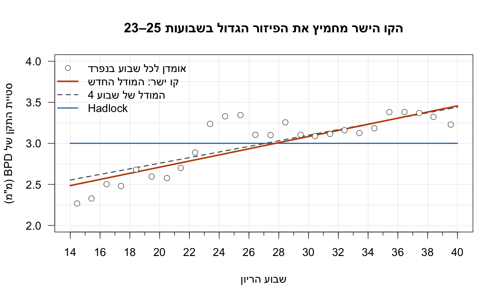
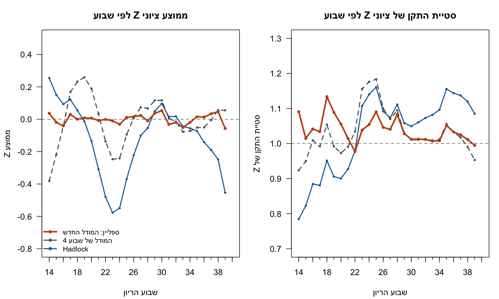
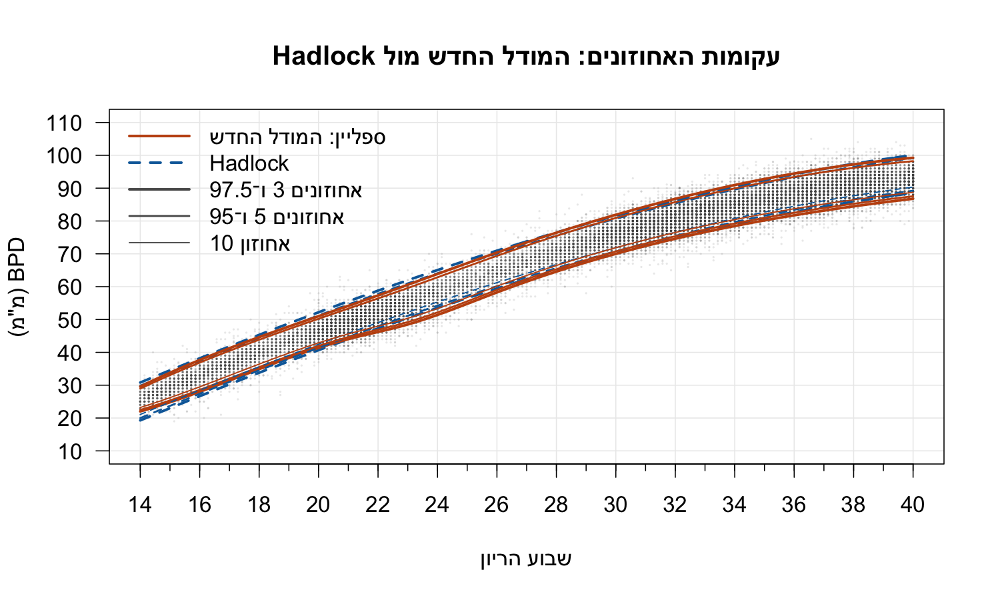
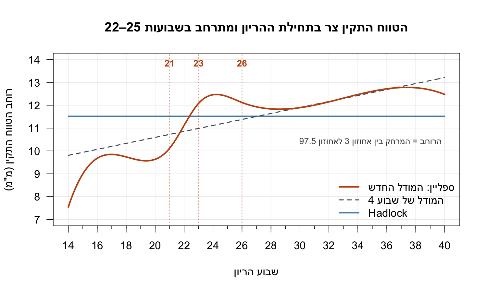
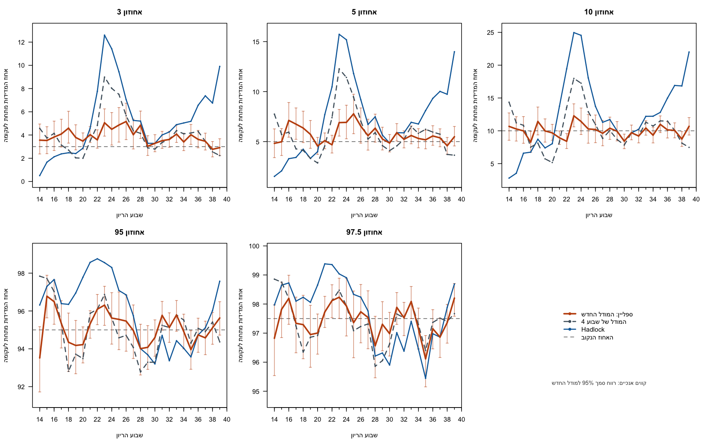

# שבוע 5 – עקומות גדילה ל-BPD ברגרסיה גמישה

מסמך חי: מוסיפים אליו החלטות ונימוקים בכל פעם שמסיימים שלב, כמו בשבועות 3 ו-4.

## 1. המשימה

**נוסח המטלה:**

> השלב הבא של הניתוח הוא התאמת מודל רגרסיה "גמישה" או לא פרמטרית.
> אם משתמשים בשיטה שנלמדה בכיתה (cubic splines), תנו את הדעת על מספר ומיקום ה-knots.
> ניתן גם להשתמש בשיטות אחרות כמו שיטת Loess או שיטת Kernel עליהן דיברנו מעט וניתן לקרוא יותר בספרות.
> יש להתאים מודל הן לתוחלת והן לסטיית התקן (כפי שנעשה בשבוע שעבר), לחשב את האחוזונים ולבדוק את טיב ההתאמה.
> תסבירו במצגת את ההחלטות שלכם – למה בחרתם בנקודות הספציפיות ל-knots, איזה מודלים שקלתם לעשות וכו.
> תקפידו לרשום במצגת בסופו של דבר את המודל הסופי איתו עבדתם.
> בגרפים בהם אתם מתארים את המודל תציגו גם את הגרף של השיטה בה משתמשים היום (אפשר גם להציג את המודל אותו התאמתם בשבוע שעבר).

**מהשיעור (11.11.2026, `lecture_2026-11-11_splines.pdf`, סעיף 13):** לבחור **אחת** מהשיטות (ספליינס, קרנל או LOESS), להתאים בה תוחלת וסטיית תקן, לחשב אחוזונים ולהשוות ל-Hadlock ול-Kurmanavicius. אם בוחרים ספליינס, להחליט כמה קשרים ואיפה ולנמק.

**"השיטה שבה משתמשים היום"** היא Hadlock. לפי קובץ ההקדמה (`Intro1.pdf`), אלה העקומות שבהן משתמשים בישראל.

## 2. רשימת הדרישות

כל שורה היא דרישה מהמטלה או מהשיעור, עם השלב שבו היא מטופלת. בסוף השבוע כל השורות צריכות להיות מסומנות.

| # | הדרישה | מקור | שלב | בוצע |
|---|---|---|---|---|
| 1 | מודל רגרסיה גמישה: ספליין קובי, LOESS או קרנל, שיטה אחת | מטלה, שיעור | 1 | ✓ (ספליין קובי, החלטה 1) |
| 2 | אם ספליין: החלטה על מספר ה-knots ועל מיקומם | מטלה, שיעור | 2, 3 | ✓ (החלטות 3, 4, 5ב, 5ג) |
| 3 | מודל לתוחלת | מטלה | 2 | ✓ |
| 4 | מודל לסטיית התקן, כמו בשבוע 4 | מטלה | 3 | ✓ (ספליין קובי, אותם קשרים כמו בתוחלת: 21, 23, 26. ראו החלטות 5–5ג) |
| 5 | חישוב האחוזונים | מטלה | 4 | ✓ |
| 6 | בדיקת טיב ההתאמה | מטלה | 3, 5 | ✓ |
| 7 | השוואה ל-Hadlock ול-Kurmanavicius | שיעור | 5 | ✓ |
| 8 | בגרפים שמתארים את המודל: גם עקומת Hadlock. המודל של שבוע 4 רשות | מטלה | 2, 3, 4 | ✓ |
| 9 | הסבר ההחלטות במצגת: למה ה-knots האלה, אילו מודלים נשקלו | מטלה | 6 | ✓ (שקפים 3-7) |
| 10 | המודל הסופי רשום במצגת | מטלה | 6 | ✓ (שקפים 5 ו-14. סטיית התקן לבדה גם בנספח, שקף 16) |

## 3. מה לא עושים השבוע

- **לא משתמשים בקובץ הבדיקה.** ההשוואה עליו היא שלב 6 בתוכנית הכללית של `Intro1.pdf`, והיא עוד לא התבקשה. גם הבחירה בין הקשרים נעשית על קובץ האימון בלבד.
- **לא מתאימים את כל שלוש השיטות עד הסוף.** בשיעור נאמר לבחור אחת. שיטות אחרות יכולות להופיע רק כ"חלופה שנשקלה", אם נחליט שזה נחוץ כדי לנמק את הבחירה (החלטה 1).
- **לא משנים את הנתונים:** אותו `train.csv` משבוע 3, בלי ניקוי נוסף.
- **לא מוסיפים שיטות שלא הוזכרו במטלה,** כמו רגרסיית קוונטילים או LMS. אם נראה שהנחת הנורמליות לא מחזיקה, מדווחים על כך ולא מחליפים שיטה.
- **אותם אחוזונים כמו בשבוע 4:** 3, 5, 10, 95 ו-97.5, אותם שבועות (14–40), ואותה הנחת נורמליות.

## 4. נקודת המוצא: מה ידוע משבוע 4

הפרטים ב-[README של שבוע 4](../week%204/README.md). בקצרה:

- **המודל של שבוע 4** (fractional polynomials): תוחלת `3.727 + 0.15329·w² − 0.002448·w³`, סטיית תקן `2.076 + 0.0341·w`. הוא משוחזר בסעיף 2 של הקוד כ-`fp_model`, עם אותם מקדמים.
- **בכלל קובץ האימון הוא מכויל היטב,** למשל 3.83% מהמדידות מתחת לאחוזון 3 (ב-Hadlock: 5.35%).
- **הבעיה שנשארה מקומית:** בשבועות 14–25 העקומה מתנדנדת סביב הנתונים. ממוצע השאריות הוא ‎−0.98 מ"מ בשבוע 14, ‎+0.71 בשבוע 19 ו-‎−0.71 בשבוע 23. בשבוע 23 נמצאות 17.98% מהמדידות מתחת לאחוזון 10, במקום 10%. גם הפיזור בשבועות 23–25 גדול ממה שהקו הישר של סטיית התקן מניח.
- **הכלים שכבר בנינו ונמשיך להשתמש בהם:** cross-validation לפי הריון (5 קבוצות, `seed = 2026`), קנס האחוזונים מההרצאה, ציוני Z, וכיסוי האחוזונים עם bootstrap לפי הריון.

השאלה המרכזית של השבוע נובעת מכאן: **האם שיטה גמישה מתקנת את הבעיה בשבועות 14–25, והאם השיפור מצדיק מודל מסובך יותר?**

## 5. מושגים

- **רגרסיה גמישה או לא פרמטרית:** במקום לקבוע מראש צורת נוסחה ולאמוד רק את המקדמים, נותנים לנתונים לקבוע את הצורה, ומאפשרים לעקומה להתנהג אחרת באזורים שונים של ההריון.
- **Knot (קשר):** נקודה על ציר השבועות שבה העקומה רשאית לשנות את צורתה. בין שני קשרים יש קטע, ובכל קטע פולינום משלו.
- **ספליין קובי:** בכל קטע פולינום מדרגה 3, והקטעים מחוברים בצורה חלקה (בלי קפיצה ובלי שבירה). זו עדיין רגרסיה ליניארית רגילה, עם משתנה נוסף `(w − t)³₊` לכל קשר `t`. המשתנה הזה שווה 0 לפני הקשר. מספר המקדמים: 4 ועוד מספר הקשרים.
- **ספליין קובי טבעי:** ספליין קובי שמחויב להיות קו ישר מחוץ לשתי נקודות קצה, כדי שלא "יברח" בקצוות. מספר המקדמים: 2 ועוד מספר הקשרים הפנימיים.
- **B-splines:** דרך חישובית אחרת לבנות את אותו ספליין, יציבה יותר. ב-R: `splines::bs()` ו-`splines::ns()`. המקדמים שלה לא נקראים כנוסחה פשוטה.
- **החלקת קרנל:** הערך בכל שבוע הוא ממוצע משוקלל של המדידות סביבו, כשמדידות קרובות מקבלות משקל גבוה יותר. **רוחב הפס (bandwidth)** קובע כמה רחוק מסתכלים.
- **LOESS:** כמו קרנל, אבל בכל חלון מתאימים רגרסיה קטנה במקום ממוצע. **span** הוא אחוז הנתונים שנכנס לכל חלון.
- **התאמת יתר:** עקומה גמישה מדי מתחילה לעקוב אחרי רעש אקראי שקיים רק במדגם. cross-validation לפי הריון בודק זאת, כי הוא בודק את העקומה על הריונות שהיא לא ראתה.

## 6. תוכנית העבודה

כל שלב מקביל לסעיף בקובץ [bpd_week5.R](bpd_week5.R). הפלטים נשמרים ב-`output/`, עם מספר הסעיף בתחילת שם הקובץ.

### שלב 0 – תשתית (סעיפים 0–2 בקוד) – בוצע

- הגדרות, `heb()`, `save_plot()`, `save_table()` והצבעים, כמו בשבוע 4.
- טעינת `train.csv` וחלוקה קבועה של ההריונות ל-5 קבוצות (`fold`), זהה לחלוקה של שבוע 4.
- המודלים להשוואה: `had_model`, `kur_model`, ו-`fp_model` (המודל של שבוע 4, מותאם מחדש מאותם נתונים, עם אותם מקדמים).
- הקובץ רץ מתיקיית השורש בלי שגיאות.

### שלב 1 – בחירת השיטה (סעיף 3 בקוד) – בוצע

- **מה החלטנו:** ספליין (החלטה 1), ספליין קובי רגיל (החלטה 1ב), בסיס ידני (החלטה 2).
- **מה בנינו:** מנוע אחד שמשמש גם לתוחלת וגם לסטיית התקן:

| כלי | מה הוא עושה |
|---|---|
| `fit_spline(y, x, knots, natural)` | מתאים ספליין קובי רגיל או טבעי עם הקשרים שנותנים לו. מחזיר את מספר המקדמים, את RSS, את הנוסחה בשבועות ואת `predict(w)` |
| `cv_predict_spline(y, x, knots, natural)` | תחזיות על הריונות מוסתרים, לפי אותן 5 קבוצות של שבוע 4 |
| `spline_formula(fit)` | הנוסחה כטקסט, למצגת. למשל: `a + b*w + ... + g*(w-24)^3+` |
| `spline_label(knots, natural)` | שם קצר למועמד, לטבלאות |

- **בדיקות** (`output/03_engine_checks.csv`, כולן עברו, והקוד נעצר אם אחת נכשלת):
  - ספליין רגיל בלי קשרים זהה לפולינום מדרגה 3 שמותאם ב-`lm`.
  - ספליין טבעי בלי קשרים זהה לקו ישר.
  - הנוסחה בשבועות נותנת בדיוק את העקומה המותאמת, גם בספליין הטבעי, שבו פותחים סוגריים.
  - ספליין טבעי ישר מחוץ לשבועות 14–40.
  - מספר המקדמים: 4 ועוד מספר הקשרים ברגיל, 2 ועוד מספר הקשרים בטבעי.
  - בבדיקות האלה משמשים הקשרים 20 ו-30 כדוגמה בלבד. זו לא הבחירה.
- **בדיקה חד-פעמית, לא בקובץ הקוד:** עם קשרים לדוגמה (18, 24, 32), העקומות של המנוע זהות לאלה של `splines::bs()` ו-`splines::ns()` עד הפרש של פחות מ-10⁻⁹ מ"מ.
- **פלטים:** `03_growth_by_week.csv` (קצב הגדילה, הנימוק להחלטה 1ב), `03_engine_checks.csv`.

#### החלטה 1 – איזו שיטה גמישה?

**השאלה:** המטלה מציעה שלוש שיטות: cubic splines, ‏LOESS וקרנל. צריך לבחור אחת, ולהתאים בה גם את התוחלת וגם את סטיית התקן.

**ההתלבטות:**

| שיטה | איך היא עובדת, בפשטות | מה בוחרים | יתרון | חיסרון אצלנו |
|---|---|---|---|---|
| **ספליין קובי** | רגרסיה ליניארית רגילה, עם פולינום מדרגה 3 בכל קטע בין קשרים, והקטעים מחוברים בצורה חלקה | מספר הקשרים ומיקומם | נותן נוסחה. גמיש מקומית. כל הכלים של רגרסיה רגילה עובדים עליו | צריך להחליט על הקשרים ולנמק. עלול להתנהג לא טוב בקצוות |
| **LOESS** | בכל שבוע מתאימים רגרסיה קטנה רק על המדידות הסמוכות | span (רוחב החלון), דרגה | גמיש מאוד, ומתנהג סביר בקצוות | אין נוסחה, רק טבלת ערכים. קשה לומר כמה הוא "מסובך" |
| **קרנל** | בכל שבוע ממוצע משוקלל של המדידות הסמוכות | רוחב פס, סוג קרנל | הכי פשוט לתכנת | אין נוסחה. בקצוות (שבוע 14, שבועות 39–40) הממוצע רואה מדידות רק מצד אחד, ולכן העקומה נמשכת פנימה |

**ההחלטה:** ספליין.

**למה:**
- **המודל הסופי הוא נוסחה.** כך אפשר לכתוב אותו במצגת, כפי שהמטלה דורשת, ולהכניס אותו למכשיר אולטרסאונד כמו את הנוסחאות של Hadlock ו-Kurmanavicius. LOESS וקרנל נותנים רק טבלת ערכים, ובכל שבוע צריך לחשב את העקומה מחדש מכל הנתונים.
- **הוא מטפל בדיוק בבעיה של שבוע 4.** הבעיה הייתה מקומית: גל בשבועות 14–25. בנוסחה של שבוע 4 כל הנתונים קובעים יחד את אותם מקדמים, ולכן אי אפשר לתקן אזור אחד בלי להשפיע על האחרים. בספליין העקומה בכל קטע נקבעת בעיקר מהמדידות של אותו קטע, ואפשר להציב קשרים בדיוק באזור הבעייתי.
- **זו עדיין רגרסיה ליניארית.** לכן כל מה שבנינו בשבוע 4 עובד עליו בלי שינוי: אותו cross-validation לפי הריון, אותה אמידה של סטיית התקן מ-`|שארית| · 1.25`, ואותו חישוב אחוזונים.
- **קל להשוות את המורכבות שלו לשבוע 4.** מספר המקדמים בספליין ידוע מראש: 4 ועוד מספר הקשרים בספליין קובי. לכן אפשר לשאול במונחים פשוטים אם השיפור מצדיק את המקדמים הנוספים, כמו ששאלנו בשבוע 4 על (2,3) מול (1,3). ב-LOESS ובקרנל המורכבות נקבעת ברוחב החלון, ואין לה ספירה פשוטה.
- **הבחירה בקשרים ניתנת להסבר.** אפשר למקם קשרים בשבועות שיש להם משמעות, ולהסביר לרופא איפה העקומה רשאית לשנות כיוון. ברוחב חלון של LOESS אין משמעות קלינית.

**המחיר:**
- **צריך להחליט כמה קשרים ואיפה,** וההחלטה הזו משפיעה על התוצאה. נבחר אותם בכלל שנקבע מראש (החלטה 3), ונבדוק אותם על הריונות מוסתרים.
- **הנוסחה ארוכה יותר** משל Hadlock: איבר נוסף לכל קשר, ולמקדמים אין פירוש פשוט כל אחד בנפרד. מה שמובן הוא העקומה כולה.
- **בקצוות ספליין קובי רגיל יכול "לברוח".** לכן נשארת פתוחה השאלה אם להשתמש בספליין קובי רגיל או בספליין טבעי (החלטה 1ב).

**הסבר קצר למצגת:**
> בחרנו ב-cubic spline. הבעיה של המודל משבוע 4 הייתה מקומית, גל בשבועות 14–25, וספליין מאפשר לעקומה לשנות צורה באזור אחד בלי להזיז את שאר ההריון. בניגוד ל-LOESS ולקרנל, התוצאה היא נוסחה, שאפשר לרשום ולהכניס למכשיר כמו את Hadlock. מספר המקדמים שלה ידוע, ולכן אפשר לבדוק ישירות אם השיפור מצדיק את המורכבות.

#### החלטה 1ב – ספליין קובי רגיל או טבעי?

**השאלה:** יש שני סוגים של ספליין קובי. הם נבדלים רק במה שקורה בקצוות, כלומר בתחילת ההריון ובסופו.

**ההתלבטות:**

| אפשרות | מה קורה בקצוות | יתרון | חיסרון |
|---|---|---|---|
| **ספליין קובי רגיל** | אחרי הקשר האחרון העקומה ממשיכה כפולינום מדרגה 3, בלי מגבלה | חופשי להתעקל גם בקצוות | עלול "לברוח" בקצוות, במיוחד כשחוזים מחוץ לטווח הנתונים או כשבקצה יש מעט נתונים |
| **ספליין קובי טבעי** | בנקודות הקצה (שבוע 14 ושבוע 40) העקומה חייבת להיות ישרה, כלומר קצב הגדילה לא משתנה שם | יציב בקצוות ומחוץ לטווח. חוסך 2 מקדמים | אם בקצה הנתונים באמת מתעקלים, האילוץ מטה את העקומה |

**מה בדקנו:** בכמה מ"מ גדל ה-BPD הממוצע בשבוע, בכל שלב של ההריון (`output/03_growth_by_week.csv`). החישוב: ההפרש בין הממוצעים של שבועות סמוכים, חלקי ההפרש בגיל הממוצע שלהם.

| שבוע | 15 | 17 | 19 | 30 | 35 | 37 | 38 | 39 |
|---|---|---|---|---|---|---|---|---|
| גדילה לשבוע (מ"מ) | 3.37 | 3.66 | 3.25 | 2.60 | 1.82 | 1.46 | 1.29 | 0.79 |

- **בתחילת ההריון** הגדילה יציבה יחסית: בין 3.25 ל-3.66 מ"מ בשבוע, בשבועות 15–19. העקומה כמעט ישרה שם, והאילוץ של ספליין טבעי לא מזיק.
- **בסוף ההריון** הגדילה מאטה בחדות: מ-1.82 מ"מ בשבוע 35 ל-0.79 בשבוע 39, כלומר יותר מחצי בתוך ארבעה שבועות. זו עקמומיות חזקה בדיוק בקצה, שם ספליין טבעי מחייב את העקומה להיות ישרה.

**תיקון:** בגרסה הראשונה חישבנו את ההפרש בין ממוצעי שבועות סמוכים בלי לחלק בהפרש הגילים. המרווח הזה אינו בדיוק שבוע. בשבוע 39 הוא 1.16 שבועות, כי שבוע 39 כולל את יום 280, ובשבוע 21 הוא 0.93 שבועות (עמודת `mean_age` בקובץ). המספרים בגרסה הראשונה היו לכן מעט מוטים, אבל המסקנה לא השתנתה.

**ההחלטה:** ספליין קובי רגיל. בשלב 2 נכניס את הספליין הטבעי, עם אותם קשרים, לטבלת המועמדים כחלופה שנשקלה, ו-cross-validation יראה אם הנימוק מחזיק.

**למה:**
- **האילוץ של ספליין טבעי סותר את מה שקורה בסוף ההריון.** קצב הגדילה של הראש יורד בחצי בשבועות האחרונים. עקומה שמוכרחת להיות ישרה בשבוע 40 עלולה לעבור מעל המדידות בשבועות האלה, ולהזיז את כל האחוזונים שם.
- **זה האזור שבו אסור לטעות.** הסריקות השגרתיות הן בסביבות שבוע 22, בשבוע 32 וממש לפני הלידה (`Intro1.pdf`). גם בנתונים שלנו, בכל שבוע מ-30 עד 39 יש יותר מ-2,000 מדידות.
- **הבעיה שספליין טבעי פותר לא קיימת אצלנו:**
  - **אין חיזוי מחוץ לטווח.** העקומות נדרשות לשבועות 14–40, והנתונים מכסים בדיוק את הטווח הזה. בשבוע 40 עצמו (יום 280) יש 418 מדידות.
  - **יש הרבה נתונים בשני הקצוות.** בשבוע 14 יש 787 מדידות, ובכל אחד מהשבועות האחרונים אלפים. הם מחזיקים את העקומה במקום ולא נותנים לה לברוח.
- **החיסכון של 2 מקדמים לא משמעותי** מול 43,741 מדידות.

**המחיר:** אם ספליין רגיל בכל זאת יתנהג לא טוב בקצוות, נגלה זאת רק בבדיקת המועמדים. לכן הספליין הטבעי נכנס להשוואה, ובגרף המודל צריך לבדוק במיוחד את שבועות 14–15 ו-37–40.

**הסבר קצר למצגת:**
> בחרנו ספליין קובי רגיל ולא טבעי. ספליין טבעי מכריח את העקומה להיות ישרה בקצוות, אבל בסוף ההריון גדילת הראש מאטה בחדות: מ-1.82 מ"מ בשבוע בשבוע 35 ל-0.79 בשבוע 39. היתרון שלו, יציבות מחוץ לטווח הנתונים, לא נדרש כאן, כי הנתונים מכסים את כל שבועות 14–40, ויש בקצוות מאות עד אלפי מדידות בכל שבוע. בדקנו גם ספליין טבעי כחלופה.

#### החלטה 2 – איך בונים את הספליין בקוד?

**השאלה:** ספליין הוא רגרסיה ליניארית עם עמודות מיוחדות. את העמודות האלה אפשר לבנות בשתי דרכים.

**ההתלבטות:**

| אפשרות | מה זה | יתרון | חיסרון |
|---|---|---|---|
| **בסיס ידני** | בונים בעצמנו את העמודות `w`, `w²`, `w³` ו-`(w − t)³₊` לכל קשר, ובספליין טבעי את `B_t(w)` לפי הנוסחה מהשיעור | כל מקדם שיוצא הוא חלק מהנוסחה. אפשר לרשום אותה במצגת ישירות | העמודות דומות מאוד זו לזו, וזה עלול להקשות על החישוב |
| **`splines::bs()` ו-`ns()`** | פונקציות מוכנות של R שבונות בסיס B-splines | יציב חישובית | המקדמים לא נקראים כנוסחה. כדי לרשום את המודל צריך לתרגם אותם |

**ההחלטה:** בסיס ידני.

**למה:**
- **המטלה דורשת לרשום את המודל הסופי.** בבסיס הידני הנוסחה היא פשוט המקדמים, בצורה שכל אחד יכול לחשב: חלק פולינומי כמו אצל Hadlock, ועוד איבר אחד לכל קשר, שמתחיל לפעול רק אחרי הקשר.
- **רואים בדיוק מה המודל עושה.** כל קשר מוסיף איבר אחד, ואפשר להסביר מה האיבר הזה עושה: מאותו שבוע והלאה העקומה רשאית לשנות כיוון.
- **הבעיה החישובית נפתרת בשתי דרכים:** מחלקים את השבוע ב-10 בזמן ההתאמה, כמו בשבוע 4, וההתאמה עצמה נעשית ב-`lm.fit`, שמחשב בצורה יציבה גם כשהעמודות דומות. הבדיקה מול `bs()` ו-`ns()` הראתה שהעקומות זהות.

**המחיר:** למקדמים בנפרד אין פירוש פשוט. מה שאפשר להסביר הוא העקומה כולה, וכמה איברים יש בה. בספליין טבעי הנוסחה ארוכה יותר, כי כשפותחים סוגריים נוספים איברים בשבועות 14 ו-40.

**הסבר קצר למצגת:**
> בנינו את הספליין בעצמנו, כרגרסיה ליניארית עם איבר `(w − t)³₊` לכל קשר. כך הנוסחה הסופית היא המקדמים עצמם: החלק הפולינומי כמו אצל Hadlock, ועוד איבר אחד שנכנס לפעולה אחרי כל קשר. בדקנו שהעקומות זהות לאלה של הפונקציות המוכנות ב-R.

### שלב 2 – מודל התוחלת (סעיף 4 בקוד) – בוצע

1. **מגדירים את המועמדים:** כמה קשרים ואיפה (החלטה 3). לכל מערך קשרים גם ספליין טבעי, כחלופה (החלטה 1ב).
2. **בוחרים לפי קריטריון** (החלטה 4), על הריונות מוסתרים.
3. **מתאימים את המודל הנבחר על כל קובץ האימון** וכותבים אותו כנוסחה.
4. **בודקים שאריות לפי שבוע** ומשווים לגל של שבוע 4.
5. **גרף:** המודל מעל ענן הנתונים, עם עקומת Hadlock ועם המודל של שבוע 4, אם נחליט להציג אותו (החלטה 6).

**פלטים:** `04_mean_candidates.csv`, `04_mean_stability.csv`, `04_mean_final_model.csv`, `04_mean_residuals_by_week.csv`, `04_mean_growth.csv`, `04_mean_fit.png`, `04_mean_residuals_by_week.png`, `04_mean_growth.png`.

#### שלוש עובדות מהנתונים שעליהן נשענות החלטות 3 ו-4

1. **מספר המדידות בכל שבוע נקבע לפי לוח הסריקות, לא לפי הביולוגיה.** 13% מהמדידות הן משבועות 14–19, ‏12.8% משבועות 23–28, ו-53.4% משבועות 30–39 (בדיקה חד-פעמית על `train.csv`, לא בקובץ הקוד). הסריקות השגרתיות הן בסביבות שבוע 22, בשבוע 32 ולפני הלידה (`Intro1.pdf`).
2. **הבעיה שרצינו לתקן נמצאת דווקא בשבועות הדלילים.** הגל של שבוע 4: העקומה גבוהה מדי ב-0.98 מ"מ בשבוע 14, נמוכה מדי ב-0.71 בשבוע 19, וגבוהה מדי ב-0.71 בשבוע 23.
3. **RMSE כמעט לא רואה את הגל.** בשבוע 4, מודל עם 8 חזקות כמעט העלים את הגל: ההטיה השבועית הגדולה ביותר ירדה מ-0.98 ל-0.22 מ"מ. ה-RMSE השתפר רק מ-3.157 ל-3.139. רוב ה-RMSE, כ-3 מ"מ, הוא הבדלים טבעיים בין עוברים, ששום מודל לא יקטין.

#### החלטה 3 – כמה קשרים ואיפה?

**השאלה:** ספליין מוגדר לפי הקשרים שלו. כמה קשרים לשים, ובאילו שבועות?

**ההתלבטות:** האפשרויות מהשיעור:

| אפשרות | איפה הקשרים יוצאים אצלנו | הערכה |
|---|---|---|
| AIC/BIC עם קשר בכל שבוע | הקריטריון בוחר | מניח שהמדידות בלתי תלויות, ואצלנו יש כ-2.5 מדידות להריון. עם 43,741 מדידות הוא ישאיר הרבה קשרים, כמו 256 המודלים בשבוע 4 |
| לפי אחוזונים של השבוע | עם 2 קשרים: 24, 33. עם 3: 22, 31, 35 | שמה קשרים איפה שיש הרבה סריקות, כלומר בסוף ההריון, ולא איפה שהעקומה מתכופפת |
| רוחבים שווים | עם 2 קשרים: 23, 31. עם 3: 21, 27, 34 | לא מתחשבת בנתונים |
| משמעות קלינית | 20 ו-30, או 22 ו-32 (הסריקות השגרתיות) | קל להסביר, אבל אין סיבה שהעקומה תתכופף דווקא שם |
| חיפוש ב-cross-validation | הנתונים קובעים | בודק ישירות על הריונות מוסתרים. המחיר: בודקים הרבה אפשרויות, וייתכן שהמנצחת תנצח במזל |

(המיקומים לפי אחוזונים ולפי רוחבים שווים מעוגלים לשבוע שלם. הם מחושבים בקוד, סעיף 4א.)

**ההחלטה (של הצוות):** חיפוש ב-cross-validation לפי הריון, עם גבולות שנקבעו מראש:
- **2 או 3 קשרים,** כדי שהנוסחה לא תהיה מורכבת מדי: 6 או 7 מקדמים.
- **קשרים בשבועות שלמים בלבד.**
- **בין שבוע 16 לשבוע 38.**
- **לפחות שבועיים בין קשרים סמוכים.**

סך הכול 1,561 מערכי קשרים: 231 עם 2 קשרים ו-1,330 עם 3.

**למה:**
- **הנתונים קובעים איפה העקומה מתכופפת,** ולא לוח הסריקות. קשרים לפי אחוזונים היו נופלים בעיקר בשבועות 30–39, שם העקומה של שבוע 4 כבר הייתה טובה.
- **2–3 קשרים:** מספיק כדי לתקן גל מקומי, ועדיין נוסחה שאפשר לרשום ולהסביר.
- **שבועות שלמים:** לרופא קל יותר להבין "משבוע 23" מאשר "משבוע 23.4".
- **שבועות 16–38:** קשר צמוד לקצה נשען על מעט נתונים מצד אחד שלו.
- **לפחות שבועיים בין קשרים:** שני קשרים בשבועות סמוכים מאפשרים לעקומה ליצור "גבשושית" לפי שבוע אחד של נתונים.
- **שיטות המיקום מהשיעור לא נזרקות:** הן חלק מ-1,561 האפשרויות, ומסומנות בטבלת המועמדים. כך רואים איפה דורגה כל אחת.

**המחיר:**
- **כשבודקים הרבה אפשרויות, המנצחת עלולה לנצח במזל.** לכן נקבע מראש כלל פשטות (החלטה 4), ונבדקה יציבות הבחירה.
- **אנחנו לא יודעים מי נבדקת בכל שבוע.** אין לנו את התיק הרפואי, ולכן אם הגל בשבועות 20–25 נובע מהאוכלוסייה שנבדקת ולא מגדילת העובר, העקומה תלמד אותו. הצוות קיבל את המגבלה הזו, וצריך לציין אותה במצגת.

#### החלטה 4 – לפי מה בוחרים בין המועמדים?

**השאלה:** לכל מערך קשרים יש תחזיות על הריונות מוסתרים. איך מסכמים אותן לציון אחד, ואיך בוחרים?

**ההתלבטות:**

| אפשרות | מה היא מודדת | הערכה |
|---|---|---|
| RMSE ב-cross-validation (כמו בשבוע 4) | השגיאה הממוצעת לכל מדידה | עקבית עם שבוע 4. אבל רובה הבדלים טבעיים בין עוברים, והשבועות העמוסים שולטים בה (עובדה 3) |
| **ההטיה השבועית ב-cross-validation** | ממוצע השאריות בכל שבוע, על הריונות מוסתרים, ואז שורש ממוצע הריבועים על פני השבועות. כל שבוע מקבל אותו משקל | מודדת בדיוק את מה שהמודל יכול לשנות. זה סיכום במספר אחד של גרף השאריות לפי שבוע משבוע 4 |
| קנס האחוזונים | מודד את המטרה עצמה | דורש גם מודל לסטיית התקן. נשמר לשלב 3, כמו בשבוע 4 |
| AIC/BIC | | מניחים שהמדידות בלתי תלויות |

**ההחלטה:** ההטיה השבועית על הריונות מוסתרים, עם כלל פשטות שנקבע מראש. RMSE מדווח לצדה.

**כלל הפשטות (one-standard-error rule):** בוחרים את המודל עם **הכי מעט קשרים** שהציון שלו לא גבוה מהציון הטוב ביותר ועוד טעות תקן אחת. את טעות התקן מחשבים מההבדלים בין 5 הקבוצות. בין מודלים עם אותו מספר קשרים, בוחרים את הציון הנמוך ביותר.

**למה:**
- **היא פשוטה להסבר כמו RMSE, ורואה את מה ש-RMSE מחמיץ:** "בכל שבוע, עד כמה העקומה רחוקה מהממוצע של המדידות". ב-RMSE כל 1,561 המועמדים נמצאים בטווח צר, בין 3.138 ל-3.155 מ"מ. בהטיה השבועית ההבדלים בין המועמדים גדולים פי כמה, ולכן רואים אותם.
- **משקל שווה לכל שבוע:** כל אישה נבדקת מול העקומה של השבוע שלה. העקומה בשבוע 25 צריכה להיות מדויקת כמו העקומה בשבוע 32, גם אם במדגם נסרקו בשבוע 25 פחות נשים. גם קנס האחוזונים של שבוע 4 חושב כממוצע על פני השבועות.
- **הכלל נקבע לפני שראינו תוצאות.** בבחירת סטיית התקן של שבוע 4 החלטנו ש"פער של 2% הוא קטן" רק אחרי שראינו את המספרים, וזה נרשם כמחיר. כאן הכלל מוגדר מראש, והוא מעדיף את המודל הפשוט: 3 קשרים נבחרים רק אם הם טובים מ-2 קשרים בבירור. זה כלל מקובל בספרות (Hastie, Tibshirani & Friedman, *The Elements of Statistical Learning*).

**המחיר:**
- **מנקודת המבט של העומס על המערכת** (`Intro1.pdf`: יותר מדי אזעקות שווא), טעות בשבוע עמוס פוגעת ביותר נשים. RMSE משקף את נקודת המבט הזו, ולכן הוא מוצג לצדה.
- **הציון לא יכול להגיע ל-0,** כי גם הממוצע של המדידות בכל שבוע משתנה מעט באקראי.
- **טעות התקן מ-5 קבוצות היא אומדן גס.**

#### תוצאות החיפוש (`output/04_mean_candidates.csv`)

| מודל | מקדמים | הטיה שבועית (מ"מ) | ההטיה הגדולה ביותר בשבוע אחד (מ"מ) | RMSE (מ"מ) | דירוג מתוך 1,561 |
|---|---|---|---|---|---|
| **קשרים 21, 23, 26 – נבחר** | 7 | **0.090** | 0.186 | 3.138 | 1 |
| קשרים 20, 23, 26 | 7 | 0.091 | 0.175 | 3.138 | 2 |
| הטוב ביותר עם 2 קשרים: 25, 27 | 6 | 0.173 | 0.350 | 3.141 | 154 |
| אחוזונים, 3 קשרים: 22, 31, 35 | 7 | 0.208 | 0.427 | 3.142 | 356 |
| רוחבים שווים, 2 קשרים: 23, 31 | 6 | 0.217 | 0.410 | 3.143 | 412 |
| קליני, הסריקות השגרתיות: 22, 32 | 6 | 0.236 | 0.473 | 3.144 | 531 |
| אחוזונים, 2 קשרים: 24, 33 | 6 | 0.260 | 0.513 | 3.146 | 721 |
| רוחבים שווים, 3 קשרים: 21, 27, 34 | 7 | 0.262 | 0.574 | 3.145 | 740 |
| קליני: 20, 30 | 6 | 0.275 | 0.595 | 3.146 | 841 |
| ייחוס: ספליין בלי קשרים (פולינום מדרגה 3) | 4 | 0.387 | 0.852 | 3.155 | – |
| ייחוס: המודל של שבוע 4, FP (2,3) | 3 | 0.416 | 0.979 | 3.157 | – |

**מה רואים:**
- **הבחירה לפי הכלל:** הציון הטוב ביותר הוא 0.0896, עם טעות תקן של 0.0078, ולכן הסף הוא 0.0974. אף מודל עם 2 קשרים לא עובר את הסף (הטוב שבהם: 0.173), ולכן נבחר הטוב ביותר עם 3 קשרים: **21, 23, 26**.
- **שני הקריטריונים מסכימים:** גם לפי RMSE המודל 21, 23, 26 הוא הראשון. כלומר, הבחירה לא תלויה בקריטריון.
- **השיפור לעומת שבוע 4 גדול.** ההטיה השבועית קטנה פי 4.6, מ-0.416 ל-0.090 מ"מ. ההטיה הגדולה ביותר בשבוע אחד ירדה מ-0.98 ל-0.19 מ"מ.
- **שלושת הקשרים מרוכזים בשבועות 21–26,** בדיוק סביב הגל של שבוע 4.
- **שיטות המיקום מהשיעור דורגו נמוך** (מקום 356 ומטה). הסיבה: אף אחת מהן לא שמה קשרים צפופים בשבועות 21–26.

**הספליין הטבעי (החלטה 1ב):** הטוב ביותר מבין הספליינים הטבעיים, עם קשרים 21, 23, 28, מגיע להטיה של 0.167, כמעט פי 2 מהספליין הרגיל. זה מאשר את ההחלטה לבחור בספליין רגיל.

**יציבות (`output/04_mean_stability.csv`):** החיפוש חזר על 20 המועמדים המובילים עם 5 חלוקות אקראיות אחרות של ההריונות. **בכל חמש החלוקות נבחר אותו מודל, 21, 23, 26,** והציון שלו נע בין 0.0897 ל-0.0899. כלומר, הבחירה לא נובעת ממזל של חלוקה מסוימת.

#### המודל הסופי לתוחלת (`output/04_mean_final_model.csv`)

> תוחלת BPD במ"מ = 11.438 − 3.1952·w + 0.42867·w² − 0.0091125·w³ + 0.070735·(w−21)³₊ − 0.097427·(w−23)³₊ + 0.036470·(w−26)³₊

**כמה ספרות לרשום:** המקדמים מוכפלים במספרים גדולים (`w³` מגיע ל-64,000), ולכן העיגול משנה את העקומה. בבדיקה חד-פעמית: עם 4 ספרות משמעותיות הנוסחה המעוגלת סוטה מהעקומה בעד 0.05 מ"מ, ועם 5 ספרות בעד 0.008 מ"מ. לכן הנוסחה נרשמת עם 5 ספרות משמעותיות, גם במצגת. המקדמים המלאים נמצאים בקובץ.

`w` הוא שבוע ההריון עם שברים. `(w−t)³₊` שווה `(w−t)³` אחרי שבוע `t`, ו-0 לפניו. עד שבוע 21 זה פולינום רגיל מדרגה 3, ובכל קשר נכנס לפעולה איבר נוסף שמשנה את צורת העקומה מאותו שבוע והלאה. העקומה עולה בכל טווח השבועות 14–40 (נבדק בקוד).

#### שאריות לפי שבוע (`output/04_mean_residuals_by_week.csv`)

| שבוע | 14 | 17 | 19 | 23 | 24 | 30 | 33 | 39 |
|---|---|---|---|---|---|---|---|---|
| שבוע 5 (מ"מ) | +0.09 | +0.07 | +0.02 | ‎−0.03 | ‎−0.10 | +0.16 | ‎−0.16 | ‎−0.19 |
| שבוע 4 (מ"מ) | ‎−0.98 | +0.45 | +0.71 | ‎−0.71 | ‎−0.70 | +0.36 | ‎−0.25 | +0.19 |

הגל של שבועות 14–25 נעלם. השארית הגדולה ביותר היא עכשיו בשבוע 39: העקומה גבוהה מדי ב-0.19 מ"מ. שבוע 39 כולל גם את יום 280.

#### ממצא: קצב הגדילה של העקומה (`output/04_mean_growth.csv`)

הגדילה לשבוע, מחושבת כמו בהחלטה 1ב, בנתונים ולפי כל עקומה:

| שבוע | 17 | 19 | 21 | 22 | 23 | 25 | 27 | 30 | 35 |
|---|---|---|---|---|---|---|---|---|---|
| בנתונים (מ"מ בשבוע) | 3.66 | 3.25 | 2.73 | 2.69 | 2.85 | 3.49 | 3.13 | 2.60 | 1.82 |
| העקומה שנבחרה | 3.48 | 3.23 | 2.77 | 2.66 | 2.87 | 3.37 | 3.11 | 2.55 | 1.70 |
| המודל של שבוע 4 | 3.08 | 3.17 | 3.20 | 3.19 | 3.17 | 3.08 | 2.93 | 2.59 | 1.75 |
| Hadlock | 3.58 | 3.44 | 3.30 | 3.22 | 3.14 | 2.96 | 2.77 | 2.46 | 1.87 |

**מה רואים:**
- **לפי העקומה החדשה, ראש העובר גדל בשבועות 21–22 לאט יותר** (כ-2.7 מ"מ בשבוע) מאשר בשבוע 25 (כ-3.4 מ"מ בשבוע). אחר כך הקצב יורד בהדרגה עד סוף ההריון.
- **זה בדיוק מה שקורה בנתונים, אבל ביולוגית קשה להסביר את זה.** ב-Hadlock, למשל, הקצב יורד בהדרגה לאורך כל ההריון. סביר יותר שזה קשור למי שנבדקת בשבועות האלה: בשבועות 20–22, סביב סריקת המערכות, יש הכי הרבה מדידות.
- **זו תכונה של הנתונים, לא תוצאה של בחירת 3 קשרים.** גם המודל הטוב ביותר עם 2 קשרים (25, 27) מראה האטה ואז האצה, אם כי חלשה יותר: 2.92 מ"מ בשבוע בשבועות 21–22, ו-3.26 בשבוע 26 (בדיקה חד-פעמית, לא בקובץ הקוד).
- **המודל של שבוע 4 לא יכול להראות את זה.** לכן הוא החמיץ את הנתונים בשבועות 14–25.

**ההחלטה (של הצוות):** מקבלים את הקשרים 21, 23, 26, שנבחרו בכלל שנקבע מראש.

**למה:**
- **זו בחירת הכלל,** והיא יציבה בכל החלוקות.
- **מודל בלי ההאטה מחייב להוסיף אילוץ על צורת קצב הגדילה.** זה מעבר למה שהמטלה ביקשה, והוא היה פוגע בהתאמה לנתונים בשבועות 20–25.
- **אין לנו דרך לדעת מי נבדקת בכל שבוע,** כי אין לנו את התיק הרפואי.

**המחיר:** העקומה משקפת את האוכלוסייה שנבדקה בכל שבוע, וייתכן שבשבועות 21–25 זו לא האוכלוסייה הכללית. במצגת מציגים את זה כמגבלה.

#### החלטה 6 – להציג את המודל של שבוע 4 בגרפים?

**השאלה:** המטלה מחייבת להציג את Hadlock בכל גרף שמתאר את המודל, ומאפשרת (רשות) להציג גם את המודל של שבוע 4.

**ההחלטה (של הצוות):** כן, בגרפים של התוחלת ושל סטיית התקן, באפור-כחלחל (`COL_ALT`), בקו מקווקו. בגרף האחוזונים יופיעו רק המודל החדש ו-Hadlock.

**למה:** בגרפים של התוחלת רואים במבט אחד שהגל של שבוע 4 נעלם. בגרף האחוזונים כבר יש 10 עקומות, ועוד 5 היו הופכים אותו לבלתי קריא.

#### הגרפים

בכל הגרפים: המודל החדש בכתום, Hadlock בכחול, המודל של שבוע 4 באפור-כחלחל מקווקו. הקשרים מסומנים בקווים אנכיים מנוקדים.

בגרף הזה שלוש העקומות כמעט חופפות, כי ההבדלים ביניהן הם פחות מ-2 מ"מ, על ציר של 100 מ"מ. את ההבדלים רואים בגרף השאריות:

- **המודל של שבוע 4:** הגל בשבועות 14–25.
- **Hadlock:** גבוה מדי ב-1.73 מ"מ בשבוע 23, וגבוה מדי ב-1.36 מ"מ בשבוע 39 (עמודת `mean_resid_hadlock`).
- **המודל החדש:** קרוב ל-0 בכל השבועות.

#### הסבר קצר למצגת

> בחרנו את הקשרים ב-cross-validation לפי הריון. בדקנו 1,561 אפשרויות של 2 או 3 קשרים, בשבועות שלמים, עם לפחות שבועיים ביניהם. קריטריון הבחירה: עד כמה העקומה רחוקה מהממוצע של המדידות בכל שבוע, על הריונות שהמודל לא ראה, כשכל שבוע מקבל אותו משקל. קבענו מראש שנבחר 3 קשרים רק אם הם טובים מ-2 בבירור. נבחרו הקשרים 21, 23 ו-26, ואותה בחירה התקבלה בחמש חלוקות אקראיות נוספות. ההטיה השבועית קטנה פי 4.6 לעומת המודל של שבוע 4. מגבלה: העקומה עוקבת אחרי האטה בגדילה בשבועות 21–22 שקיימת בנתונים. ייתכן שהיא נובעת ממי שנבדקת סביב סריקת המערכות, ואין לנו את התיק הרפואי כדי לבדוק זאת.

### שלב 3 – מודל סטיית התקן (סעיף 5 בקוד) – בוצע

1. **אומדים סטיית תקן** מ-`|שארית| · 1.25`, כמו בשבוע 4. השאריות הן של מודל התוחלת החדש.
2. **הצורה: ספליין קובי רגיל,** באותו מנוע כמו התוחלת (החלטה 5).
3. **מגדירים מועמדים:** כמה קשרים ואיפה (החלטה 5ב).
4. **משווים לפי קנס האחוזונים** על הריונות מוסתרים (החלטה 5א), ומחשבים את כלל טעות התקן האחת כמו בתוחלת. הבחירה הסופית: אותם קשרים כמו בתוחלת, בגלל פשטות (החלטה 5ג).
5. **בודקים יציבות** בחמש חלוקות אקראיות נוספות, כמו בתוחלת.
6. **מתאימים את המודל הנבחר** על כל קובץ האימון, וכותבים אותו כנוסחה.
7. **בודקים ציוני Z לפי שבוע:** ממוצע קרוב ל-0, סטיית תקן קרובה ל-1, וכ-90% מהציונים בטווח המרכזי. כך בדקנו בשבוע 4, והאחוזונים נשענים על זה.
8. **גרף:** סטיית התקן לפי שבוע, עם Hadlock (קבועה, 3 מ"מ) ועם המודל של שבוע 4.
9. **מרכיבים** את `new_model`: תוחלת מהספליין של שלב 2, וסטיית תקן מהספליין של השלב הזה.

**פלטים:** `05_sd_candidates.csv`, `05_sd_stability.csv`, `05_sd_final_model.csv`, `05_z_summary.csv`, `05_z_by_week.csv`, `05_sd_fit.png`, `05_z_by_week.png`.

#### החלטה 5 – קו ישר או ספליין לסטיית התקן?

**השאלה:** את התוחלת התאמנו בספליין גמיש. האם גם סטיית התקן צריכה להיות גמישה?

**ההתלבטות:**

| אפשרות | הערכה |
|---|---|
| **קו ישר, כמו בשבוע 4** | הכי פשוט: שני מספרים, באותה צורה כמו אצל Kurmanavicius. אבל בשבוע 4 הוא החמיץ את הפיזור הגדול בשבועות 23–25 |
| **ספליין, באותו מנוע כמו התוחלת** | גמיש מקומית, כמו התוחלת. נוסחה ארוכה יותר: 4 מקדמים ועוד אחד לכל קשר |

**הגרסה הראשונה (commit ‏266f2db):** בחרנו בקו ישר, בשביל פשטות. בדיקת ציוני Z הראתה שהוא לא מספיק:
- **בשבועות 23–25 הפיזור האמיתי גדול מהקו בכ-20%.** סטיית התקן של ציוני Z שם הייתה 1.17–1.20, ובשבועות 26–28 עדיין כ-1.10. לכן העקומות שם צרות מדי. בשבוע 23 רק 84.9% מהציונים היו בטווח המרכזי, במקום 90%.
- **בקצוות זה הפוך.** בשבועות 14–15 ו-39 סטיית התקן של Z הייתה 0.94–0.97, כלומר העקומות שם רחבות מדי.
- **התיקון בתוחלת לא פתר את הבעיה.** בשבוע 4 סטיית התקן של Z בשבועות 23–25 הייתה 1.16–1.18. אחרי שהתוחלת כבר מדויקת שם, היא 1.17–1.20. כלומר, זו תכונה של הפיזור עצמו, ולא תוצאה של תוחלת שגויה.
- **המטלה מבקשת מודל גמיש "הן לתוחלת והן לסטיית התקן".**

**ההחלטה (של הצוות):** ספליין קובי רגיל, באותו מנוע כמו התוחלת. הקו הישר לא נזרק: הוא מופיע בטבלת המועמדים כנקודת ייחוס.

**למה:**
- **זו דרישת המטלה,** ובשיעור נאמר להתאים בשיטה שנבחרה גם את התוחלת וגם את סטיית התקן.
- **הבעיה מקומית,** בשבועות 23–28 ובקצוות, וזה בדיוק המקרה שבו ספליין עדיף על נוסחה אחת לכל הטווח (החלטה 1).
- **אותו מנוע ואותם כלים כמו בתוחלת:** אותו בסיס, אותה כתיבה כנוסחה, ואותו כלל בחירה. אין עוד שיטה להסביר.
- **ההמלצה של Royston & Wright** לפשטות בסטיית התקן נשמרת דרך הכלל: גם מודלים עם 0 או 1 קשרים הם מועמדים, ואם הם מספיק טובים, הכלל יבחר בהם (החלטה 5ב).

**המחיר:** נוסחה של 7 מקדמים במקום 2.

#### החלטה 5א – לפי מה בוחרים בין המועמדים?

**השאלה:** בתוחלת בחרנו לפי ההטיה השבועית. מה הקריטריון המתאים לסטיית התקן?

**ההתלבטות:**

| אפשרות | מה היא מודדת | הערכה |
|---|---|---|
| **קנס האחוזונים, כמו בשבוע 4** | בכל שבוע ובכל אחד מ-5 האחוזונים: כמה רחוק אחוז המדידות מתחת לעקומה מהאחוז הנקוב, מחולק ב-`sqrt(p(1−p))`. ממוצע על השבועות ועל האחוזונים | מודד ישירות את המטרה, את האחוזונים. עקבי עם שבוע 4 |
| מקבילה ל"הטיה השבועית": כמה סטיית התקן של Z רחוקה מ-1 בכל שבוע | האם הפיזור נכון בכל שבוע | פשוט, אבל עקיף. בודק את הפיזור, לא את האחוזונים עצמם |
| RMSE של `|שארית|` | השגיאה בחיזוי `|שארית|` | כמו RMSE בתוחלת: רובו רעש טבעי בין עוברים, והוא כמעט לא מבחין בין המודלים |

**ההחלטה (של הצוות):** קנס האחוזונים, על הריונות מוסתרים, בדיוק כמו בשבוע 4.

**איך מחשבים:** בכל אחד מ-5 הסיבובים של ה-cross-validation מתאימים מחדש על 4 קבוצות **גם את התוחלת** (ספליין עם הקשרים 21, 23, 26) **וגם את סטיית התקן,** ובודקים על הקבוצה החמישית כמה מדידות נמצאות מתחת לכל עקומה. אלה אותן 5 קבוצות של הריונות כמו בשבוע 4 ובתוחלת.

**למה:**
- **סטיית התקן קיימת כדי לחשב אחוזונים.** הקנס מודד בדיוק את זה: האם 3% מהמדידות באמת מתחת לאחוזון 3, בכל שבוע.
- **עקבי עם שבוע 4,** ולכן אפשר להשוות ישירות: המודל של שבוע 4 נבדק כאן באותו קנס ובאותן קבוצות (שורת ייחוס בטבלה).
- **כל שבוע מקבל אותו משקל,** כמו בהטיה השבועית של התוחלת (החלטה 4), ומאותה סיבה: כל אישה נבדקת מול העקומה של השבוע שלה.
- **החלוקה ב-`sqrt(p(1−p))`** נותנת משקל הוגן לאחוזונים הקיצוניים. ב-3% סטייה של נקודת אחוז אחת חמורה יותר מאשר ב-10%.
- **התוחלת מותאמת מחדש בכל סיבוב,** כדי שגם השאריות שעליהן נבנית סטיית התקן יהיו של מודל שלא ראה את ההריונות הנבדקים.

**המחיר:** הקנס תלוי גם בתוחלת. התוחלת קבועה לכל המועמדים, ולכן ההשוואה ביניהם הוגנת, אבל הקנס לא מבודד את סטיית התקן לגמרי.

#### החלטה 5ב – אילו מועמדים?

**השאלה:** כמה קשרים ואיפה, ואיזה סוג ספליין?

**ההחלטה (של הצוות):**
- **אותם גבולות כמו בתוחלת:** קשרים בשבועות שלמים בין 16 ל-38, ולפחות שבועיים בין קשרים סמוכים.
- **אבל מ-0 עד 3 קשרים,** ולא רק 2–3 כמו בתוחלת.
- **ספליין קובי רגיל, כמו בתוחלת.** הספליין הטבעי, עם 1–3 קשרים, נבדק כחלופה, והכלל בוחר רק מבין הספליינים הרגילים. זה אותו מבנה כמו בחיפוש של התוחלת.
- **נקודות ייחוס, לא מועמדות:** הקו הישר (ספליין טבעי בלי קשרים) עם התוחלת החדשה, המודל של שבוע 4 כולו, ו-Hadlock.

סך הכול 1,585 ספליינים רגילים (כולל 0 קשרים, שהוא פולינום מדרגה 3) ו-1,584 ספליינים טבעיים.

**למה:**
- **0 ו-1 קשרים:** כדי שהכלל יוכל לבחור מודל פשוט אם הוא מספיק טוב. כך ההחלטה אם צריך גמישות נקבעת בנתונים, ולא מראש.
- **אותם גבולות כמו בתוחלת:** אותם נימוקים (החלטה 3). קשר צמוד לקצה נשען על מעט נתונים, ושני קשרים בשבועות סמוכים יוצרים "גבשושית" לפי שבוע אחד.
- **ספליין רגיל ולא טבעי, כמו בתוחלת:**
  - **עקביות:** אותו סוג מודל לתוחלת ולסטיית התקן.
  - **מהנתונים:** סטיית התקן יורדת בשבועות 38–40 (בעקומה הסופית: מ-3.33 מ"מ בשבוע 37 ל-3.25 בשבוע 40). ספליין טבעי מוכרח להיות ישר בקצה, ולא יכול לעקוב אחרי זה.
  - **בתוצאות:** הספליין הטבעי הטוב ביותר (31, 34, 36) מגיע לקנס 0.0374, גבוה מהסף של הכלל (0.0357).

**המחיר:** ספליין רגיל עלול "לברוח" בקצוות. כאן זה קורה בשבוע 14 (ראו "מה נשאר").

#### החלטה 5ג – אילו קשרים, ולמה

**השאלה:** אחרי החיפוש: אילו קשרים לוקחים לסטיית התקן?

**כלל הבחירה (כמו בתוחלת, החלטה 4):** בוחרים את המודל עם **הכי מעט קשרים** שהקנס שלו לא גבוה מהקנס הטוב ביותר ועוד טעות תקן אחת. את טעות התקן מחשבים מההבדלים בין 5 הקבוצות. בין מודלים עם אותו מספר קשרים, בוחרים את הקנס הנמוך ביותר.

**תוצאות החיפוש (`output/05_sd_candidates.csv`):** קנס נמוך יותר = אחוזונים מדויקים יותר.

| מודל לסטיית התקן | מקדמים | קנס האחוזונים | דירוג מתוך 1,585 |
|---|---|---|---|
| **ספליין, אותם קשרים כמו בתוחלת: 21, 23, 26 – נבחר** | 7 | **0.0359** | 91 |
| ספליין, הטוב ביותר ובחירת הכלל: 21, 23, 30 | 7 | 0.0339 | 1 |
| הטוב ביותר עם 2 קשרים: 27, 30 | 6 | 0.0376 | 310 |
| הטוב ביותר עם קשר אחד: 36 | 5 | 0.0397 | 1,161 |
| ספליין בלי קשרים (פולינום מדרגה 3) | 4 | 0.0399 | 1,296 |
| חלופה: הספליין הטבעי הטוב ביותר, 31, 34, 36 | 5 | 0.0374 | – |
| ייחוס: קו ישר, עם התוחלת החדשה | 2 | 0.0443 | – |
| ייחוס: המודל של שבוע 4 כולו | 2 | 0.0650 | – |
| ייחוס: Hadlock | 1 | 0.1255 | – |

**מה רואים:**
- **מה הכלל בוחר:** הקנס הטוב ביותר הוא 0.0339, עם טעות תקן של 0.0018, ולכן הסף הוא 0.0357. 71 מודלים עוברים את הסף, וכולם עם 3 קשרים. אף מודל עם 0, 1 או 2 קשרים לא עובר אותו. לכן הכלל בוחר את הטוב ביותר עם 3 קשרים: 21, 23, 30.
- **גמישות נחוצה בבירור.** גם הקשרים שנבחרו (21, 23, 26) נותנים קנס נמוך ב-19% מזה של הקו הישר (0.0359 מול 0.0443). הקנס של המודל של שבוע 4 גבוה ב-81% (0.0650), וזה של Hadlock גבוה פי 3.5.
- **שני הקשרים הראשונים, 21 ו-23, מופיעים גם בבחירת הכלל.** שם הפיזור עולה בחדות. ההבדל הוא רק בקשר השלישי: 26 או 30.

**ההתלבטות:**

| אפשרות | יתרון | חיסרון |
|---|---|---|
| **מה שהכלל בוחר: 21, 23, 30** | הקנס הנמוך ביותר. נאמנים לכלל שנקבע מראש | שני מערכי קשרים שונים בתוחלת ובסטיית התקן, וקשה לנמק למה דווקא 30. בחלוקות אחרות של הנתונים הכלל בוחר בכל פעם מיקום אחר (טבלת היציבות) |
| **אותם קשרים כמו בתוחלת: 21, 23, 26** | מערך קשרים אחד לכל המודל. הסבר אחד: "בשבועות 21, 23 ו-26 העקומות, של הממוצע ושל הפיזור, רשאיות לשנות צורה" | הקנס גבוה ב-6% (0.0359 מול 0.0339), וחורג מהסף בחלוקה הראשית ב-0.0002 |

**ההחלטה (של הצוות):** אותם קשרים כמו בתוחלת, **21, 23, 26.**

**למה:**
- **המודל צריך להיות גם פשוט וקל להסבר, לא רק מדויק.** מערך קשרים אחד חוסך שאלה שאין לה תשובה טובה ("למה 30 בסטיית התקן ו-26 בתוחלת?"). את המודל כולו אפשר לתאר כ"פולינום עד שבוע 21, ושלוש נקודות שבהן העקומות רשאיות לשנות צורה".
- **ההבדל בדיוק בתוך הרעש:**
  - **ביציבות:** בכל חמש החלוקות האחרות, 21, 23, 26 נמצא מתחת לסף (טבלת היציבות למטה). רק בחלוקה הראשית הוא חורג, ב-0.0002.
  - **בציוני Z לפי שבוע:** שני המודלים כמעט זהים. בשניהם רק שבוע אחד (18) רחוק מ-1 ביותר מ-0.1. בשבועות 23–25 סטיית התקן של Z היא 1.04–1.09, ובבחירת הכלל 1.05–1.06 (טבלת ציוני Z למטה).
- **הנתונים לא מבחינים בין המיקומים של הקשר השלישי.** בחלוקות השונות הכלל בחר את הקשר השלישי בשבועות 28–31, ואת הקשרים 21, 23, 30 הוא בחר רק בחלוקה הראשית. לכן גם 30 הוא לא תשובה "נכונה" יותר מ-26.

**המחיר:**
- **ההחלטה התקבלה אחרי שראינו את התוצאות,** וחורגת מהכלל שנקבע מראש בחלוקה הראשית. זו אותה בעיה שרשמנו כמחיר בבחירת סטיית התקן של שבוע 4. לכן היא נרשמת כאן במפורש, עם הנימוק (פשטות) ועם המספרים שמראים שההבדל קטן. בחירת הכלל מוצגת לצדה בכל הטבלאות.
- **הקנס גבוה ב-6%** מהטוב ביותר.

**יציבות (`output/05_sd_stability.csv`):** החיפוש חזר על 20 המועמדים המובילים, ועל 21, 23, 26, עם 5 חלוקות אקראיות אחרות של ההריונות. בכל חלוקה גם התוחלת הותאמה מחדש בכל סיבוב.

| חלוקה | מה הכלל בחר | הקנס הטוב ביותר | הסף | הקנס של 21, 23, 26 | 21, 23, 26 מתחת לסף? | הקנס של 21, 23, 30 | 21, 23, 30 מתחת לסף? |
|---|---|---|---|---|---|---|---|
| 2027 | 20, 24, 30 | 0.0343 | 0.0367 | 0.0351 | כן | 0.0344 | כן |
| 2028 | 21, 23, 31 | 0.0340 | 0.0360 | 0.0350 | כן | 0.0343 | כן |
| 2029 | 21, 24, 28 | 0.0343 | 0.0360 | 0.0353 | כן | 0.0346 | כן |
| 2030 | 21, 23, 31 | 0.0336 | 0.0357 | 0.0353 | כן | 0.0344 | כן |
| 2031 | 22, 24, 29 | 0.0341 | 0.0365 | 0.0351 | כן | 0.0342 | כן |

- **בניגוד לתוחלת, המיקום המדויק לא יציב.** בכל חלוקה הכלל בחר מערך קשרים מעט שונה.
- **אבל התבנית יציבה:** תמיד 3 קשרים, תמיד הראשון בשבועות 20–22, השני ב-23–24, והשלישי ב-28–31.
- **שני המערכים, 21, 23, 26 ו-21, 23, 30, נמצאים מתחת לסף בכל חמש החלוקות.** הקנס של 21, 23, 26 גבוה מהטוב ביותר בכל חלוקה ב-2.2% עד 5.1%.

#### המודל הסופי לסטיית התקן (`output/05_sd_final_model.csv`)

> סטיית התקן של BPD במ"מ = ‎−58.904 + 10.233·w − 0.56567·w² + 0.010377·w³ − 0.041389·(w−21)³₊ + 0.043599·(w−23)³₊ − 0.013318·(w−26)³₊

- המקדמים כבר כוללים את הכפל ב-`sqrt(π/2)`, ולכן הנוסחה נותנת ישר את סטיית התקן במ"מ.
- נרשמת עם 5 ספרות משמעותיות, כמו התוחלת. הנוסחה המעוגלת סוטה מהעקומה בעד 0.0058 מ"מ (מחושב בקוד).
- סטיית התקן חיובית בכל השבועות 14–40 (נבדק בקוד). ערכים לדוגמה: 1.96 מ"מ בשבוע 14, ‏3.24 בשבוע 24, ‏3.10 בשבוע 30, ‏3.33 בשבוע 37 ו-3.25 בשבוע 40.

**המודל השלם:** `BPD ~ N(תוחלת(w), סטיית תקן(w)²)`. התוחלת היא הספליין של שלב 2, וסטיית התקן היא הספליין הזה, **שניהם עם הקשרים 21, 23, 26.**

#### ציוני Z (`output/05_z_summary.csv`, `output/05_z_by_week.csv`)

| בכלל קובץ האימון | ממוצע Z | סטיית התקן של Z | בטווח המרכזי (רצוי 90%) | הסטייה הגדולה ביותר של סטיית התקן של Z מ-1, בשבוע אחד |
|---|---|---|---|---|
| **המודל החדש (21, 23, 26)** | 0.00 | 1.03 | 89.6% | **0.13** (שבוע 18) |
| בחירת הכלל (21, 23, 30) | 0.00 | 1.03 | 89.6% | 0.13 (שבוע 18) |
| קו ישר, עם התוחלת החדשה | 0.00 | 1.03 | 89.6% | 0.20 (שבוע 25) |
| המודל של שבוע 4 | 0.00 | 1.03 | 89.5% | 0.18 |
| Hadlock | ‎−0.13 | 1.06 | 88.2% | 0.22 |

**בכלל הנתונים אין הבדל** בין המודלים. ההבדל הוא בחלוקה לפי שבוע:

| שבוע | 14 | 15 | 18 | 23 | 24 | 25 | 26 | 28 | 39 |
|---|---|---|---|---|---|---|---|---|---|
| סטיית התקן של Z: המודל החדש | 1.09 | 1.01 | 1.13 | 1.04 | 1.05 | 1.09 | 1.05 | 1.08 | 0.99 |
| סטיית התקן של Z: בחירת הכלל | 1.08 | 1.02 | 1.13 | 1.06 | 1.05 | 1.06 | 1.00 | 1.06 | 1.01 |
| סטיית התקן של Z: קו ישר | 0.94 | 0.97 | 1.08 | 1.17 | 1.19 | 1.20 | 1.11 | 1.10 | 0.95 |
| בטווח המרכזי, המודל החדש (%) | 88.7 | 91.8 | 88.0 | 89.4 | 88.7 | 87.8 | 88.9 | 87.7 | 90.1 |
| בטווח המרכזי, קו ישר (%) | 91.7 | 91.9 | 88.6 | 84.9 | 87.1 | 85.7 | 86.5 | 86.8 | 91.6 |

**מה רואים:**
- **הבעיה בשבועות 23–28 נפתרה.** עם הקו הישר, ב-5 שבועות (23, 24, 25, 26, 28) סטיית התקן של Z הייתה רחוקה מ-1 ביותר מ-0.1. עם הספליין זה קורה רק בשבוע אחד, שבוע 18. בשבוע 23 הטווח המרכזי עלה מ-84.9% ל-89.4%.
- **גם סוף ההריון השתפר:** בשבוע 39 סטיית התקן של Z היא 0.99, במקום 0.95.
- **ממוצע Z נשאר קרוב ל-0 בכל השבועות,** לכל היותר 0.057 בערך מוחלט (שבוע 39). זה ההישג של התוחלת הגמישה.

#### מה נשאר

- **שבוע 14:** ספליין רגיל צונח בקצה. סטיית התקן יורדת מ-2.18 מ"מ בשבוע 14.5 ל-1.96 בשבוע 14.0. לכן סטיית התקן של Z בשבוע 14 היא 1.09, כלומר העקומות שם מעט צרות מדי. עם הקו הישר היא הייתה 0.94, כלומר רחבות מדי. הסטייה דומה בגודלה ובכיוון ההפוך. 88.7% מהציונים בטווח המרכזי, קרוב ל-90%.
- **שבוע 18:** סטיית התקן של Z היא 1.13. גם עם הקו הישר היא הייתה 1.08. זה שבוע בודד, עם 849 מדידות, ולא אזור כמו 23–28.
- **ההשפעה על האחוזונים עצמם תימדד בשלב 5:** אחוז המדידות מתחת לכל עקומה בכל שבוע, עם רווחי סמך, ובדיקה על הריונות מוסתרים.

#### הסבר קצר למצגת

> גם לסטיית התקן התאמנו ספליין קובי, באותה שיטה כמו בתוחלת. הקו הישר של שבוע 4 החמיץ את הפיזור הגדול בשבועות 23–28: שם הפיזור האמיתי היה גדול ממנו בכ-20%, והבעיה לא נפתרה כשתיקנו את התוחלת. את המועמדים השווינו לפי קנס האחוזונים של שבוע 4, על הריונות שהמודל לא ראה. אפשרנו גם 0 ו-1 קשרים, אבל רק מודלים עם 3 קשרים התקרבו לטוב ביותר. בחרנו את אותם קשרים כמו בתוחלת, 21, 23 ו-26, כדי שלכל המודל יהיה מערך קשרים אחד: אלה השבועות שבהם גם הממוצע וגם הפיזור משנים צורה. המיקום הטוב ביותר, 21, 23, 30, מדויק יותר רק ב-6%, ובכל חמש החלוקות האחרות של הנתונים שני המערכים עוברים את הסף. הקנס שלנו נמוך ב-19% מזה של הקו הישר, ובשבועות 23–25 העקומות כבר לא צרות מדי.

### שלב 4 – האחוזונים (סעיף 6 בקוד) – בוצע

1. **מחשבים** את חמשת האחוזונים (3, 5, 10, 95, 97.5) לכל שבוע שלם 14–40: האחוזון p הוא התוחלת ועוד `z_p` כפול סטיית התקן, כמו בשבוע 4. לצדם, אותה טבלה של Hadlock.
2. **בודקים בקוד** שבכל שבוע האחוזונים מסודרים (3 < 5 < 10 < 95 < 97.5), ושכל עקומה עולה לאורך כל ההריון. שתי הבדיקות עברו.
3. **שני גרפים** (החלטה 7): עקומות האחוזונים מעל הנתונים, ורוחב הטווח התקין לפי שבוע.

**פלטים:** `06_percentiles_by_week.csv` (המודל החדש ו-Hadlock), `06_range_width.csv`, `06_percentile_curves.png`, `06_range_width.png`.

#### החלטה 7 – איך להציג את האחוזונים?

**השאלה:** המטלה מחייבת להציג את Hadlock בכל גרף שמתאר את המודל. ההבדלים בין המודלים הם 1–3 מ"מ על ציר של 100 מ"מ, ובגרף אחד עם 10 עקומות כמעט לא רואים אותם.

**ההתלבטות:**

| אפשרות | יתרון | חיסרון |
|---|---|---|
| גרף אחד: 5 עקומות של המודל החדש ו-5 של Hadlock, מעל הנתונים | פשוט, ונותן את התמונה הכללית | ההבדלים כמעט לא נראים |
| **גרף אחד ועוד גרף של רוחב הטווח התקין** | רואים במבט אחד מה השתנה בסטיית התקן, במונחים קליניים (מ"מ של טווח תקין) | עוד גרף להסביר |
| גרף אחד עם הגדלה של שבועות 20–28 | רואים את ההבדלים באזור החשוב | מראה רק חלק מההריון, וההגדלה עדיין עמוסה בעקומות |

**ההחלטה (של הצוות):** גרף העקומות, ולצדו גרף של רוחב הטווח התקין.

**למה:**
- **"כמה רחב הטווח התקין בכל שבוע" קל להסביר** גם למי שלא מכיר סטיית תקן. אצל Hadlock הוא קבוע לאורך כל ההריון, ואצלנו הוא משתנה לפי הנתונים.
- **הרוחב הוא סטיית התקן כפול כ-3.84** (המרחק בין אחוזון 3 לאחוזון 97.5 בהתפלגות נורמלית). לכן צורתו כצורת סטיית התקן, אבל ביחידות של הטווח התקין שהרופא רואה.
- **בגרף העקומות** האחוזונים מובחנים בעובי הקו (עבה: 3 ו-97.5, בינוני: 5 ו-95, דק: 10), והמודל מובחן בצבע ובסוג הקו. המודל של שבוע 4 לא מופיע שם, כמו שהוחלט בהחלטה 6. הוא מופיע בגרף הרוחב.

**המחיר:** גרף הרוחב לא מראה איפה הטווח ממוקם, כלומר את התוחלת. את זה מראים גרף העקומות וגרף השאריות של שלב 2.

#### האחוזונים (`output/06_percentiles_by_week.csv`)

במ"מ, בשבועות נבחרים. הטבלה המלאה, לכל שבוע 14–40, נמצאת בקובץ.

| שבוע | 14 | 18 | 20 | 23 | 24 | 26 | 30 | 32 | 36 | 40 |
|---|---|---|---|---|---|---|---|---|---|---|
| אחוזון 3 | 22.0 | 34.9 | 41.4 | 48.5 | 51.4 | 58.3 | 70.0 | 74.6 | 81.7 | 86.8 |
| אחוזון 5 | 22.5 | 35.5 | 42.0 | 49.2 | 52.2 | 59.0 | 70.7 | 75.3 | 82.5 | 87.5 |
| אחוזון 10 | 23.2 | 36.4 | 42.9 | 50.4 | 53.3 | 60.1 | 71.9 | 76.5 | 83.7 | 88.7 |
| אחוזון 95 | 28.9 | 43.8 | 50.2 | 59.6 | 62.8 | 69.4 | 80.9 | 85.8 | 93.4 | 98.2 |
| אחוזון 97.5 | 29.6 | 44.6 | 51.0 | 60.6 | 63.9 | 70.4 | 81.9 | 86.7 | 94.5 | 99.2 |
| Hadlock, אחוזון 3 | 19.3 | 33.8 | 40.7 | 50.4 | 53.5 | 59.4 | 70.1 | 74.8 | 82.7 | 88.5 |
| Hadlock, אחוזון 97.5 | 30.8 | 45.3 | 52.2 | 62.0 | 65.0 | 71.0 | 81.6 | 86.3 | 94.2 | 100.0 |

#### רוחב הטווח התקין (`output/06_range_width.csv`)

המרחק בין אחוזון 3 לאחוזון 97.5, במ"מ:

| שבוע | 14 | 17 | 19 | 22 | 23 | 24 | 25 | 29 | 37 | 40 |
|---|---|---|---|---|---|---|---|---|---|---|
| המודל החדש | 7.54 | 9.85 | 9.59 | 11.12 | 12.08 | 12.46 | 12.38 | 11.83 | 12.78 | 12.47 |
| המודל של שבוע 4 | 9.81 | 10.20 | 10.46 | 10.85 | 10.99 | 11.12 | 11.25 | 11.77 | 12.82 | 13.21 |
| Hadlock | 11.52 | 11.52 | 11.52 | 11.52 | 11.52 | 11.52 | 11.52 | 11.52 | 11.52 | 11.52 |

**מה רואים:**
- **בשבועות 14–20 הטווח התקין שלנו צר בהרבה מזה של Hadlock:** 9.6–9.9 מ"מ בשבועות 17–19, לעומת 11.5. כך בנתונים: הפיזור בין עוברים בתחילת ההריון קטן. אצל Hadlock סטיית התקן קבועה, 3 מ"מ, ולכן הטווח שלו רחב מדי שם.
- **בשבועות 22–25 הטווח מתרחב בחדות,** עד 12.46 מ"מ בשבוע 24. זה הפיזור הגדול שהקו הישר של שבוע 4 החמיץ (שם 11.12 מ"מ בלבד בשבוע 24).
- **מאמצע ההריון ואילך המודל החדש והמודל של שבוע 4 כמעט זהים.** בשבועות 29–37 ההפרש ביניהם קטן מ-0.1 מ"מ. בסוף ההריון הטווח שלנו מצטמצם מעט, ל-12.47 מ"מ בשבוע 40, במקום 13.21 בשבוע 4.
- **בשבועות 23–24 אחוזון 3 שלנו נמוך מזה של Hadlock בכ-2 מ"מ** (48.5 מול 50.4 בשבוע 23, ו-51.4 מול 53.5 בשבוע 24). לפי Hadlock, יותר עוברים בשבועות האלה יסומנו כקטנים. הסיבה: התוחלת של Hadlock גבוהה מהנתונים בשבוע 23 ב-1.73 מ"מ (שלב 2).
- **שבוע 14 הוא הקצה:** הטווח שם, 7.54 מ"מ, צר מאוד. זו אותה צניחה בקצה של סטיית התקן ("מה נשאר" בשלב 3). כאן ההבדל מ-Hadlock הפוך: אחוזון 3 שלנו גבוה משלו ב-2.7 מ"מ (22.0 מול 19.3), ולכן אצלנו יותר עוברים יסומנו כקטנים. בשלב 5 נבדוק כמה מדידות בשבוע 14 יוצאות בפועל מחוץ לעקומות.

#### הסבר קצר למצגת

> האחוזונים מחושבים מהתוחלת ומסטיית התקן, בהנחת התפלגות נורמלית, כמו בשבוע 4. כדי להראות את ההבדל מ-Hadlock הוספנו גרף של רוחב הטווח התקין, המרחק בין אחוזון 3 לאחוזון 97.5. אצל Hadlock הוא קבוע, 11.5 מ"מ, לאורך כל ההריון. אצלנו הוא צר בתחילת ההריון, כ-9.6 מ"מ בשבועות 17–19, ומתרחב בשבועות 22–25 עד 12.5 מ"מ, כפי שקורה בנתונים. בשבועות 23–24 אחוזון 3 שלנו נמוך בכ-2 מ"מ מזה של Hadlock, ולכן פחות עוברים יסומנו שם כקטנים.

### שלב 5 – טיב ההתאמה מול המודלים הקיימים (סעיף 7 בקוד) – בוצע

1. **לכל מודל, אחוזון ומדידה** בודקים אם המדידה נמצאת מתחת לעקומה. אם המודל מכויל, p אחוזים מהמדידות נמצאים מתחת לאחוזון p, בכלל הנתונים ובכל שבוע.
2. **רווחי סמך של 95%:** ‏1,000 חזרות bootstrap לפי הריון, כמו בשבוע 4.
3. **סיכום במספרים מעטים:** בכמה שבועות האחוז הנקוב מחוץ לרווח הסמך, וקנס האחוזונים של כל מודל.
4. **בדיקת התאמת יתר:** אותם מדדים למודל החדש, על הריונות שהוא לא ראה.
5. **גרף:** אחוז המדידות מתחת לכל עקומה, לפי שבוע.

**פלטים:** `07_percentile_coverage.csv` (הטבלה המלאה: מודל × שבוע × אחוזון), `07_coverage_summary.csv`, `07_penalty_all.csv` (קנס האחוזונים של כל מודל על כל קובץ האימון), `07_cv_check.csv`, `07_percentile_coverage.png`.

#### החלטה 8 – מול אילו מודלים משווים?

**השאלה:** המודל החדש צריך להיבדק מול מודלים אחרים. מול אילו?

**ההחלטה (של הצוות):** ארבעה מודלים: המודל החדש, Hadlock, Kurmanavicius והמודל של שבוע 4.

**למה:**
- **Hadlock:** זו השיטה שבה משתמשים היום בישראל (`Intro1.pdf`). המטרה של כל העבודה היא לבדוק אם אפשר לשפר אותה.
- **Kurmanavicius:** בשיעור נאמר להשוות גם אליו.
- **המודל של שבוע 4:** כך רואים כמה הוסיפה השבוע הגמישות, כלומר מה השתנה בגלל ההחלטות של השבוע הזה. המודל של שבוע 4 מותאם מחדש לאותו קובץ אימון, עם אותם מקדמים כמו בשבוע 4.

#### החלטה 9 – איך מודדים את טיב ההתאמה?

**השאלה:** מה נחשב "התאמה טובה" של עקומות אחוזונים, ואיך מסכמים אותה?

**ההתלבטות:**

| אפשרות | מה היא מודדת | הערכה |
|---|---|---|
| **אחוז המדידות מתחת לכל עקומה, מול האחוז הנקוב** | האם אחוזון 3 באמת משאיר 3% מהמדידות מתחתיו | מודד ישירות את מה שהרופא משתמש בו. כך בדקנו בשבועות 2 ו-4 |
| ציוני Z בלבד | האם הפיזור והממוצע נכונים | עקיף. כבר נבדק בשלב 3 |
| רק בכלל הנתונים | כיול כולל | מסתיר בעיות מקומיות: בשבוע 4 הכיול הכולל היה טוב, והבעיה הייתה רק בשבועות 23–25 |

**ההחלטה (של הצוות):** אחוז המדידות מתחת לכל עקומה, **בכלל הנתונים וגם בכל שבוע בנפרד,** עם רווחי סמך. בנוסף, שני מספרי סיכום:
- **בכמה שבועות האחוז הנקוב מחוץ לרווח הסמך** (מתוך 26 שבועות, לכל אחוזון).
- **קנס האחוזונים,** אותו מדד ששימש לבחירת סטיית התקן (החלטה 5א), על כל קובץ האימון.

**למה:**
- **כל אישה נבדקת מול העקומה של השבוע שלה.** לכן צריך שהעקומות יהיו נכונות בכל שבוע, ולא רק בממוצע.
- **רווחי סמך לפי הריון:** לכל הריון יש בממוצע כ-2.5 מדידות, והן לא בלתי תלויות. אם מגרילים הריונות שלמים, רווח הסמך מתחשב בזה, כמו בשבוע 4. רווח סמך שמגריל מדידות בודדות היה צר מדי.
- **"בכמה שבועות מחוץ לרווח הסמך" קל להבנה.** גם במודל מושלם, בכ-5% מהשבועות האחוז הנקוב ייצא מחוץ לרווח הסמך במקרה, כלומר בכ-1.3 שבועות מתוך 26 לכל אחוזון. לכן מספר גבוה בהרבה מזה מעיד על בעיה אמיתית.
- **קנס האחוזונים** מסכם את כל השבועות ואת כל האחוזונים במספר אחד, ומאפשר להשוות לבחירה בשלב 3.

**המחיר:** 26 שבועות × 5 אחוזונים × 4 מודלים זה הרבה מספרים. לכן ה-README מציג את הסיכום, והטבלה המלאה נמצאת בקובץ.

#### החלטה 10 – בדיקת התאמת יתר

**השאלה:** המודל החדש גמיש יותר, ונבחר מתוך אלפי מועמדים. האם הוא מתאים את עצמו לרעש של המדגם?

**ההחלטה (של הצוות):** אותם מדדים פעמיים: על הנתונים שעליהם המודל הותאם, ועל הריונות מוסתרים (cross-validation, אותן 5 קבוצות). בכל סיבוב מתאימים מחדש גם את התוחלת וגם את סטיית התקן. בנוסף, אותה בדיקה לשבוע 14 בלבד.

**למה:**
- **אם יש התאמת יתר,** המודל ייראה טוב על הנתונים שלו וגרוע יותר על הריונות חדשים. אם המספרים כמעט זהים, אין התאמת יתר.
- **כך בדקנו בשבוע 4** (`05_cv_check.csv` שם). השבוע זה חשוב יותר, כי מודל גמיש חשוף יותר להתאמת יתר.
- **שבוע 14 בנפרד:** שם הטווח התקין הכי צר (7.5 מ"מ, שלב 4), כי סטיית התקן צונחת בקצה. רצינו לבדוק שזה לא נובע מכמה מדידות בקצה.

#### החלטה 11 – מה מציגים בגרף?

**ההחלטה (של הצוות):**
- **בגרף לפי שבוע מופיעים המודל החדש, המודל של שבוע 4 ו-Hadlock.** רווחי סמך מוצגים רק למודל החדש.
- **Kurmanavicius מופיע רק בטבלאות.**

**למה:**
- **Kurmanavicius רחוק מאוד:** בכל שבוע בין 41% ל-72% מהמדידות נמצאות מתחת לאחוזון 10 שלו, במקום 10%. אם הוא בגרף, הציר נמתח ואי אפשר לראות את ההבדלים בין שלושת האחרים. כך הוחלט גם במצגת של שבוע 4.
- **רווחי סמך לשלושה מודלים** היו ממלאים את הגרף בקווים. המודל החדש הוא זה שאנחנו בודקים, ולכן רק לו.

**המחיר:** את רווחי הסמך של המודלים האחרים, ואת התוצאות של Kurmanavicius לפי שבוע, רואים רק בקובץ `07_percentile_coverage.csv`.

#### תוצאות בכלל קובץ האימון (`output/07_coverage_summary.csv`)

אחוז המדידות מתחת לכל עקומה, ובסוגריים רווח סמך של 95%:

| מודל | אחוזון 3 (רצוי 3%) | אחוזון 5 (רצוי 5%) | אחוזון 10 (רצוי 10%) | אחוזון 95 (רצוי 95%) | אחוזון 97.5 (רצוי 97.5%) |
|---|---|---|---|---|---|
| **המודל החדש** | 3.72 (3.49–3.97) | 5.49 (5.20–5.78) | **9.80** (9.42–10.17) | **95.08** (94.81–95.34) | **97.43** (97.22–97.62) |
| המודל של שבוע 4 | 3.83 (3.58–4.06) | 5.53 (5.24–5.81) | 9.95 (9.57–10.32) | 95.00 (94.74–95.27) | 97.40 (97.19–97.59) |
| Hadlock | 5.35 (5.08–5.64) | 7.59 (7.25–7.90) | 12.94 (12.49–13.35) | 95.81 (95.55–96.04) | 97.59 (97.40–97.77) |
| Kurmanavicius | 24.56 (24.02–25.10) | 33.40 (32.77–33.97) | 50.20 (49.53–50.82) | 99.82 (99.78–99.87) | 99.90 (99.87–99.93) |

- **בכלל הנתונים המודל החדש והמודל של שבוע 4 כמעט זהים.** זה צפוי: הבעיות של שבוע 4 היו מקומיות, וכשמסכמים את כל השבועות יחד הן מתקזזות.
- **אצל שניהם, אחוזון 3 ואחוזון 5 משאירים מעט יותר מדי מדידות מתחתם:** 3.72% במקום 3%, ו-5.49% במקום 5%. רווח הסמך לא כולל את האחוז הנקוב. אחוזונים 10, 95 ו-97.5 מכוילים.
- **Hadlock:** ‏5.35% מתחת לאחוזון 3 ו-12.94% מתחת לאחוזון 10. כלומר, הוא מסמן כקטנים כ-1.8 פעמים יותר עוברים מהצפוי באחוזון 3.
- **Kurmanavicius רחוק מאוד:** חצי מהמדידות (50.20%) מתחת לאחוזון 10 שלו. לא בדקנו את הסיבה, ולכן לא מציעים לה הסבר, כמו בשבוע 4.

#### תוצאות לפי שבוע

**בכמה מתוך 26 השבועות האחוז הנקוב מחוץ לרווח הסמך** (במודל מושלם: כ-1.3 שבועות לכל אחוזון, במקרה):

| מודל | אחוזון 3 | אחוזון 5 | אחוזון 10 | אחוזון 95 | אחוזון 97.5 | סך הכול, מתוך 130 | קנס האחוזונים |
|---|---|---|---|---|---|---|---|
| **המודל החדש** | 9 | 6 | 6 | 5 | 4 | **30** | **0.0352** |
| המודל של שבוע 4 | 15 | 14 | 15 | 11 | 8 | 63 | 0.0649 |
| Hadlock | 19 | 22 | 20 | 18 | 14 | 93 | 0.1255 |
| Kurmanavicius | 26 | 26 | 26 | 26 | 26 | 130 | 0.8894 |

**השבועות הבעייתיים של שבוע 4:**

| אחוז המדידות מתחת לעקומה | שבוע 23, אחוזון 3 | שבוע 23, אחוזון 10 | שבוע 24, אחוזון 10 | שבוע 14, אחוזון 3 | שבוע 14, אחוזון 10 |
|---|---|---|---|---|---|
| רצוי | 3 | 10 | 10 | 3 | 10 |
| **המודל החדש** | **5.1** | **12.3** | **11.4** | **3.6** | **10.7** |
| המודל של שבוע 4 | 9.0 | 18.0 | 17.3 | 4.6 | 14.4 |
| Hadlock | 12.6 | 25.0 | 24.5 | 0.5 | 2.8 |

**מה רואים:**
- **המודל החדש עדיף בבירור לפי שבוע.** האחוז הנקוב מחוץ לרווח הסמך ב-30 מתוך 130 צירופים של שבוע ואחוזון, לעומת 63 במודל של שבוע 4 ו-93 ב-Hadlock. גם קנס האחוזונים קטן כמעט בחצי מזה של שבוע 4.
- **הבעיה של שבוע 4 בשבועות 23–25 קטנה מאוד.** הסטייה הגדולה ביותר בשבוע אחד באחוזון 10 ירדה מ-7.98 נקודות אחוז (17.98% במקום 10%, שבוע 23) ל-2.28 נקודות (12.28% באותו שבוע).
- **Hadlock טועה בשני הכיוונים.** בשבועות 23–24 רבע מהמדידות מתחת לאחוזון 10 שלו, כי התוחלת שלו גבוהה מדי שם. בשבוע 14 רק 2.8% מתחת לאחוזון 10, כי הטווח שלו רחב מדי בתחילת ההריון. בסוף ההריון (שבוע 39) הוא שוב מסמן יותר מדי עוברים כקטנים: 22% מתחת לאחוזון 10.
- **שבוע 14 בסדר,** למרות הטווח הצר: 3.6% מתחת לאחוזון 3 ו-10.7% מתחת לאחוזון 10, ובכל חמשת האחוזונים האחוז הנקוב בתוך רווח הסמך.

#### בדיקת התאמת יתר (`output/07_cv_check.csv`)

| מדד, המודל החדש | על הנתונים שעליהם הותאם | על הריונות מוסתרים |
|---|---|---|
| מתחת לאחוזון 3 (%) | 3.72 | 3.76 |
| מתחת לאחוזון 10 (%) | 9.80 | 9.82 |
| מתחת לאחוזון 97.5 (%) | 97.43 | 97.40 |
| קנס האחוזונים | 0.0352 | 0.0359 |
| שבוע 14, מתחת לאחוזון 3 (%) | 3.56 | 3.56 |
| שבוע 14, מתחת לאחוזון 97.5 (%) | 96.82 | 96.70 |

**אין התאמת יתר.** על הריונות שהמודל לא ראה, המספרים כמעט זהים: ההבדל באחוזים קטן מ-0.13 נקודות אחוז, והקנס עולה רק ב-2%. גם בשבוע 14, בקצה, אין הבדל של ממש.

#### מה נשאר: הזנב התחתון

- **אחוזון 3 משאיר יותר מדי מדידות מתחתיו, באופן עקבי.** בכלל הנתונים 3.72% במקום 3%. ב-9 שבועות האחוז הנקוב מחוץ לרווח הסמך, ובכולם יש יותר מדי מדידות מתחת לעקומה (4.0%–5.2%, הכי הרבה בשבועות 23–26).
- **הסיבה, ככל הנראה:** ההתפלגות של ה-BPD בכל שבוע לא נורמלית לגמרי. יש בה יותר ראשים קטנים מאוד ממה שהתפלגות נורמלית צופה. בכלל הנתונים האחוזונים העליונים (95, 97.5) מכוילים, כלומר הבעיה העקבית היא בצד התחתון.
- **זה לא תלוי בקשרים.** אותה תופעה הייתה במודל של שבוע 4 (3.83%), ושום בחירה של תוחלת או סטיית תקן לא תתקן אותה, כל עוד מניחים התפלגות נורמלית.
- **לא מחליפים שיטה השבוע** (סעיף 3: "מה לא עושים"). מדווחים על זה כמגבלה, וזה כיוון אפשרי להמשך: מודל שמאפשר אסימטריה.
- **המשמעות הקלינית:** באחוזון 3, כ-0.7 נקודות אחוז יותר עוברים יסומנו כקטנים מהצפוי. זה כשליש מהעודף של Hadlock, 2.35 נקודות אחוז.

#### מסקנה

> המודל החדש מתאים לנתונים טוב יותר מ-Hadlock, מ-Kurmanavicius ומהמודל של שבוע 4, בעיקר בחלוקה לפי שבוע. האחוז הנקוב מחוץ לרווח הסמך ב-30 מתוך 130 צירופים של שבוע ואחוזון, לעומת 63 בשבוע 4 ו-93 ב-Hadlock. הבעיה בשבועות 23–25 כמעט נעלמה, ואין התאמת יתר. מה שנשאר: אחוזון 3 משאיר 3.72% מהמדידות מתחתיו במקום 3%. זו תכונה של הנתונים, יותר ראשים קטנים ממה שהתפלגות נורמלית צופה, ולא של בחירת הקשרים.

#### הסבר קצר למצגת

> בדקנו כמה אחוז מהמדידות נמצאות בפועל מתחת לכל עקומה, בכלל הנתונים ובכל שבוע, עם רווחי סמך מ-bootstrap שמגריל הריונות שלמים. בכלל הנתונים המודל החדש קרוב לאחוזים הנקובים, כמו המודל של שבוע 4, ו-Hadlock מסמן כקטנים פי 1.8 יותר עוברים מהצפוי באחוזון 3. ההבדל הגדול הוא לפי שבוע: האחוז הנקוב מחוץ לרווח הסמך ב-30 מתוך 130 צירופים של שבוע ואחוזון, לעומת 63 בשבוע 4 ו-93 ב-Hadlock. בשבוע 23, למשל, 12.3% מהמדידות מתחת לאחוזון 10, לעומת 18.0% בשבוע 4 ו-25.0% ב-Hadlock. על הריונות שהמודל לא ראה התוצאות כמעט זהות, ולכן אין התאמת יתר. מגבלה: אחוזון 3 משאיר מעט יותר מדי מדידות מתחתיו, 3.7% במקום 3%. זו תכונה של התפלגות הנתונים ולא של הקשרים.

### סיכום: המודל הסופי

**השיטה:** ספליין קובי רגיל, גם לתוחלת וגם לסטיית התקן, עם אותם שלושה קשרים: **שבועות 21, 23 ו-26.** עד שבוע 21 כל עקומה היא פולינום מדרגה 3, ובכל קשר היא רשאית לשנות צורה.

> **תוחלת BPD במ"מ** = 11.438 − 3.1952·w + 0.42867·w² − 0.0091125·w³ + 0.070735·(w−21)³₊ − 0.097427·(w−23)³₊ + 0.036470·(w−26)³₊
>
> **סטיית התקן במ"מ** = ‎−58.904 + 10.233·w − 0.56567·w² + 0.010377·w³ − 0.041389·(w−21)³₊ + 0.043599·(w−23)³₊ − 0.013318·(w−26)³₊
>
> **האחוזון p** = תוחלת + `z_p` · סטיית תקן, כאשר `z_p` = ‎−1.881, ‎−1.645, ‎−1.282, 1.645, 1.960 לאחוזונים 3, 5, 10, 95, 97.5.

- `w` הוא שבוע ההריון עם שברים (ימים חלקי 7). `(w−t)³₊` שווה `(w−t)³` אחרי שבוע `t`, ו-0 לפניו.
- המקדמים המלאים: `output/04_mean_final_model.csv` ו-`output/05_sd_final_model.csv`. האחוזונים לכל שבוע: `output/06_percentiles_by_week.csv`.
- **איך נבחר:** הקשרים נבחרו לתוחלת בחיפוש cross-validation לפי הריון (החלטות 3–4), ולסטיית התקן נלקחו אותם קשרים בגלל פשטות (החלטה 5ג).
- **כמה הוא טוב:** בשלב 5. האחוז הנקוב מחוץ לרווח הסמך ב-30 מתוך 130 צירופים של שבוע ואחוזון, לעומת 63 במודל של שבוע 4 ו-93 ב-Hadlock.

### שלב 6 – מצגת – בוצע

**הקובץ:** [BPD_week5_presentation.pptx](BPD_week5_presentation.pptx). ‏22 שקפים: 14 גלויים ו-8 שקפי נספח מוסתרים.
- **העיצוב** בנוי על התבנית של שבוע 3: אותן פריסות, גופן Assistant, אותם צבעים, ומשפט מסקנה מתחת לכל כותרת.
- **הגרסה הראשונה** תוכננה שקף אחר שקף לפני הבנייה, מול ה-README והפלטים. אחר כך היא קוצרה והופשטה לקראת הצגה של 10 דקות: החלטות מ9–מ18.
- **כל מספר** בשקפים נקרא מקובץ ב-`output/` או מועתק מה-README. יוצא דופן אחד: הנוסחאות שבהערות הדובר של שקף 4 (החלטה מ13).

#### מבנה

| שקף | נושא | גרף או טבלה | מקור |
|---|---|---|---|
| 1 | פתיחה | | |
| 2 | נקודת המוצא: הבעיה המקומית של שבוע 4, וארבעת שלבי העבודה | עמודות: ממוצע השאריות של שבוע 4 בכל שבוע | `04_mean_residuals_by_week.csv` |
| 3 | השיטה: המודלים ששקלנו ולמה לא בחרנו בהם | טבלה, וקו: הגדילה לשבוע בנתונים. החלטות 1 ו-1ב | README, `03_growth_by_week.csv` |
| 4 | הקשרים: 21, 23 ו-26. מה בדקנו (כולל cross-validation), הציון והכלל | עמודות: ההטיה השבועית של 7 מועמדים. החלטות 3 ו-4 | `04_mean_candidates.csv` |
| 5 | מודל התוחלת הסופי: הנוסחה, והגל של שבוע 4 נעלם | קו: ממוצע השאריות בכל שבוע, המודל החדש, שבוע 4, Hadlock. קווים מקווקווים בקשרים | `04_mean_residuals_by_week.csv` |
| 6 | סטיית התקן: ספליין במקום הקו הישר של שבוע 4 | קו: סטיית התקן של Z בכל שבוע, הקו הישר מול המודל החדש. החלטה 5 | `05_z_by_week.csv` |
| 7 | סטיית התקן: אותם קשרים כמו בתוחלת | עמודות: קנס האחוזונים של המועמדים. החלטות 5א-5ג | `05_sd_candidates.csv` |
| 8 | עקומות האחוזונים מול Hadlock | תמונת R וטבלה | `06_percentile_curves.png`, `06_percentiles_by_week.csv` |
| 9 | רוחב הטווח התקין | קו: המודל החדש, שבוע 4, Hadlock | `06_range_width.csv` |
| 10 | טיב ההתאמה בכלל הנתונים, והתאמת יתר | שתי טבלאות, החלטה 9 | `07_coverage_summary.csv`, `07_cv_check.csv` |
| 11 | טיב ההתאמה לפי שבוע, P3 ו-P10 | שני גרפי קו | `07_percentile_coverage.csv` |
| 12 | 30 חריגות מתוך 130 | עמודות מקובצות וטבלה | `07_coverage_summary.csv`, `07_penalty_all.csv` |
| 13 | מגבלות | ארבע שורות ממוספרות | README |
| 14 | המודל הסופי ומסקנות | שלוש הנוסחאות וארבעה כרטיסים | README, "סיכום: המודל הסופי" |
| 15 | נספח מוסתר: ההאטה בגדילה בשבועות 21-22 | קו: הגדילה לשבוע בנתונים ולפי העקומות | `04_mean_growth.csv` |
| 16 | נספח מוסתר: סטיית התקן הסופית, הנוסחה וציוני Z | תמונת R וקו | `05_sd_fit.png`, `05_z_by_week.csv` |
| 17 | נספח מוסתר: מודל התוחלת מעל הנתונים, ובסיס ידני | תמונת R, החלטה 2 | `04_mean_fit.png` |
| 18 | נספח מוסתר: איך בחרנו את הקשרים לתוחלת | החלטות 3 ו-4 במלואן | README |
| 19-22 | נספח מוסתר: שאר ההחלטות, יציבות קשרי סטיית התקן, כל המועמדים לתוחלת, האחוזונים לכל שבוע | טבלאות | README, `05_sd_stability.csv`, `05_z_by_week.csv`, `04_mean_candidates.csv`, `06_percentiles_by_week.csv` |

#### ההחלטות שקיבלנו לגבי המצגת ולמה

**החלטה מ1 – ההחלטות המרכזיות מסומנות במלבן בגוון זהב, ליד התוצאה שהן השפיעו עליה.** בכל מלבן: השאלה, "בחרנו", ואם יש מקום, "למה" ו"המחיר". כמו בשבוע 4.
- **בגוף המצגת, 4 מלבנים:**
  - השיטה (שקף 3).
  - קו ישר או ספליין לסטיית התקן (6).
  - בחירת הכלל, או אותם קשרים כמו בתוחלת (7).
  - איך מודדים טיב התאמה (10).
- **בחירת הציון לקשרים** (שקף 4) מופיעה בכרטיס "ציון", במשפט אחד (החלטה מ11).
- **בנספח, 4 מלבנים נוספים:** לקבל את ההאטה בגדילה (15), בסיס ידני (17), ו"כמה קשרים ואיפה" ו"לפי מה בוחרים" במלואם (18).
- **למה:** המטלה מבקשת להסביר במצגת את ההחלטות, ובמיוחד את הקשרים. כשההחלטה ליד הגרף, רואים מיד על מה היא נשענת.

**החלטה מ2 – פרטים והחלטות קטנות בנספח מוסתר.** בנספח:
- **החלטות:** על אילו נתונים, מול אילו מודלים, כמה ספרות, אמידת סטיית התקן, ספליין רגיל גם לסטיית התקן, חלוקת השבוע ב-10, בדיקות המנוע.
- **טבלאות:** יציבות קשרי סטיית התקן, המועמדים המלאה, האחוזונים המלאה.
- **ארבעה שקפים מהגרסה הראשונה,** שהוצאו מגוף המצגת (החלטות מ11, מ12, מ14 ו-מ15).
- **למה:** כדי שההצגה תיכנס ל-10 דקות, ועדיין כל פרט יהיה זמין אם ישאלו עליו.

**החלטה מ3 – רוב הגרפים בנויים כגרפים של PowerPoint, מטבלאות ה-CSV.** כך יש לכל גרף כותרת וצירים בעברית, ומספרים קריאים בגודל של המצגת. בגוף המצגת נשארה תמונה אחת מ-R:
- **עקומות האחוזונים:** יש בהן ענן של 43,741 מדידות. גרף של PowerPoint עם עשרות אלפי נקודות מכביד על הקובץ, וקשה לעצב אותו.

בנספח יש עוד שתי תמונות: סטיית התקן (16), כי האומדן לכל שבוע בנפרד לא נשמר ב-CSV, ומודל התוחלת מעל הנתונים (17). כל התמונות נשמרו בקוד בגופן המצגת (`PLOT_PT_SLIDE`).

**החלטה מ4 – בכל גרף שמתאר את המודל מופיע Hadlock, ובדרך כלל גם המודל של שבוע 4.** הצבעים קבועים: כתום = המודל החדש, כחול = Hadlock, אפור-כחלחל מקווקו = המודל של שבוע 4 או חלופה. המטלה מחייבת את Hadlock.
- **יוצאי דופן:**
  - בגרף ציוני Z שבשקף 6 מופיעים רק המודל החדש והקו הישר, כי זו ההשוואה שמסבירה את ההחלטה. Hadlock מופיע בגרף רוחב הטווח (שקף 9).
  - Kurmanavicius מופיע רק בטבלאות (החלטה 11).

**החלטה מ5 – הנוסחאות בתיבה נפרדת, בכיוון שמאל לימין, בגופן Cambria Math.**
- **למה:** בתוך טקסט עברי PowerPoint הופך מספרים שליליים. הגופן Cambria Math כולל את הסימנים ³ ו-₊ שבנוסחה, ואם הם חסרים ב-Assistant, הם היו מוצגים בגופן אחר.

**החלטה מ6 – ניסוח מספרים בעברית,** כמו בשבוע 4:
- **בלי מספרים שליליים ובלי ±** בתוך משפט. כותבים "העקומה גבוהה מדי ב-0.98 מ"מ" ו"הטווח המרכזי".
- **טווחים עם מקף רגיל,** כמו 23-25.
- **רשימת קשרים במשפט:** "21, 23 ו-26".
- **בטבלאות,** תאים בלי עברית מוצגים משמאל לימין, כדי שסוגריים של רווחי סמך לא יתהפכו.

**החלטה מ7 – שני ערכים של קנס האחוזונים מוצגים עם ההסבר.** ‏0.0359 על הריונות מוסתרים (שקף 7), ו-0.0352 על כל קובץ האימון (שקף 12). כדי שלא ייראו כסתירה, בשקף 12 כתוב במפורש איזה מהם מוצג. הקנס על כל קובץ האימון נשמר בקוד ב-`07_penalty_all.csv`, כדי שיהיה מקור לכל מספר.

**החלטה מ8 – בלי דוגמה מספרית לחישוב אחוזון.** בתכנון הייתה דוגמה לשבוע 30, אבל התוחלת בשבוע 30 לא נמצאת בפלטים. לכן מוצגת רק הנוסחה, והערכים בטבלה.

**החלטה מ9 – ההצגה היא 10 דקות בכיתה, ולכן פחות מלל בכל שקף.** הגרסה הראשונה הייתה ברמת הפירוט של מצגת לקריאה. לקראת ההצגה:
- **אחדנו שקפים שמספרים סיפור אחד, והעברנו לנספח שקפים שחוזרים על מסר** (החלטות מ10–מ15). מ-19 שקפים גלויים ירדנו ל-14.
- **הגדלנו את הטקסט:** הטקסט העיקרי בגודל 16 וכותרות הכרטיסים בגודל 18, במקום 13–14 ו-16. טבלאות, כיתובים וטקסט בגרפים הוגדלו באותו יחס, למשל 11 ל-12.5 ו-12 ל-13.5. כותרות השקפים לא השתנו.
- **למה:** מה שכתוב בשקף צריך לעזור לקהל לעקוב אחרי ההסבר בעל פה, ולהיות קריא מסוף הכיתה.
- **המחיר:** חלק מהנימוקים עברו לנספח המוסתר ולהערות הדובר, וצריך להגיד אותם בעל פה.

**החלטה מ10 – בחירת השיטה בשקף אחד (שקף 3): המודלים ששקלנו ולמה לא בחרנו בהם.** בגרסה הראשונה היו לזה שני שקפים: השוואת ספליין, LOESS וקרנל, ושקף נפרד על ספליין רגיל מול טבעי. בשקף המאוחד:
- **טבלה של המודלים ששקלנו,** ולכל אחד משפט אחד שמסביר למה לא בחרנו בו: המודל של שבוע 4, LOESS, קרנל, ספליין טבעי, ובסוף הספליין הרגיל שנבחר.
- **לידה גרף הגדילה לשבוע,** שמראה למה לא ספליין טבעי.
- **מלבן החלטה אחד, קצר.**
- **ההסברים המלאים** נשארים בהחלטות 1 ו-1ב ב-README.
- **בשקף 2** מופיעים ארבעת שלבי העבודה: איפה המודל נכשל, שימוש בספליין קובי לתיקון, בחירת הקשרים, ובדיקה מול Hadlock, Kurmanavicius ושבוע 4. יש שם גם כרטיס קצר "למה ספליין קובי?", כדי שהבחירה תוצג כבר בפתיחה.

**החלטה מ11 – בחירת הקשרים ותוצאות החיפוש בשקף אחד (שקף 4), שבנוי סביב הגרף.** בגרסה הראשונה היו לזה שני שקפים: שני מלבני החלטה ארוכים, ואחריהם הגרף. בשקף המאוחד:
- **הגרף עם 7 עמודות במקום 10.** ירדו "20, 23, 26", "רוחבים שווים" ו"הסריקות השגרתיות", כי הן לא מוסיפות מסר.
- **תוויות בשפה פשוטה:** "ספליין טבעי", "רק שני קשרים", "קשרים לפי כמות המדידות", "קליני", "פולינום מדרגה 3, בלי קשרים".
- **שלושה כרטיסים קצרים:** "מה בדקנו", "הכלל", ו"ציון". הכרטיס "ציון" מסביר במשפט אחד למה בחרנו בהטיה השבועית ולא ב-RMSE. ב-RMSE רוב הטעות היא הבדלים טבעיים בין עוברים, ולכן כל המועמדים קיבלו בו כמעט אותו ציון.
- **השקף המפורט עם שני מלבני ההחלטה** עבר לנספח המוסתר, שקף 18. שם נמצאים הנימוקים לגבולות החיפוש, AIC ו-BIC, ומספר הקבוצות.

**החלטה מ12 – מודל התוחלת וגרף השאריות בשקף אחד (שקף 5).** בגרסה הראשונה היו לזה שני שקפים: הנוסחה ליד תמונה של העקומות מעל ענן הנתונים, ואחריה גרף השאריות לפי שבוע.
- **למה:** בתמונה עם הענן אי אפשר לראות את ההבדלים בין העקומות. הם עד כ-2 מ"מ על ציר של 100 מ"מ, והעקומה הכתומה מכסה את הכחולה. גרף השאריות מראה בדיוק את ההבדלים האלה. העקומות מעל הענן מופיעות ממילא בשקף עקומות האחוזונים.
- **בשקף המאוחד:** גרף השאריות, הנוסחה, וכרטיס "מה רואים בגרף", עם שורה אחת לכל מודל בצבע שלו. משפט המסקנה אומר מה זה אומר: שלושת הקשרים נותנים לעקומה את הגמישות שחסרה בשבוע 4, בדיוק באזור שבו היא סטתה. הוא לא חוזר על המספרים שבכרטיס.
- **קווים אנכיים מקווקווים, באפור בהיר, בשבועות 21, 23 ו-26.** כך רואים שהקשרים נמצאים בדיוק באזור שבו הגל של שבוע 4 נעלם. הקווים מצוירים מאחורי העקומות, ולא מופיעים במקרא.
- **השקף עם התמונה ועם מלבן "בסיס ידני"** עבר לנספח המוסתר, שקף 17.

**החלטה מ13 – פרטי המועמדים בהערות הדובר של שקף 4.** בהערות רשומים הקשרים של כל מועמד בגרף, ונוסחת הפולינום מדרגה 3, למקרה שישאלו.
- **מקור:** ההטיות נמצאות ב-`04_mean_candidates.csv`. הנוסחאות של המודל הנבחר ושל שבוע 4 נמצאות ב-README. את נוסחאות שאר המועמדים חישבנו בבדיקה חד-פעמית, עם המנוע של הקוד ועל אותו `train.csv`. הן לא בקוד ולא בפלטים.
- **המחיר:** אלה המספרים היחידים במצגת שאין להם קובץ מקור. אם יעברו לגוף המצגת, צריך להוסיף לקוד שמירה שלהם.

**החלטה מ14 – סטיית התקן בשני שקפים במקום שלושה (שקפים 6 ו-7).**

**השאלה:** בגרסה הראשונה היו לסטיית התקן שלושה שקפים: הקו הישר לא הספיק, הקשרים, וסטיית התקן הסופית. הבעיה הופיעה בשקף הראשון, והפתרון רק שני שקפים אחריו, באותו גרף. בשקף הראשון היו גם שני מלבני החלטה, ואחד מהם ("איך בוחרים את הקשרים") שייך לשקף הקשרים. האם לאחד?

**ההתלבטות:**
- להשאיר שלושה שקפים, ולהעביר את המלבן השני לשקף הקשרים.
- לאחד את כל השלושה לשקף אחד: שני גרפים ושלוש החלטות, וזה עומס.
- שני שקפים: הבעיה והפתרון באותו גרף, ושקף נפרד לקשרים.

**ההחלטה:** שני שקפים.
- **שקף 6: הבעיה והפתרון באותו גרף.** הגרף מציג את סטיית התקן של Z בכל שבוע עם הקו הישר ועם המודל החדש, כך שרואים במבט אחד את ה"גבעה" בשבועות 23-25 ואת התיקון שלה. לצד הגרף מלבן החלטה אחד (בחרנו, למה, המחיר), וכרטיס אפור "התוצאה עם הספליין".
- **שקף 7: הקשרים.** השיטה לבחירת הקשרים עברה למשפט המסקנה, והמלבן קוצר.
- **שקף סטיית התקן הסופית** עבר לנספח המוסתר, שקף 16. את רוחב הטווח רואים ממילא בשקף 9, והנוסחה מופיעה בשקף 14.

**למה:**
- כך מבנה החלק של סטיית התקן מקביל לחלק של התוחלת: שקף לקשרים ושקף למודל.
- גרף אחד שמראה גם את הבעיה וגם את הפתרון ברור יותר משני גרפים כמעט זהים, שני שקפים זה מזה.

**המחיר:**
- הגרף של סטיית התקן במ"מ מול Hadlock, והנוסחה ליד הגרף, יצאו מגוף המצגת.
- הקשרים מוצגים אחרי התוצאה, ולא לפניה.

**החלטה מ15 – שקף ההאטה בגדילה עבר לנספח המוסתר (שקף 15).** ההאטה בשבועות 21-22 מופיעה גם כהסתייגות הראשונה בשקף המגבלות, עם אותם מספרים. בהצגה של 10 דקות לא חוזרים על אותו מסר פעמיים, וההאטה היא מגבלה ולא תוצאה מרכזית. השקף נשאר בנספח, עם גרף הגדילה לשבוע, למקרה שישאלו.

**החלטה מ16 – ניסוחים בחלק של סטיית התקן.**
- **הקו הישר מוצג כמודל של שבוע 4 שאליו השווינו,** ולא כ"גרסה הראשונה" שלנו. ההשוואה לחלופה הפשוטה היא חלק רגיל מבחירת מודל. התהליך המלא, כולל הגרסה עם הקו הישר, מתועד בהחלטה 5.
- **במלבן של שקף 6** במקום "סטיית התקן של Z בין 1.17 ל-1.20" כתוב "העקומות צרות מדי", ואחריו הדוגמה: בשבוע 23 רק 84.9% מהמדידות בטווח שאמור להכיל 90% מהן. המספרים של Z עברו לכרטיס "התוצאה". המטרה: שהנימוק יהיה מובן גם למי שלא מכיר ציוני Z.
- **משפט המסקנה של שקף 7 מדויק:** השיטה זהה לתוחלת (הריונות מוסתרים וכלל טעות תקן אחת), אבל הציון הוא דיוק האחוזונים. הכלל בחר 21, 23 ו-30, ולקחנו את קשרי התוחלת. הניסוח הקודם ("בחרנו כמו בתוחלת, לפי קנס האחוזונים") רמז שגם בתוחלת בחרנו לפי קנס האחוזונים, וזה לא נכון.
- **"המחיר" בשקף 7:** "סטינו מהכלל שקבענו מראש, אחרי שראינו את התוצאות, ובחרנו באפשרות שהקנס שלה מעט גבוה יותר". הנוסח הקודם ("ההחלטה התקבלה אחרי שראינו את התוצאות") לא אמר מה הבעיה בזה.
- **הערות דובר:** בשקף 7 יש הסבר מלא של בחירת הקשרים, עם דוגמה (מתחת לעקומת P10 צריכות להיות 10% מהמדידות). בשקף 6 יש תשובה לשאלה "האם זה מקרי שהבעיה בתוחלת ובסטיית התקן באותו מקום?". שלושה הסברים אפשריים: סקירת המערכות, קצב גדילה מהיר שמגדיל את השפעת הטעות בתיארוך, ויותר נתונים באזור. אלה השערות שלא נבדקו, ואין בהן מספרים.

**החלטה מ17 – cross-validation נזכר בשמו פעם אחת, בשקף 4.** בגרסה הקודמת כל השקפים כתבו "הריונות מוסתרים", אבל לא אמרו מה זה ואיך זה נעשה. שקף 4 הוא המקום הראשון שבו משתמשים בשיטה. לכן במשפט המסקנה וגם בכרטיס "מה בדקנו" כתוב: "cross-validation לפי הריון: 5 קבוצות של הריונות, מתאימים על 4 ובודקים על החמישית". בשקפים הבאים "הריונות מוסתרים" מתייחס לזה.
- **למה לפי הריון:** לכל הריון יש בממוצע כ-2.5 מדידות. אם מדידות של אותו הריון היו מתחלקות בין ההתאמה לבדיקה, הבדיקה הייתה אופטימית מדי.

**החלטה מ18 – הגרף של שקף 6 נשאר בסולם של סטיית התקן של Z, עם קו רצוי ב-1.**

**השאלה:** האם להציג במקום זאת את הפער באחוזים, כלומר בכמה הפיזור בנתונים רחב מהטווח של המודל, עם קו רצוי ב-0, כמו גרף השאריות בשקף 5?

**ההתלבטות:**
- סטיית התקן של Z, עם קו רצוי ב-1.
- פער באחוזים, עם קו רצוי ב-0. הגרסה הזו נבנתה ונבחנה במצגת.
- מרחק מ-1 בערך מוחלט. נפסלה, כי היא מאבדת את הכיוון: אי אפשר לדעת אם הטווח צר מדי או רחב מדי.

**ההחלטה:** הגרף המקורי, סטיית התקן של Z.

**למה:** הצוות העדיף אותו אחרי שראה את שתי הגרסאות. המידע בשתיהן זהה: הגבעה של הקו הישר בשבועות 23-25 והתיקון של הספליין.

**המחיר:** צריך להסביר בעל פה מה זה "סטיית התקן של Z" ולמה 1 הוא הערך הרצוי. הכיתוב מתחת לגרף ("מעל 1 = העקומות צרות מדי באותו שבוע") עוזר בזה.

**לבדוק בפתיחה ב-PowerPoint:** המצגת נבנתה ונבדקה במחשב שאין בו את הגופן Assistant ואין בו PowerPoint פעיל, ולכן התצוגה המקדימה הייתה בגופן חלופי. מבנה הקובץ עבר בדיקת תקינות. אחרי הגדלת הטקסט לגודל 16 העיצוב מתוקן ידנית, שקף אחר שקף.

**לתקן במצגת (מצב נוכחי):**
- **מספרי העמודים** הם טקסט שהוקלד ולא שדה אוטומטי. אחרי האיחודים וההעברות לנספח הם לא מתאימים למספר השקף בפועל. למשל, בשקף 6 כתוב 7.
- **שתי הפניות לשקפים לפי המספור הישן:**
  - בשקף 9: "בשקף 13 רואים שהכיול שם בכל זאת תקין". צריך להיות שקף 11.
  - בשקף 12: "בשקף 8 הוא חושב על הריונות מוסתרים". צריך להיות שקף 7.
- **התווית בגרף של שקף 4** היא "קליני (לפי טרימסטר): 20, 30", אבל שבועות 20 ו-30 הם לא גבולות של טרימסטרים.

## 7. החלטות פתוחות

כל החלטה תתועד במבנה הקבוע (השאלה, ההתלבטות, ההחלטה, למה, והמחיר) כשנגיע אליה.

| # | השאלה | האפשרויות | מתי |
|---|---|---|---|
| 1 | איזו שיטה? | **הוחלט: ספליין** (שלב 1, החלטה 1) | שלב 1 |
| 1ב | איזה ספליין? | **הוחלט: ספליין קובי רגיל.** הטבעי נכנס להשוואה בשלב 2 כחלופה (שלב 1, החלטה 1ב) | שלב 1 |
| 2 | איך בונים אותו בקוד? | **הוחלט: בסיס ידני כמו בשיעור** (שלב 1, החלטה 2) | שלב 1 |
| 3 | כמה קשרים ואיפה? | **הוחלט: חיפוש ב-cross-validation, 2–3 קשרים בשבועות שלמים 16–38, לפחות שבועיים ביניהם.** נבחרו 21, 23, 26 (שלב 2, החלטה 3) | שלב 2 |
| 4 | לפי איזה קריטריון בוחרים בין המועמדים? | **הוחלט: ההטיה השבועית על הריונות מוסתרים, עם כלל טעות תקן אחת** (שלב 2, החלטה 4) | שלב 2 |
| 5 | סטיית התקן: אותה שיטה ואותם קשרים? | **הוחלט: ספליין קובי רגיל, באותו מנוע כמו התוחלת.** בגרסה הראשונה קו ישר, והוחלף כי החמיץ את הפיזור בשבועות 23–28 (שלב 3, החלטה 5) | שלב 3 |
| 5א | לפי איזה קריטריון בוחרים את קשרי סטיית התקן? | **הוחלט: קנס האחוזונים על הריונות מוסתרים, כמו בשבוע 4** (שלב 3, החלטה 5א) | שלב 3 |
| 5ב | אילו מועמדים לסטיית התקן? | **הוחלט: 0–3 קשרים, אותם גבולות כמו בתוחלת. ספליין רגיל, והטבעי כחלופה** (שלב 3, החלטה 5ב) | שלב 3 |
| 5ג | אילו קשרים לסטיית התקן? | **הוחלט: אותם קשרים כמו בתוחלת, 21, 23, 26,** בגלל פשטות ההסבר. הכלל בחר 21, 23, 30, וההבדל בתוך הרעש (שלב 3, החלטה 5ג) | שלב 3 |
| 6 | להציג את המודל של שבוע 4 בגרפים? | **הוחלט: כן, בגרפים של התוחלת ושל סטיית התקן** (שלב 2, החלטה 6) | שלב 2 |
| 7 | איך להציג את האחוזונים? | **הוחלט: גרף העקומות, ולצדו גרף של רוחב הטווח התקין** (שלב 4, החלטה 7) | שלב 4 |
| 8 | מול אילו מודלים משווים? | **הוחלט: Hadlock, Kurmanavicius והמודל של שבוע 4** (שלב 5, החלטה 8) | שלב 5 |
| 9 | איך מודדים טיב התאמה? | **הוחלט: אחוז המדידות מתחת לכל עקומה, בכלל הנתונים ולפי שבוע, עם bootstrap לפי הריון. סיכום: שבועות מחוץ לרווח הסמך, וקנס האחוזונים** (שלב 5, החלטה 9) | שלב 5 |
| 10 | איך בודקים התאמת יתר? | **הוחלט: אותם מדדים על הריונות מוסתרים, וגם בשבוע 14 בנפרד** (שלב 5, החלטה 10) | שלב 5 |
| 11 | מה מציגים בגרף הכיול? | **הוחלט: המודל החדש, שבוע 4 ו-Hadlock. Kurmanavicius רק בטבלאות** (שלב 5, החלטה 11) | שלב 5 |

## 8. הרצה

מתיקיית השורש: `Rscript "week 5/bpd_week5.R"`. הפלט נשמר ב-`week 5/output`.

## 9. רשימת משימות

- [x] שלב 0 – תשתית: תיקייה, קובץ קוד, README, מודלים להשוואה
- [x] שלב 1 – בחירת שיטה ומנוע
- [x] שלב 2 – מודל התוחלת
- [x] שלב 3 – מודל סטיית התקן (ספליין) ובדיקת ציוני Z
- [x] שלב 4 – האחוזונים
- [x] שלב 5 – טיב ההתאמה מול המודלים הקיימים
- [x] הרצה מחדש של כל הקובץ עם המודל הסופי
- [x] שלב 6 – מצגת
- [x] מעבר על רשימת הדרישות (סעיף 2) וסימון כל השורות

